# 2. Identity Security Cloud overview

English study book · Set Up and Administer Identity Security Cloud

**Listed learning time: 1 hr 10 min.** All five lessons were read in the authenticated course player on 15 November 2026 (Hong Kong). Explanations below are rewritten in English, retaining the course's lesson order and product terminology. Product descriptions reflect this course version; they have not been independently checked against later product updates.

[Open the original module](https://university.sailpoint.com/set-up-and-administer-identity-security-cloud/275064/scorm/17hnvnsgznn4q)

**Image coverage:** 44 distinct inline image assets were saved, including diagrams, interface examples, flashcard artwork, narrator transitions, dividers, and GIF decorations. They appear beside their corresponding material. Four background-only image assets remain unsaved and are identified by filename and lesson in the final coverage section. No knowledge-check answers were submitted.

## 2.1 Overview

### What this module prepares you to do

This module introduces ISC's purpose, principal capabilities, core identity processes, and the basics of signing in and navigating the platform. The course's guide for this module is Ava.

Keep four questions in mind: how ISC improves identity security; how its capabilities support an organization's security infrastructure; how those capabilities help administrators carry out their responsibilities; and how a user begins accessing the platform.

The module progresses from a product overview to the flow of identity data and access changes, then explains authentication, user permissions, tenant setup, and invitations.

**Missing artwork at this location:** the common background photograph and the Overview narrator banner were not saved. Their exact paths are listed under Capture coverage and missing materials.

## 2.2 Identity Security Cloud overview

### Introduction: what ISC does

Identity Security Cloud is SailPoint's identity-security offering built on the SailPoint Atlas platform. The lesson presents AI and automation as central to managing access across a large and changing technology environment.

The objective is to connect an identity's legitimate needs with the resources it should be able to use. The course highlights automated access decisions, better visibility into risk, ongoing compliance activity, and a shorter path to obtaining value from identity-security capabilities.


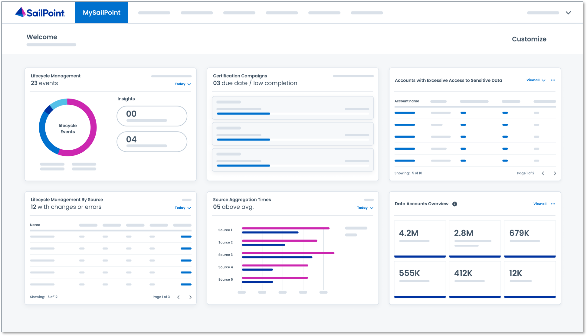

### Key features — all three tabs expanded

**Administration.** ISC brings account information and the access held by users into a platform that administrators can manage. Account administration and access decisions are considered together, rather than as unrelated tasks.

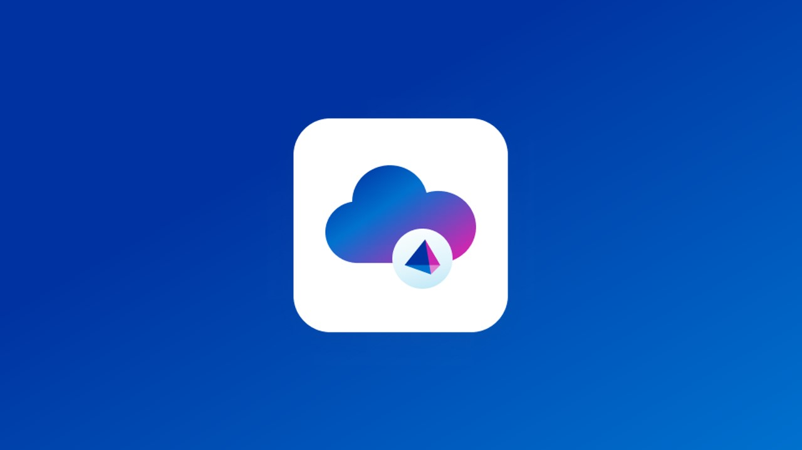

**Lifecycle and access management.** Policy-based automation supports access changes as people join, change responsibilities, or leave. The lesson connects lifecycle events with provisioning and control of user accounts, with the aim of reducing security exposure while delivering appropriate access efficiently.

**Governance.** Analytics, certifications, and policy enforcement help organizations examine access and identify concerns. The course also describes the use of unusual-pattern information to support decisions about access reviews and changes.

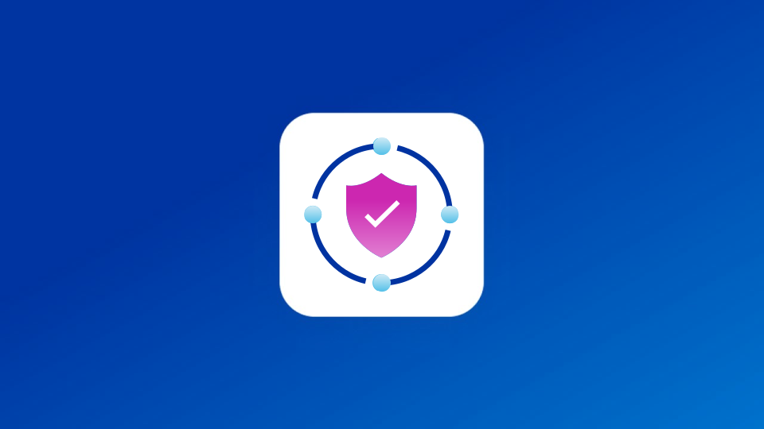

### AI-Driven Identity Security

AI and machine learning are presented as aids to understanding access, identifying anomalies, and making better decisions. Their role extends beyond producing reports.

The lesson describes four related uses: detecting unusual access; extracting insights from identity data; offering recommendations during requests and reviews using information about similar users; and discovering or refining roles.

Those capabilities can also help administrators inspect access history, locate relevant information, explore identity data, develop workflows and reports, accelerate application onboarding, support certifiers' decisions, and maintain a role program through Access Modeling.

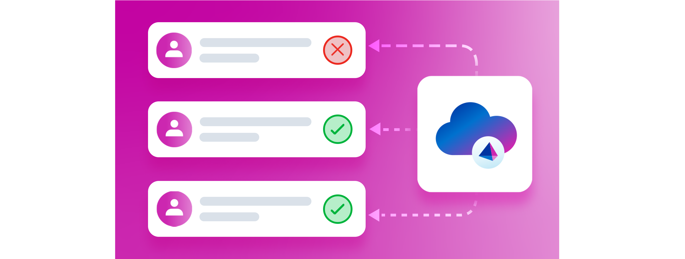

### Related identity-security solutions — flashcards expanded

The course introduces the following solutions at a high level. Detailed configuration of these products is outside this module.

**Password management:** extends password-policy management and supports keeping passwords synchronized across connected systems.

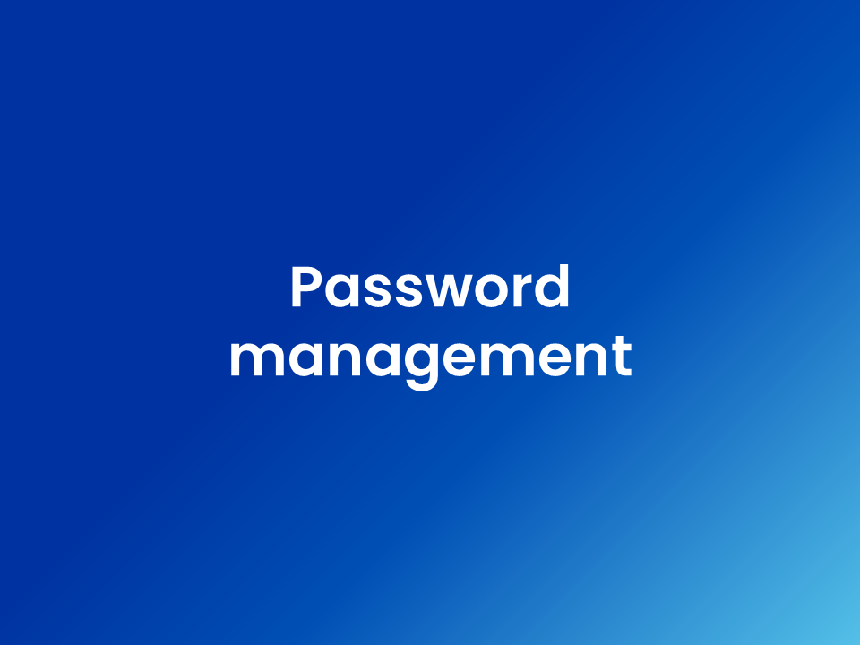

**Machine Identity Security (MIS):** addresses non-human accounts and the risks created by machine identities that are unused, untracked, or insufficiently managed.

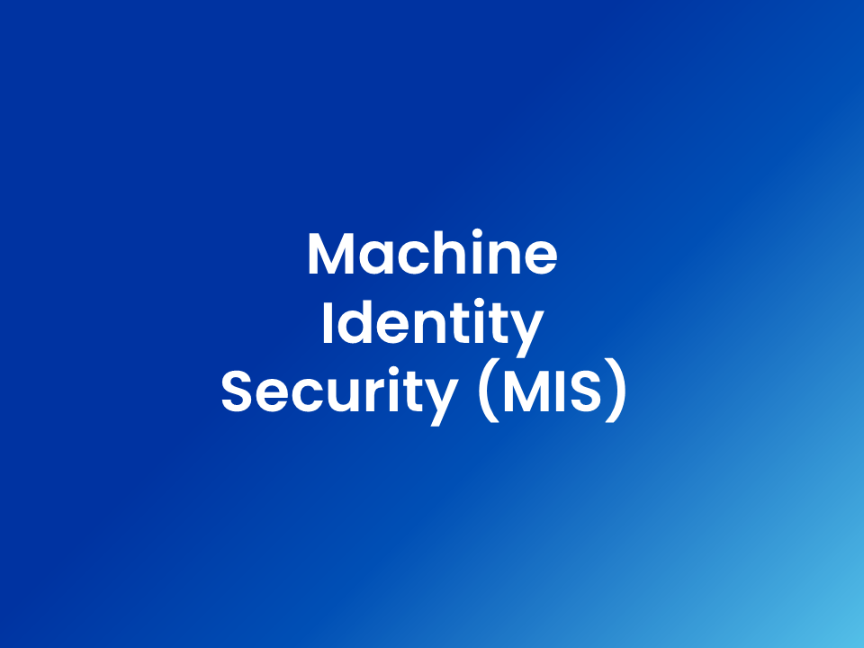

**Data access security:** focuses on unstructured information outside the application/database structures discussed elsewhere in identity administration.

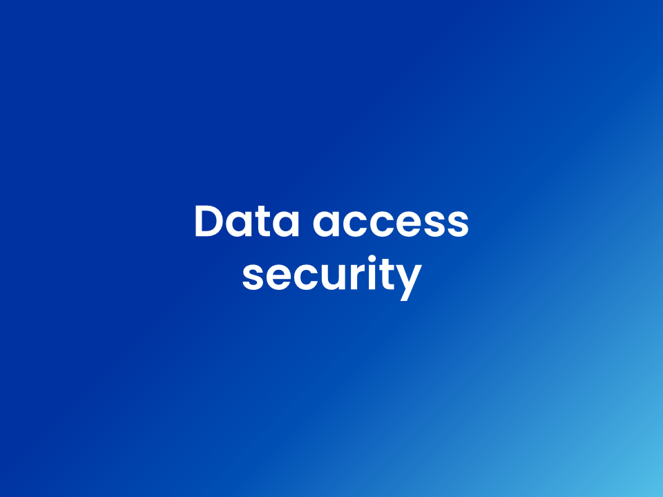

**Privileged Task Automation (PTA):** automates sensitive administrative activities to reduce manual work and improve control over privileged operations.

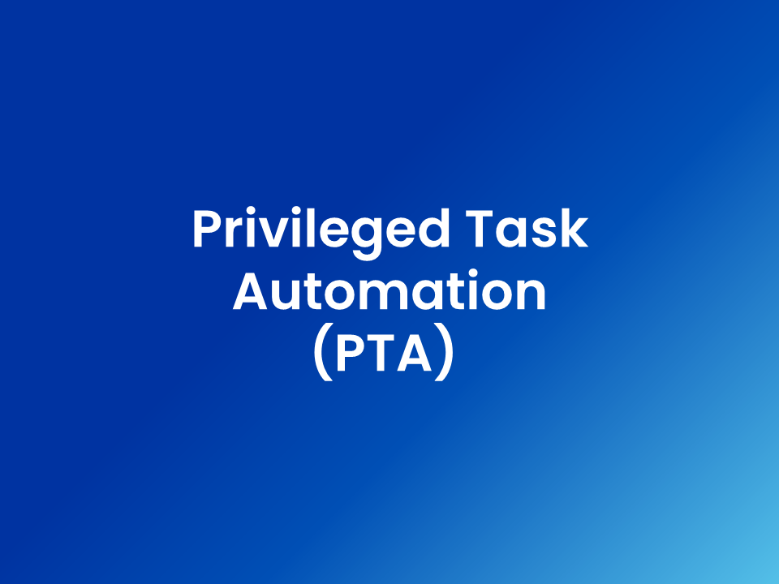

**Non-employee risk management:** addresses lifecycle management for contractors, seasonal staff, and other people outside the regular employee population.

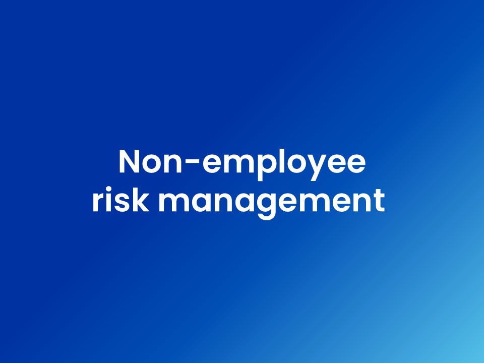

**Access risk management:** the course's card associates this solution with lifecycle access control for SAP environments.

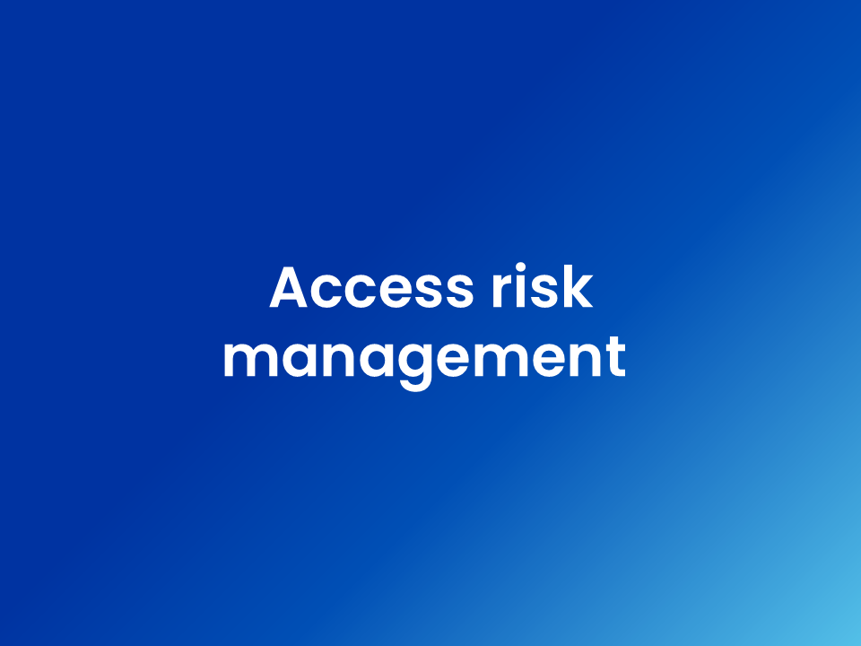

**Cloud Infrastructure Entitlement Management (CIEM):** provides visibility into cloud access and entitlements and supports control over those permissions.

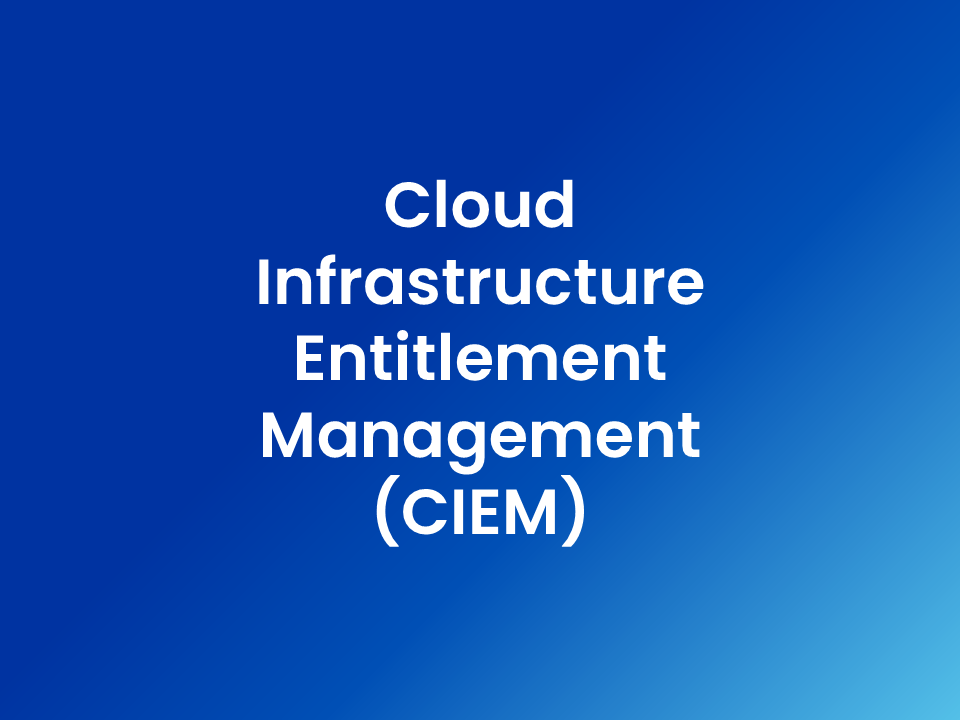

### Extensibility — all five accordion explanations expanded

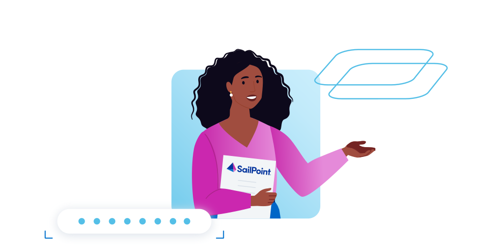

ISC can connect with other technologies and support organization-specific identity processes. The course introduces five extension mechanisms and refers learners to the separate Extend Identity Security Cloud course for deeper coverage.

**REST API configuration.** APIs provide a way for other software to request operations and exchange information with ISC. The examples concern integration between applications, access requests, and certification-related operations. This lesson does not supply request payloads or endpoint-by-endpoint instructions.

**Transforms.** Transforms apply defined operations to attribute values so data can be used consistently during aggregation or provisioning. The course's examples include converting a job description such as Accountant to lowercase and normalizing date, telephone, or country-code formats. They allow administrators to perform supported attribute operations without writing a custom rule for each formatting task.

**Rules.** Rules implement customized behavior beyond ordinary configuration. The course describes these as coded logic, using BeanShell, that can participate at appropriate processing points. Its emphasis is on extending behavior or automation; it does not provide a complete rule-development procedure here.

**Workflows and forms.** Workflows orchestrate automatic steps in response to events. They can address tasks that are difficult to perform manually or are not available as a simple UI operation. The lesson names templates, the workflow-building interface, and JSON files as ways to build a workflow. Forms are included in the topic heading, but a separate forms-building walkthrough is not provided in this lesson.

**Event triggers.** A trigger/webhook lets an integration subscribe to an event and respond when it occurs. The lesson explains this as a notification mechanism for relevant service activity, allowing subsequent automation or communication through the selected integration or channel.

### Study check

Distinguish an attribute transformation from a custom coded rule and a multi-step workflow. Be able to explain how policy-based account/access automation differs from requesting every permission anew at each login. AI capabilities include anomaly identification, peer-based recommendations, and role-model improvement.

**Missing artwork at this location:** the background photograph and shared narrator banner used behind the lesson heading were not saved. The main product, interface, feature, and card images above were saved.

## 2.3 Primary ISC processes

### Two central processes: aggregation and provisioning

**Aggregation** brings account and entitlement information from connected source systems into ISC. The course links this with checking identity information and confirming the access present on a source. It gives administrators a basis for understanding the current identity/access situation.

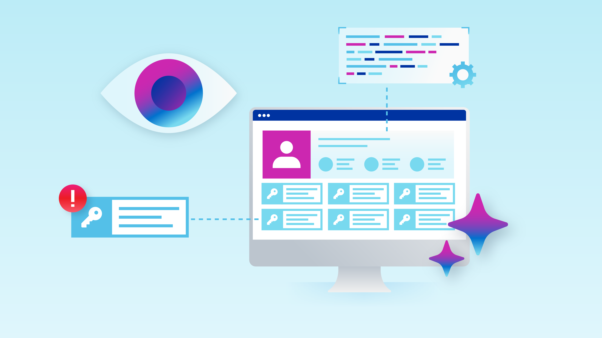

**Provisioning** creates, changes, or removes access. It can follow an access request and approval, a certification decision, or automatic configuration. Joiner, mover, and leaver changes can be evaluated against role membership and lifecycle-state definitions to determine which access changes are needed.

Provisioning may be automated or request-driven. The lesson also notes that some integrations can use helpdesk or ticketing systems to track and manage fulfillment.

The relationship matters: aggregation supplies information about identities and their access; the model and relevant decisions determine desired changes; provisioning carries out changes; subsequent aggregation provides evidence about the resulting access. This closed loop prevents an instruction to change access from being treated as sufficient proof that the source now reflects that change.

### Configuration artifacts that support the processes

**Source configuration.** A source represents an external application, service, database, or other connected system. The course notes that more than one source can represent the same application, with different filters selecting different portions of its data.

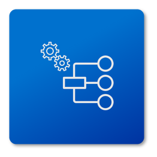

**Identity data model.** This configuration determines how an identity is represented and how its information appears in the interface. It provides structure for the attributes used to describe the identity.

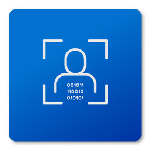

**Access model.** The model translates business access requirements into manageable structures. At this introductory level, the lesson discusses roles for job functions, rules for criteria-based automation, and policies for security requirements. Module 7 provides the more detailed treatment of entitlements, access profiles, roles, and lifecycle states.

### Data-reading and provisioning sequence — expanded panels

**1. Connect and aggregate sources.** ISC connects to enterprise systems. Authoritative data, such as HR or an appropriately designated directory source, establishes identities. Multiple sources may contribute information about the same population.

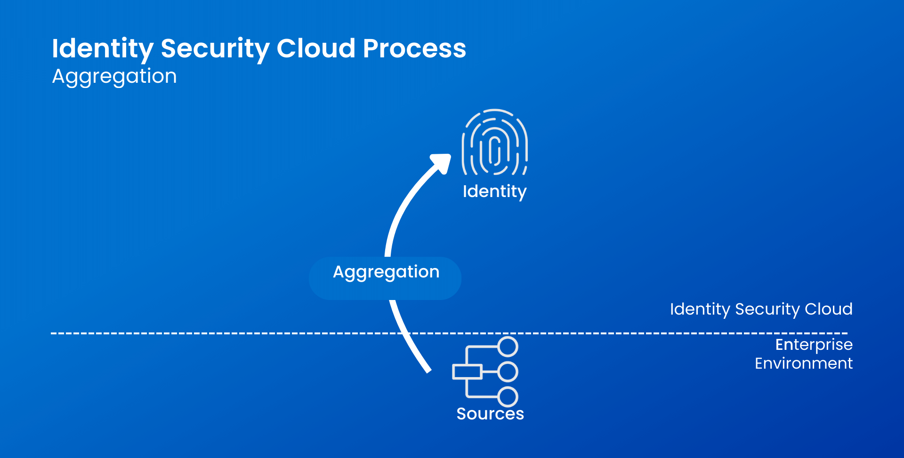

**2. Build the identity view.** Identity attributes describe the person, including information such as name, email address, and employee identifier. Accounts from other sources and their associated permissions enrich this view.

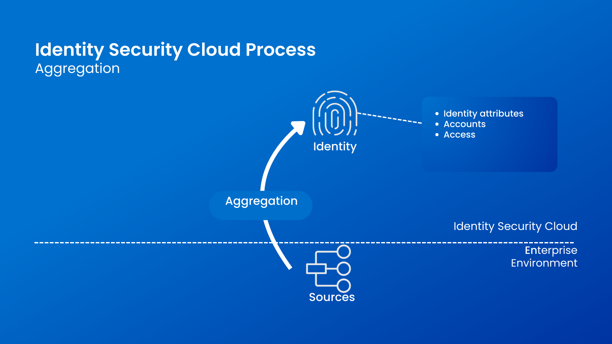

**3. Collect entitlements.** Entitlements express access held through source accounts. The gathered permissions are recorded in an Entitlement Catalog.

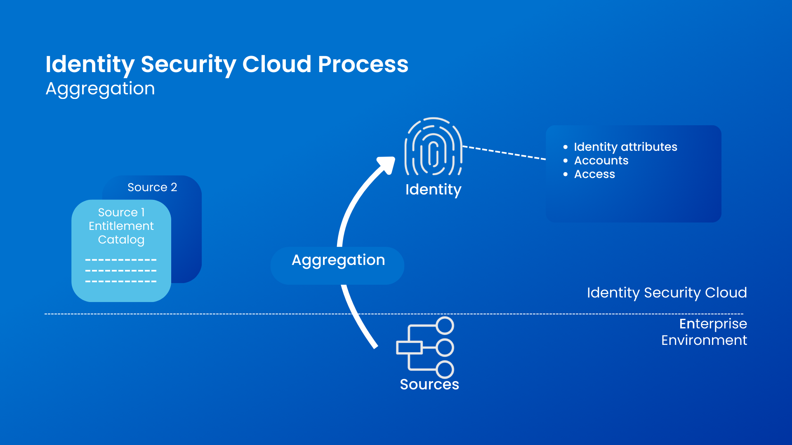

**4. Apply the access model.** Identity and entitlement information supplies the material for grouping and managing business access. Business policies provide additional constraints for evaluating what should be permitted.

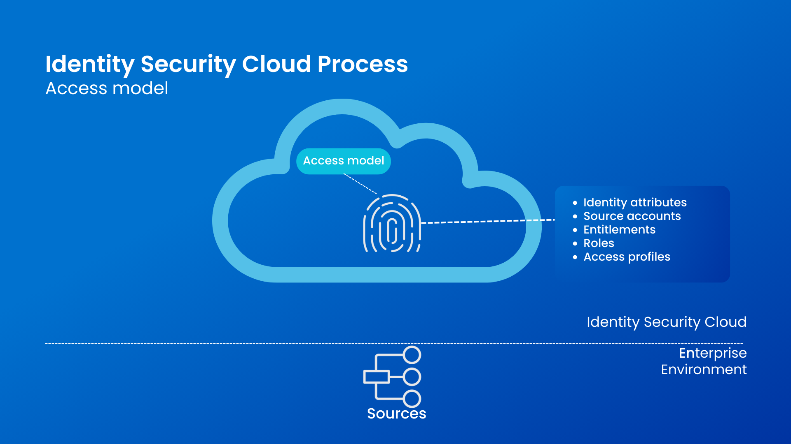

**5. Provision required access.** Configure the required changes for the appropriate user or account. The lesson identifies role and lifecycle-state configuration as mechanisms for automatic provisioning.

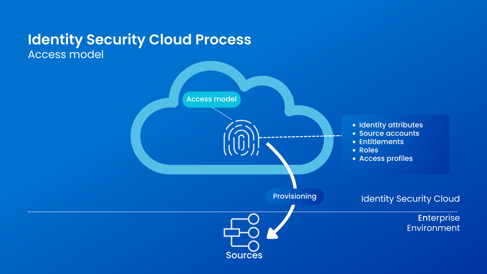

### Governance — both tabs expanded

**Certifications** require a responsible person to review access and decide whether it remains appropriate. A collection of such reviews is a certification campaign; the review allocated to a particular certifier is a certification. Certification supports audit needs and the removal of unnecessary access.

**Policy implementation/evaluation** defines prohibited or otherwise constrained access and checks identities for violations. The examples include Separation of Duties, which limits incompatible involvement in important processes, and more general policies that support the integrity of organizational data.

Certification and policy evaluation serve different purposes: one asks an accountable reviewer to decide whether access is appropriate; the other evaluates access against defined policy conditions. Both support the least-privilege objective.

### Certification and policy implementation — four steps expanded

**1. Access review.** Gather the access information and send it to a suitable decision-maker. Depending on the situation, that person might be a manager, administrator, or someone with the knowledge to judge the access involved.

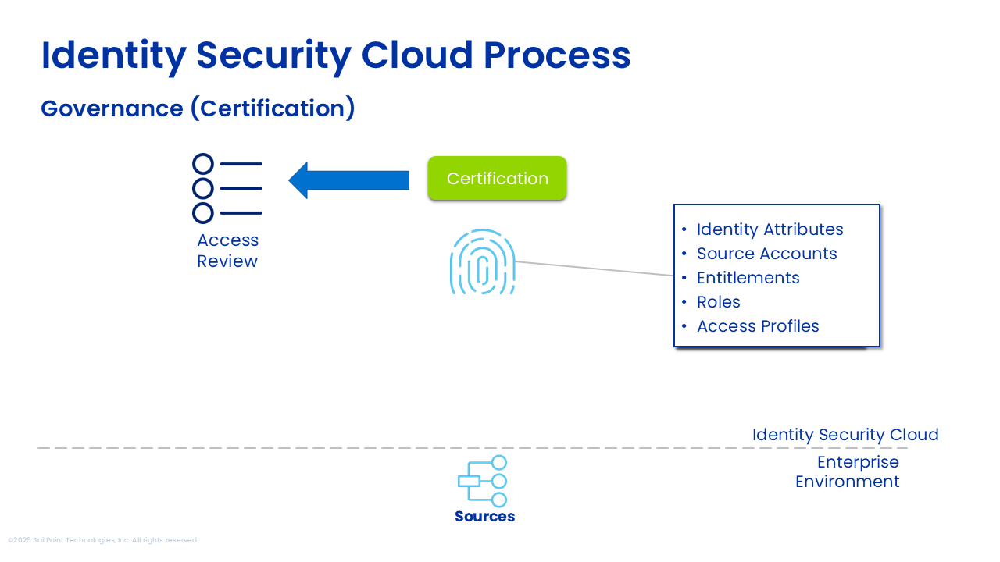

**2. Access decision.** Keep/approve appropriate access or revoke access that should be removed. A revocation decision causes ISC to initiate the relevant provisioning request.

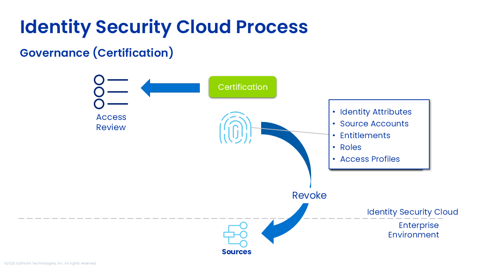

**3. Reaggregation.** Read the source again to verify the resulting access. This provides the confirmation stage of the closed-loop process.

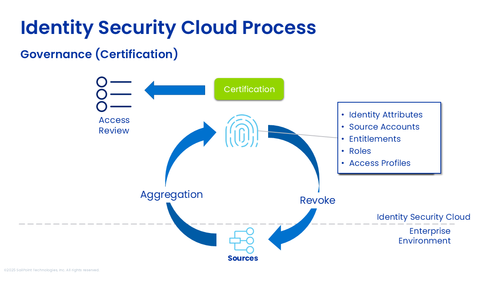

**4. Policy evaluation and response.** Check identities against defined policies and report violations to responsible authorities. Those authorities assess the findings and take corrective action. A violation report identifies an issue; it does not by itself establish that the issue has already been fixed.

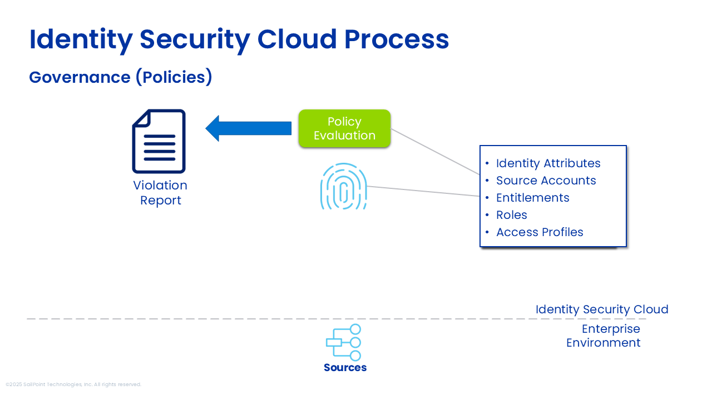

### Study check

Configuration artifacts define how identity data is connected, organized, and processed. Aggregation and provisioning work together, and certifications require informed human decisions about existing access. The principle of least privilege is to limit permissions to what the job requires.

**Missing artwork at this location:** the heading background and shared narrator banner were not saved. The five process panels and four governance panels above are retained as individual images with their English content unchanged.

## 2.4 Getting started with Identity Security Cloud

### Authentication: all three methods expanded

**Native authentication.** The course describes initial administrator access using an ISC password created through invitation-based registration. For this method, invited users register and establish the password used by ISC to validate access.

**Pass-through authentication.** Another connected authentication system, such as AD or LDAP, validates credentials through the configured Directory Connection. The external system performs the validation described in the lesson.

**Single sign-on (SSO).** An identity provider authenticates the user and supplies identity information. ISC acts as the service provider that accepts the resulting identity information for access to the platform.

The lesson states that pass-through and SSO users do not need the native-password registration process described above: they need the tenant address and successful validation by the configured authentication system.

Some operations require stronger verification in addition to the initial sign-in. The course lists phone/email codes, knowledge-based questions, and third-party MFA providers such as DUO or RSA as examples of mechanisms in this area. These examples describe the training material; they are not a recommendation to configure a particular authentication method.

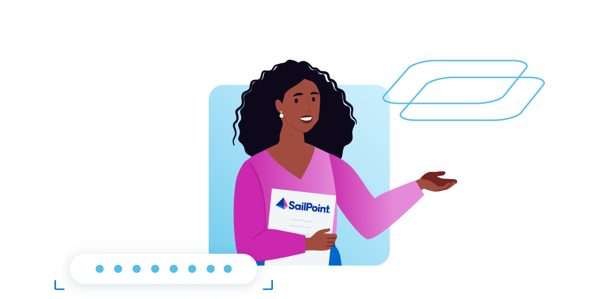

### Authorization: the AuthZ model

Authentication establishes identity. ISC then uses assigned user levels to determine which functions that identity may access. The lesson calls this authorization model AuthZ.

**Org administrator.** The highest level described here can view, modify, and perform tasks throughout the ISC components available to the different user levels.

**Special-level administrators.** These levels support specific administrative responsibilities. Course examples include Certification Admin, Helpdesk, Report Admin, Role Admin, and Source Admins.

**Sub-administrators.** Their administrative authority is restricted to a defined set of object types, rather than extending across every administrative function.

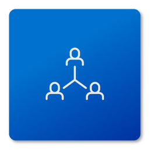

**End users.** The basic user level supports authorized user tasks such as access requests or password-management functions. It does not imply unrestricted administrator access.

Users may hold more than one level, and some targeted administrative levels may require time-based one-time passwords. The lesson points to the User Level Matrix for further detail, but the matrix itself was not supplied as a downloadable item in the inspected material.

### Tenant setup — four-panel sequence expanded

The introduction explains that tenant setup receives support. The three substantive stages then describe the following pattern:

1. **Initial setup:** special SailPoint/setup users and at least one administrator are used during the initial tenant work.
2. **After onboarding real users:** retain the original administrator identities when appropriate for emergency use. The course calls these break-glass identities and describes them as having full administrator access.
3. **Ongoing access strategy:** an organization may keep regular administrator identities at ordinary user privilege for daily activity and use separate administrative identities for elevated work. Separate identities for individual administrators support accountability.

This is the course's access-strategy explanation. It is not a hands-on tenant-creation exercise, and no tenant or user permission was changed during this capture.

### User invitations and registration

ISC may contain identity records for people who do not need to sign in. Administrators choose which identities should receive registration invitations, either manually or through an identity group configured for invitations.

The lesson defines three registration statuses:

| Status | Meaning in this lesson |
| --- | --- |
| Not invited | No registration invitation has been sent. |
| Pending | An invitation was sent, but registration is incomplete. |
| Active | Registration is complete and the user can sign in. |

The invitation sequence is:

1. Select the identities to invite, manually or through the relevant group.
2. Send invitations from the ISC interface.
3. The invited identities move to Pending.
4. Users follow the registration email and complete the required setup, including their password and any additional security details applicable to that method.
5. Completed registration moves them to Active.

Examples of additional setup information in the course include a backup telephone number, an alternate email address, or security questions. The native-registration sequence should be distinguished from the earlier pass-through/SSO explanation.

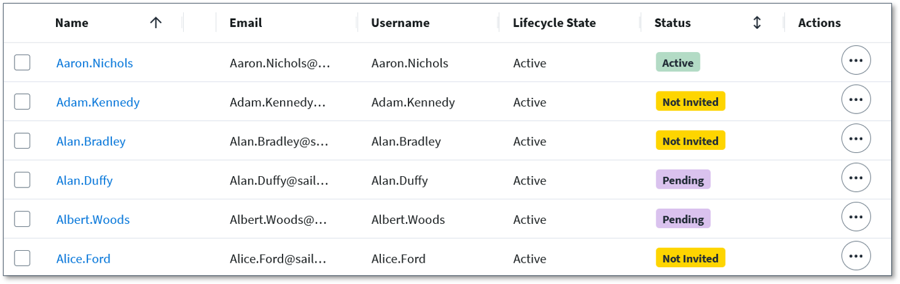

### MySailPoint and interface navigation

After login, MySailPoint is presented as the identity-security landing area. It gives administrators high-level insights and allows them to choose the data and presentation useful to their responsibilities.

The navigation illustration distinguishes ordinary end-user areas — Home, Request Center, Approvals, Task Manager, and Certifications — from elevated functionality that can include Search and Admin. A particular user's available controls still depend on assigned permissions and tenant configuration.

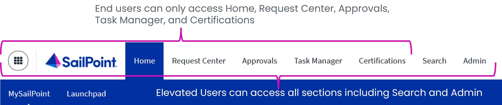

**Source clarification:** the original accessibility description for this image lists more menu names than the end-user restriction written inside the image. The explanation above follows the image's visible distinction and the lesson's user-level explanation. No original image text has been edited.

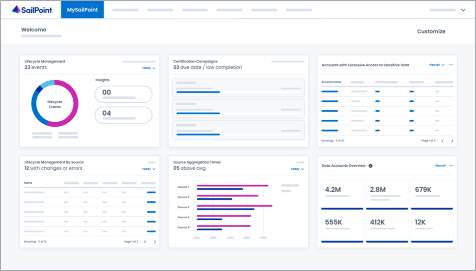

### Study check

Be able to explain the purpose of break-glass access, the difference between authentication and authorization, and the invitation-status sequence. A registration invitation is not the same thing as an access request, and an identity record is not proof that the person must be able to sign in.

**Missing artwork at this location:** the common background photograph and shared narrator banner were not saved. The user-level icons, invitation screenshot, navigation illustration, and dashboard screenshot were saved.

## 2.5 Recap

The module's expected outcomes are to explain ISC's role in identity security, identify its core processes, and understand how users begin accessing and navigating the interface.

A useful review sequence is to connect the ideas: sources provide account and entitlement data; models and decisions determine appropriate access; provisioning changes access; aggregation confirms the results; governance reviews access and policy compliance; authentication and assigned user levels determine how a person uses the platform.

**Missing artwork at this location:** the common background photograph and the Recap narrator banner were not saved. The exact paths appear below.

## Glossary and revision prompts

| Term | Meaning in this module |
| --- | --- |
| ISC | Identity Security Cloud, the platform introduced by the module. |
| SailPoint Atlas | The underlying platform named in the product overview. |
| Aggregation | Reading account and entitlement information from connected sources. |
| Provisioning | Creating, changing, or removing access in response to configuration or decisions. |
| Source | A configured connection/representation for external identity or access data. |
| Identity attribute | Information describing the person represented by an identity. |
| Entitlement Catalog | The collected set of source access rights. |
| Certification campaign | A collection of access reviews. |
| Certification | An individual review allocated to a certifier. |
| Separation of Duties | Policy constraints addressing incompatible or excessive involvement/access. |
| AuthZ | Determination of allowed functionality from assigned user levels. |
| Break-glass identity | An emergency administrative identity described in the setup discussion. |
| Transform | Defined operations that change attribute values or formatting. |
| Rule | Custom coded behavior used to extend processing. |
| Event trigger | A notification/subscription mechanism associated with a relevant event. |

To revise, explain an access-removal example from review decision through provisioning and reaggregation. Then compare the three authentication methods and describe how successful authentication still leaves authorization decisions to the assigned user levels.

## Capture coverage and missing materials

### Completed reading and retained images

All five lessons were read. The three feature tabs, five extensibility accordions, seven related-solution flashcard explanations, two aggregation/provisioning tabs, two governance tabs, three authentication accordions, process explanations, and tenant-setup panels are represented in the rewritten notes. The process panels' rendered text was read in order; the executable slider/animation is not reproduced.

All 44 distinct image URLs exposed through the inspected lessons' inline image elements were downloaded successfully. Repeated appearances of the same URL reuse one saved file. The saved set includes two different source URLs whose files share a basename; they were kept separately. The source map and hashes are in [saved-assets.json](saved-assets.json).

### Known background-only images not saved

| Source path relative to the module content directory | Affected lesson(s) | Status |
| --- | --- | --- |
| assets/2-Gh5h36bP76602T.jpg | 2.1–2.5 | Observed as a common CSS background; not saved. |
| assets/IntroductionBanner-Narrato.svg | 2.1 Overview | Observed as the introductory narrator banner; not saved. |
| assets/11ahs0/IntroductionBanner-Narrato.svg | 2.2, 2.3, 2.4 | Observed as the shared lesson-heading narrator banner; not saved. |
| assets/RecapBanner-NarratorA_NOPR.svg | 2.5 Recap | Observed as the recap narrator banner; not saved. |

These are decorative/background omissions, not a claim that all course images were preserved. Other CSS backgrounds that also had an inline image representation, such as dividers, footer art, and knowledge-check banners, are included in the saved set above.

### Other limitations

- Text is a detailed paraphrase, not a verbatim course transcript. English text within saved images remains unchanged.
- No independent narration transcript or audio/video file is included. A complete inventory of media that might appear only after additional playback is not established.
- External courses and resources, including Extend Identity Security Cloud and the User Level Matrix, were not downloaded or expanded into this module's notes.
- No knowledge-check answers were submitted. Any feedback exposed by the player was used only to understand the study topic, not as a record of the user's answers.
- No live tenant was configured, no users were invited, and no authentication or authorization settings were changed.
- Original interactive behaviors, animation timing, course tracking, and completion logic are not recreated offline.
- This reading layout follows the lessons and topic sequence but does not replicate the original screen layout exactly.
