# Module 3 — Tenant configuration

English study notes • six lessons in course order • detailed paraphrases of the inspected course pages. Original English illustrations are retained beside their subjects. These notes reflect the course version viewed on 15 November 2026; service counts, interface labels and deployment instructions may change.

## 3.1 Overview

Tenant configuration establishes the foundation for an Identity Security Cloud deployment. Although SailPoint runs the SaaS service, administrators still need to understand their organization's tenant, its security settings, its connection to enterprise systems and its implementation sequence.

The module's guide, Ian, introduces four questions: how a shared SaaS environment supports scale and security; how global settings establish consistent behavior; how to choose an implementation strategy; and how virtual appliance administration supports reliable connectivity. The practical outcome is to identify configuration work and test that the resulting tenant behaves as intended.

**Material not saved at this point:** the course background photograph and this lesson's Ian banner are CSS backgrounds. Their image files are not included. The footer animation below was saved.

## 3.2 Tenant architecture

### The multi-tenant model

ISC is delivered as a multi-tenant SaaS service. Organizations have their own tenant while sharing infrastructure and service capabilities. Shared operation lets the provider distribute maintenance costs and make improvements available across customers.

The course uses a condominium analogy. A resident occupies a private unit, while the building's infrastructure and common amenities support many residents. Each organization selects an appropriate scope of services, and optional additions can extend what it receives. This analogy explains shared service operation; it does not imply that organizations can access each other's identity records.

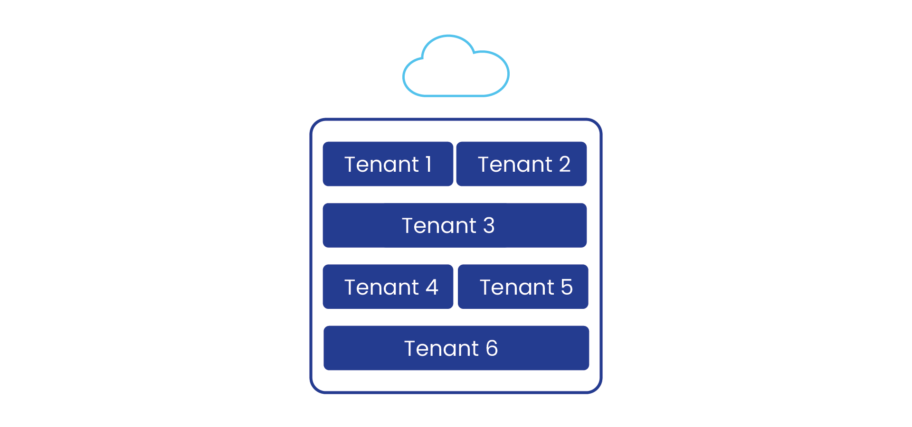

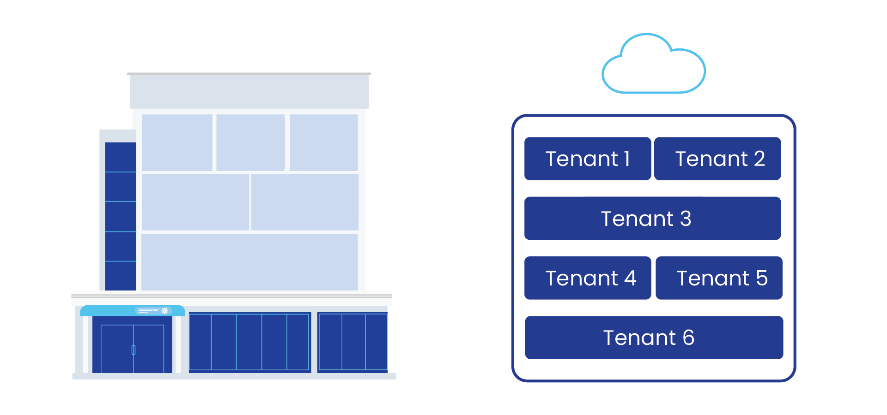

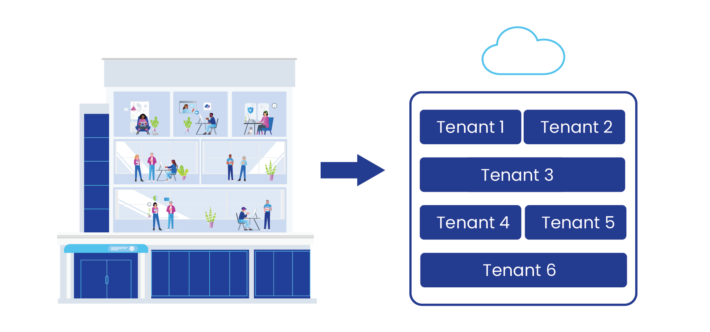

### Virtual appliance: the connection to enterprise systems

A virtual appliance, or VA, is a Linux virtual machine used to connect the tenant with systems such as on-premises sources and applications. SailPoint APIs, connectors and integrations provide the means of communication. This gives the cloud service a bridge to resources inside the organization's environment.

### Shared services, expanded

The two panels below explain how an organization consumes common SaaS capabilities while its capacity is sized for its users. New features can be released across the service, and development and infrastructure costs are shared. The course also describes the value of analytics developed across the service. These service-level benefits should be distinguished from an organization's responsibility for its own identity configuration.

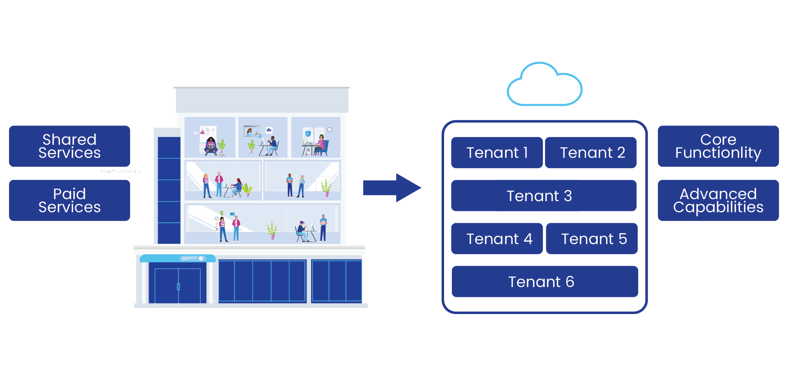

### Benefits, expanded from the five accordions

**Reduced costs.** Subscription models can relate charges to users, usage or service volume. Sharing hardware, software operation, maintenance and support reduces the need for every customer to maintain a separate service stack. The course discusses monthly or annual and pay-as-you-go arrangements as SaaS examples, rather than a price quotation.

**Scalability.** An organization can increase or reduce its consumption as its needs change. Adding users does not require the customer to build a separate SaaS infrastructure for each expansion.

**Security.** The provider operates physical and logical protections and supports privacy and security requirements. Shared service operation also enables consolidated detection and response capabilities. Administrators still need to configure access and organizational policies correctly.

**Maintenance.** The provider handles service updates, patches, availability and backups. Customers therefore spend less effort maintaining the underlying hosted software and can concentrate on identity administration.

**Additional benefits.** Continuous integration and delivery support frequent changes. Some releases expose new user capabilities; others improve the underlying service without a visible interface change.

### SaaS environments and regions

The lesson distinguishes core capabilities, optional enhancements and additional products. Examples discussed include logging, access modeling and search. The course describes an allocation of up to two tenants per customer and a map of eleven availability zones. Treat these as statements from the viewed course version, not independently verified current purchasing entitlements or deployment counts.

Region selection involves compliance and data-location requirements as well as proximity between the tenant and connected data. The original map retains its English labels below.

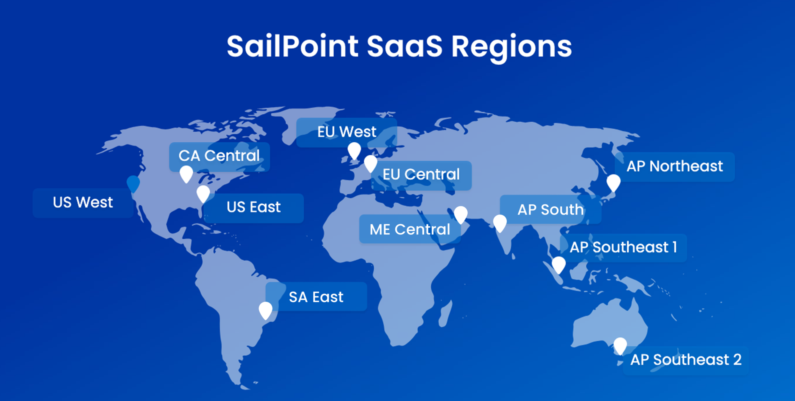

### Review and limitations

Be able to explain the shared-building analogy, describe why a VA is needed for internal resources, and relate cost, scale, security and maintenance benefits to SaaS operation.

**Incomplete exercise:** the sorting interaction was already displaying a completed result with Production, Sandbox and Additional categories. The individual cards were not available in that display and have not been reconstructed. The exercise was not reset or submitted. The linked article comparing single-tenant and multi-tenant SaaS was not downloaded.

**Unretained artwork:** the shared course photograph and this lesson's background-only Ian banner are not included. Retained narrator and divider images appear above in their course sequence.

## 3.3 Global configurations

### Session controls

Global settings define how users interact with the tenant. A maximum session duration limits how long a session can remain active before logout or reauthentication is required. An idle timeout addresses inactivity: after the configured interval without interaction, the user must authenticate again. These settings balance organizational security policy with the practical effect of repeated sign-ins on users.

### Login controls

Lockout settings combine a permitted number of failed attempts with a lockout duration. Their purpose is to limit repeated password guessing. The course gives an example in which an Active Directory account locks after five failures and ISC is configured to lock after four, followed by a password reset. The lower threshold is intended to reduce the chance that ISC failures lock the upstream directory account. This is an illustration of coordinating policies, not a universal threshold recommendation.

### Email notifications and templates

Notifications keep participants informed about identity events. The lesson discusses request approvals and cancellations, pending certifications, lifecycle-state activity and user lockouts.

Administrators can customize template subjects, reply-to information and message bodies. Rich-text or HTML formatting controls presentation, and Apache Velocity expressions support dynamic template content. The sender address is configured separately through Product Branding; changing a template's reply-to value does not replace that configuration.

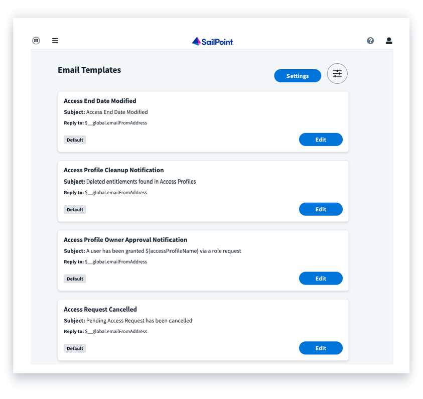

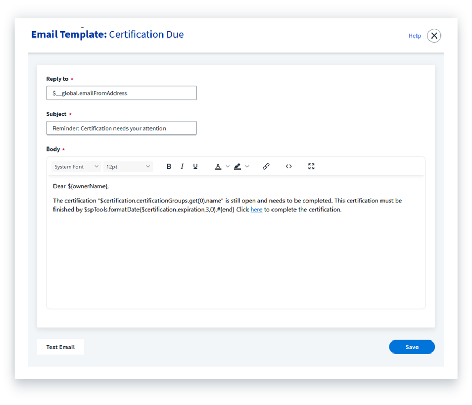

### Testing delivery, expanded from the process panels

Both production and sandbox tenants can send mail to the users associated with an event. Sandbox testing therefore needs deliberate recipient handling. The course illustrates redirecting notifications to one test address so the administrator can inspect messages before using real recipients.

**1. Plan a test.** Suppose you want to check certification invitations. Decide which event will generate the message and which template you expect to see.

**2. Redirect delivery.** Configure the test tenant to route notifications to a controlled test address. This allows inspection of messages generated for different users in one mailbox.

**3. Generate representative events.** In the example, a campaign involving ten managers generates ten messages. Redirecting the destination changes where those messages arrive; it does not turn ten event messages into one.

**4. Inspect the result.** Check the subject, dynamic values, formatting and layout in the received messages. Correct template or configuration issues and repeat the test when necessary.

**5. Restore intended delivery after validation.** When testing is complete, configure notifications to reach their intended users. This sequence illustrates a controlled test; these notes do not record any changes to a live tenant.

### Review and missing materials

Distinguish maximum session length from idle timeout, coordinate account-lockout thresholds with upstream systems, and explain why sandbox email can still reach real people. Template testing should verify content as well as delivery.

**Material not saved:** the background-only Ian banner and common photograph. Interactive settings panels and all five email process illustrations available as inline images were saved. Quiz controls were inspected without submitting answers.

## 3.4 Implementation strategies

### Start with clean data and a manageable phase

Two considerations underpin the implementation strategy: data quality and phased delivery. Automated identity decisions depend on reliable attributes and access data. Connecting more systems does not compensate for inaccurate data; it can spread errors through a larger process.

The deployment sequence should reflect business priorities. In the course example, the eventual scope contains one thousand sources, but five are especially important. The first phase connects the authoritative source and those five critical sources and establishes birthright access. This gives the team a useful, bounded implementation to validate and operate.

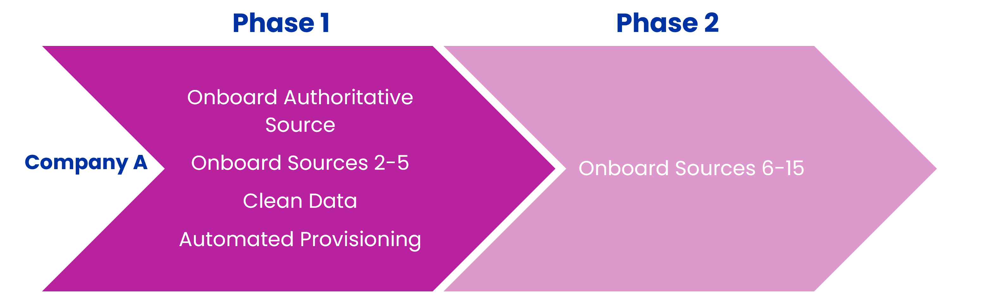

After the team gains experience and the initial behavior is stable, the next phase extends the implementation to additional sources and capabilities.

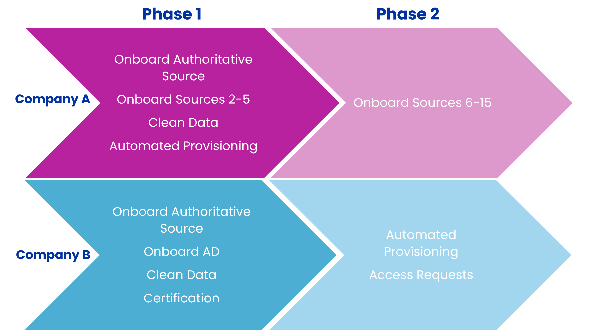

### Adapt the sequence to the organization

An organization with only a few sources might choose a different first outcome: onboard authoritative data and run certifications before automating provisioning in a later phase. The principle is to deliver valuable, testable outcomes in a sequence suited to the organization, rather than applying one fixed rollout order everywhere.

A study exercise is to identify a small group of priority sources, explain what business outcome the first phase delivers, and define which data-quality checks must pass before expanding. This exercise is a study prompt added to these notes.

**Material not saved:** the common photograph and this lesson's background-only Ian banner. Both implementation phase images were saved. Knowledge-check interactions were not submitted.

## 3.5 Virtual appliance administration

### Virtual appliance overview

A VA is the gateway between the tenant and enterprise systems. It runs as a Linux-based virtual machine with SailPoint-managed software. Understanding its placement, communication and operational state is essential to reliable source connectivity.

### The security-guard analogy, expanded

The course returns to the condominium example. The building represents the enterprise environment.

The VA is compared to a digital security guard connecting the service to resources inside that environment.

Checking credentials illustrates controlled access and policy enforcement in the analogy.

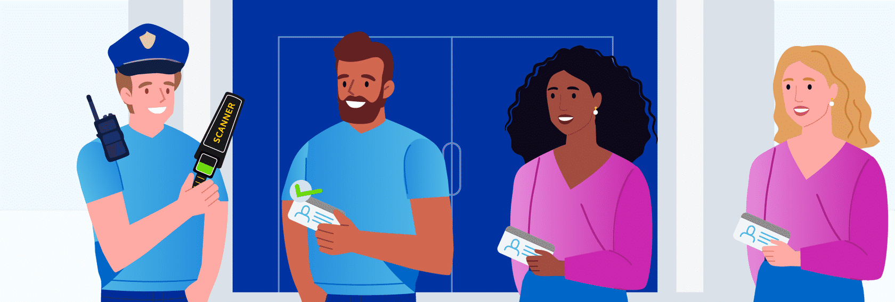

Specialized tools represent the capabilities used to support the security process.

Efficient handling of authorized activity illustrates the value of dependable connectivity.

Protecting the community illustrates the broader identity-security objective. The analogy supports understanding; it is not a literal description of every authentication or authorization decision being performed by a VA.

### Responsibilities and architecture: the four markers

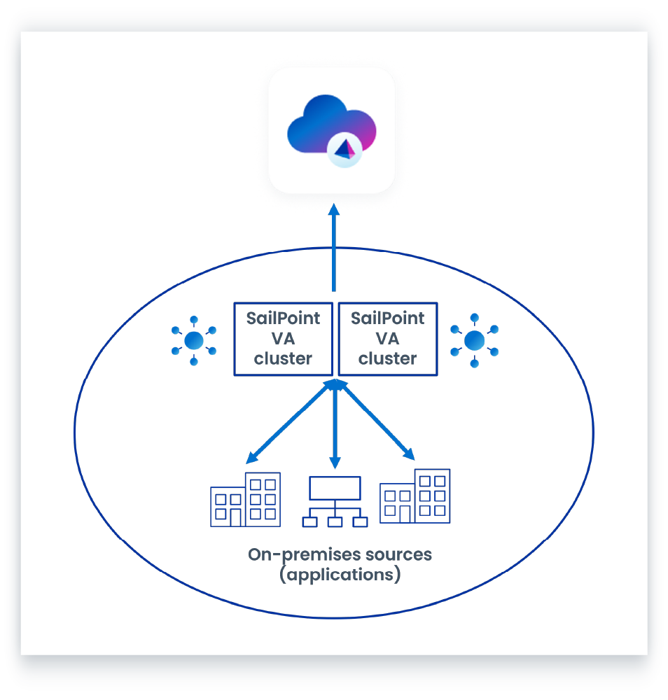

**SailPoint managed.** SailPoint controls which software components are installed and run on the appliance.

**Customer controlled.** The customer is responsible for network settings, private-key management and the number and size of clusters.

**Connectivity gateway.** The VA initiates outbound communication for tenant and source operations. Outbound initiation simplifies the connection pattern through the organization's network boundary.

**Multiple VAs in a cluster.** Administrators select how many clusters and appliances are needed. Multiple VAs can distribute work and increase processing capacity; clustering also supports continuity when one appliance is unavailable.

### Communication, expanded from the five accordions

**1. VA cluster.** The tenant creates work for a target source and places the corresponding message in the queue for that source's cluster. The queue holds operations until they can be processed.

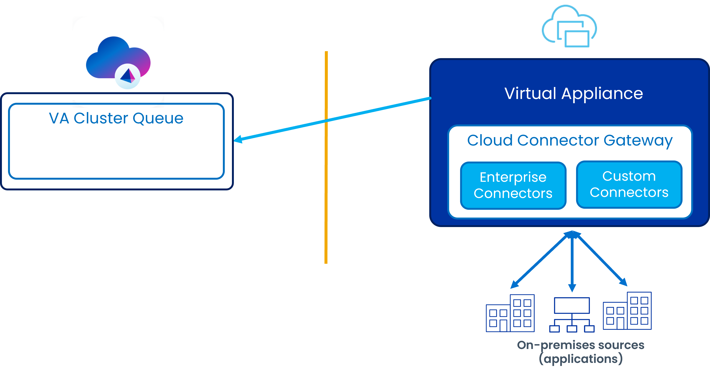

**2. Cluster queue.** The appliances in a cluster poll the same queue. This allows an available member to obtain work without requiring a separate queue for each VA.

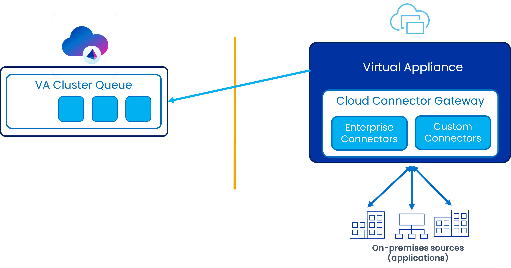

**3. Cluster queue messages.** Scheduled activities and user actions both generate work. The target source determines which cluster queue receives the message.

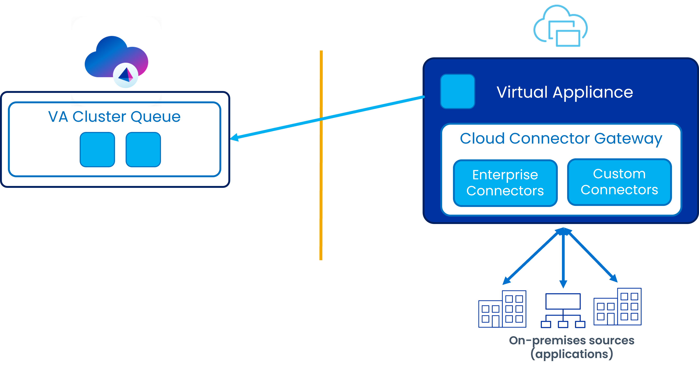

**4. Message decryption.** A VA retrieves a work item and decrypts it with its local private key. Key handling is consequently part of appliance administration.

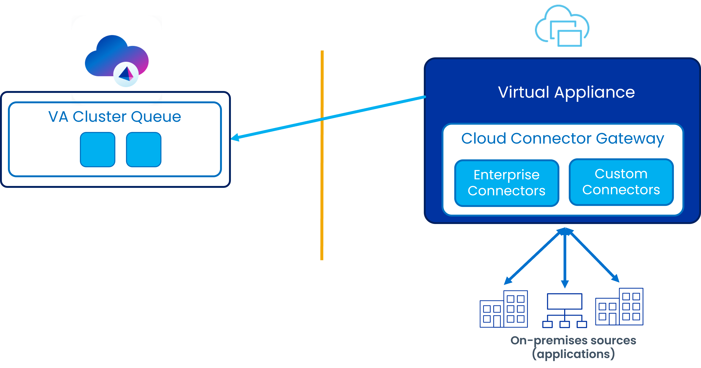

**5. Internal communication.** The Cloud Connector Gateway, or CCG, carries out the connector work. Only one VA responds to a particular message, and results and status are returned to the tenant.

### Deployment process

The first interface example shows Virtual Appliance Clusters and the Create New control. The second shows the configuration dialog, downloadable VA image and pairing fields. Both are course screenshots; no cluster was created while preparing this study book.

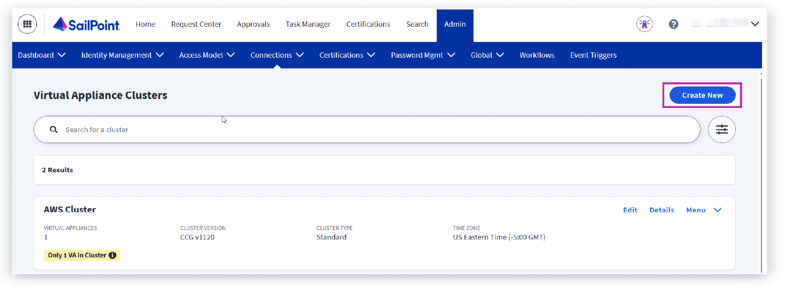

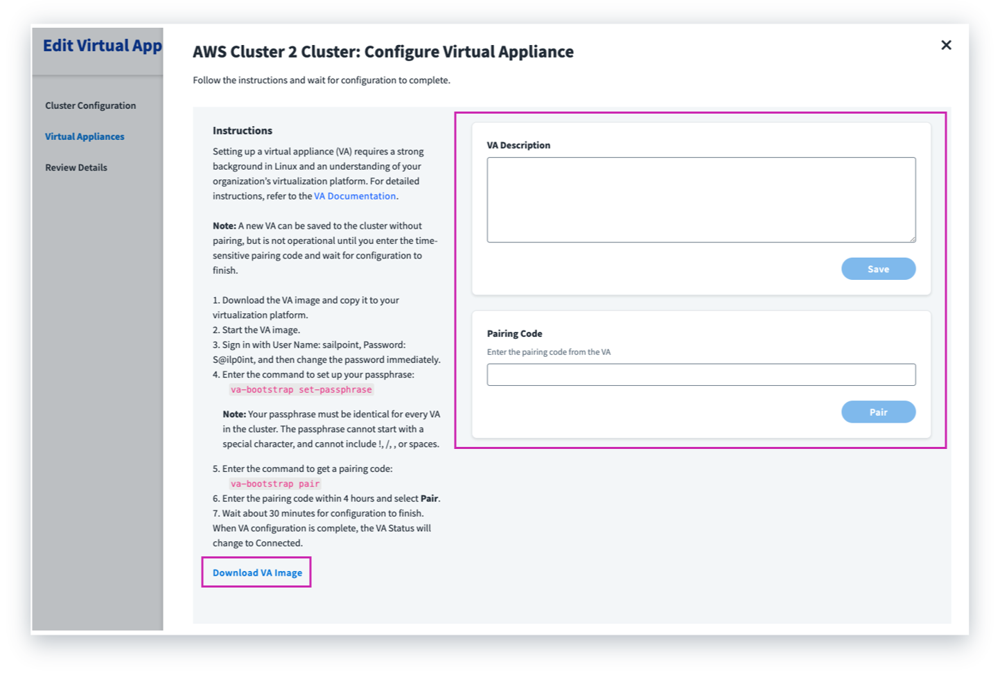

The screenshot illustrates this sequence:

1. Download the VA image and copy it to the organization's virtualization platform.
2. Start the virtual machine. Use the initial sign-in process supplied with that image and immediately replace the initial password.
3. Set the passphrase with `va-bootstrap set-passphrase`. The screenshot states that appliances in the cluster must use the same passphrase and lists restrictions on its format. Retain those exact visual requirements in the original image rather than guessing from a different software version.
4. Obtain a pairing code with `va-bootstrap pair`.
5. Enter the code in the tenant dialog and select Pair. The pictured instructions specify using the code within four hours.
6. Wait for configuration to finish. The screenshot estimates roughly thirty minutes and describes the final VA status as Connected.

A VA entry can be saved before pairing, but the course states that it is not operational until the time-sensitive code is entered and configuration completes. Setting up the appliance requires knowledge of Linux and the organization's virtualization platform. The linked detailed VA documentation was not captured, so these notes are not a replacement for the complete installation requirements.

### Deployment best practices, expanded

**Location.** Place VAs close to the sources they serve. With multiple data centers or subdomains, consider appliances near those systems. For cloud-hosted sources, a cloud VA can avoid routing source traffic through an on-premises environment unnecessarily.

**DMZ placement.** The course advises against placing the VA in a perimeter DMZ because that placement can complicate connectivity and security design.

**Clusters and appliance counts.** Use two or more VAs for a production cluster. This supports redundancy and allows upgrades to take one appliance offline while another remains available. A sandbox can use a single VA for connectivity testing. Additional appliances can increase capacity in busy clusters.

**IP addressing.** The lesson recommends static IP addresses so connectivity does not depend on a changing appliance address.

**Network communication.** The course discusses SSH administration on port 22 within the network and outbound dependencies including DNS on 53, time synchronization on 123 and HTTPS on 443. It also warns about intermediary products that interfere with the required communication and discusses controlled tunneling or proxy arrangements in restricted environments. These are course-version design considerations, not instructions to remove an organization's network protections. The full endpoint and firewall requirements were not captured.

**TLS.** Use encrypted source connections where supported and required by the design. VA-to-source communication should be considered alongside tenant-to-VA communication.

**Passphrase.** The lesson describes an organization-specific passphrase used with RSA 2048-bit asymmetric keys in VA configuration. Protect it as confidential configuration information. It recommends consistent key-passphrase use across the organization's appliances, rather than limiting consistency to a single cluster. No actual organizational key or passphrase was read or stored for this book.

### Monitoring

Once a VA has been deployed, its cluster reports a status. The lesson lists Healthy, VA Update in Progress, Empty Cluster, Only 1 VA in Cluster, Inactive VA, VA Did Not Update and All VAs Inactive.

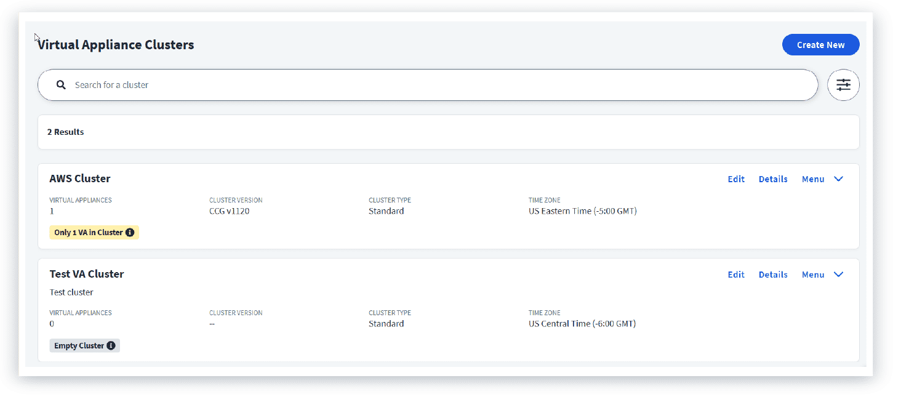

The first expanded marker explains that Healthy requires more than one associated VA and healthy appliances throughout the cluster. The second identifies the warning shown for a cluster with only one VA. A functioning single appliance therefore does not provide the same cluster state as a healthy redundant deployment.

### Email alert configuration

Notifications can alert a single recipient or distribution list when cluster health changes toward failure or recovery. The course navigation is Global > System Settings > System Notifications. Use the original interface example to locate the relevant notification area in the course version.

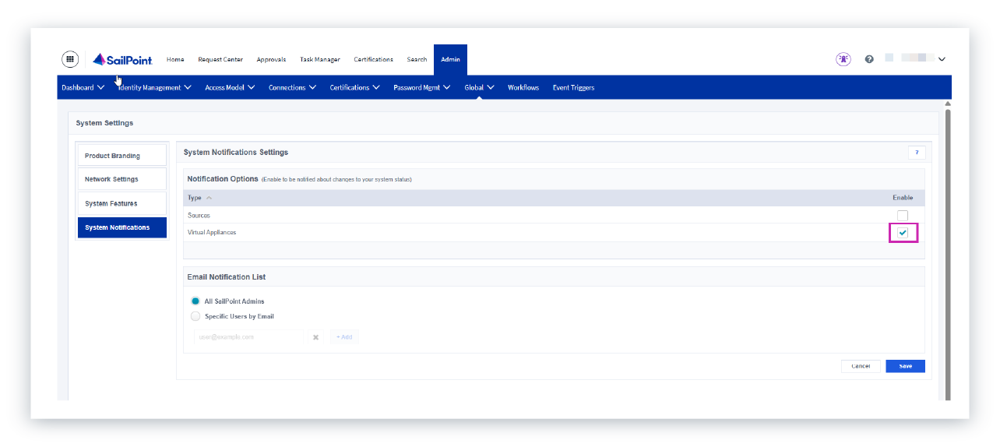

### Troubleshooting

Enable debugging at cluster level when investigating communication problems, because any member can receive the work. The illustrated steps are to select Cluster Configuration and enable its debugging checkbox. Also inspect connected-source errors and the surrounding network infrastructure to find the source of a failure. Enabling debugging in the course example was explained only; no live configuration was changed.

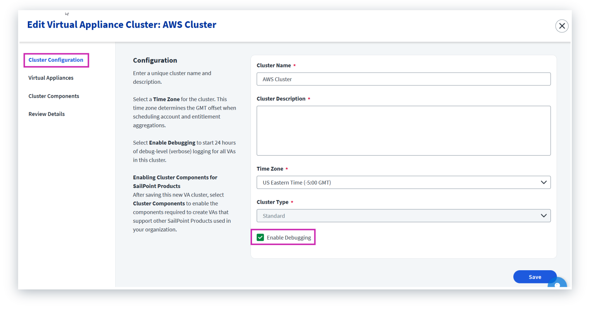

### Review and limitations

Explain the work-message path from tenant to cluster queue to one VA, then through CCG and back to the tenant. Distinguish the scalability benefit of distributing work from the resilience benefit of multiple appliances. The course recommends at least two VAs in a production cluster.

**Material not saved:** the common background photograph and this lesson's background-only Ian banner. All 23 new inline image URLs encountered in this lesson were saved, including the deployment, monitoring, notification and debugging interface examples. The external VA documentation and a separate video/audio transcript were not exported. Knowledge checks were not submitted or reset.

## 3.6 Recap

The module closes with two expected outcomes: identify the essential configuration steps for a new tenant, and demonstrate how to test that those settings work. A useful review is to connect each configuration decision to evidence: session behavior for timeout settings, received messages for templates and redirects, and cluster state and connector results for VA operation.

The sequence established in this module is architectural understanding, global configuration, a phased implementation strategy and dependable VA administration. Those foundations prepare the administrator for connectivity and source onboarding in the following modules.

**Material not saved:** this lesson's recap banner and the shared photograph are CSS backgrounds. The footer graphic was saved and is shown below. No additional closing lesson text was hidden behind a continuation control in the inspected page.

## Module coverage and missing materials

All six lesson bodies were inspected. The notes expand the architecture benefit accordions, global-setting panels, email process, VA analogy, VA responsibility markers, communication accordions, deployment guidance and monitoring markers. Fifty distinct inline image URLs were saved without editing their English content; reused graphics appear again where they support the course sequence.

Seven known background-only image paths were not saved: the common photograph, five lesson narrator banners and the recap banner. They are listed individually in coverage.json. The completed sorting exercise's cards, external linked resources, and separately exported audio/video transcripts are not included. Assessment attempts and account or tenant settings were not changed.
