# Module 5 — Onboarding identities (authoritative sources)

English study notes following the seven course lessons. Explanations are paraphrased and interactive explanations are expanded. Retained images preserve their original English content and course-version interfaces.

## 5.1 Overview

Mateo introduces the creation of identities from trusted organizational data. The module covers the identity itself, preparing accurate source data, source and identity-profile configuration, manager correlation, authoritative aggregation and resolving exceptions.

The guiding administrative question is how to create a reliable identity foundation before governing access across applications. The authoritative record must be accurate, the mappings must produce valid attributes, and the resulting identities must be checked.

**Missing artwork:** the common photograph and this lesson's Mateo banner were not saved. The footer was retained.

## 5.2 Identity overview

### What an identity represents

An identity is ISC's governed representation of a person or another entity that holds access. It brings together authoritative attributes, accounts correlated from different systems, entitlements, roles and access relationships. Requests, certifications and policy monitoring revolve around this central record.

Different populations may originate in different systems. An HR platform could supply employees while a directory supplies contractor records. Each population's trusted source can be configured separately.

The four diagram markers distinguish employees working for the organization, non-employees such as contractors and service providers, and machine entities such as bots. The final marker identifies three components: identity attributes, access elements and accounts.

### Identity attributes

These describe and distinguish the identity: examples include a name, employee number and job title. They provide context for policy and access decisions.

### Access elements

Entitlements, access profiles and roles describe the permissions associated with the identity. Bundling access elements helps organize permissions into manageable units.

### Accounts

An account enables access to a particular cloud or on-premises system. Its record can include a unique identifier, authentication information, permissions and descriptive attributes. An identity can therefore bring together several system accounts without being identical to any one of them.

**Review:** distinguish a governed identity from its accounts, its descriptive attributes and its access. All four markers and all three component tabs were read. Knowledge checks were not submitted.

## 5.3 Clean source data

### The seven-stage onboarding process

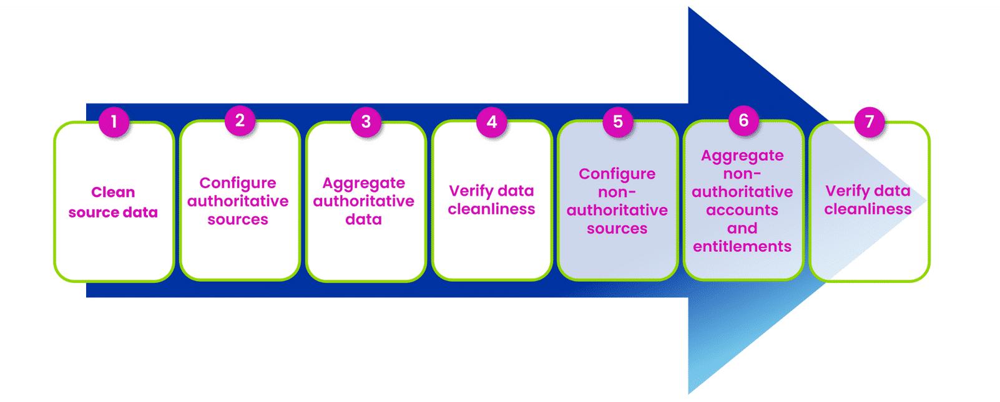

**1. Clean source data.** Check that HR or other source records are accurate and complete before import. This reduces errors at identity creation.

**2. Configure authoritative sources.** Review mappings and transforms carefully. An incorrect configuration can produce inaccurate identity attributes and later provisioning problems.

**3. Aggregate authoritative data.** Monitor logs for warnings or failures and sample the identities to confirm that their attributes were created as expected.

**4. Verify cleanliness through exceptions.** Look for incomplete identities, duplicate usernames, missing required values and transform failures.

**5. Configure non-authoritative sources.** Keep naming and attribute conventions consistent with the identity foundation.

**6. Aggregate non-authoritative accounts and entitlements.** Give entitlements meaningful names and categories so they can be understood during requests and certifications.

**7. Review identity data again.** Confirm consistency across authoritative and non-authoritative data. Stages five through seven are developed in the next module.

### Data cleaning: all three tabs

Clean data supports dependable governance and AI recommendations. HR data owners are important participants because their records populate identity attributes used by automation.

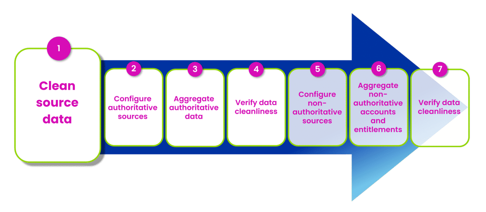

**Data hygiene.** Correct spelling, punctuation and parsing problems. Remove duplicate records and update incomplete or outdated information.

**Data quality.** Check accuracy, completeness, currency and compliance with the organization's formats and quality standards.

**Data integrity.** Keep the data consistent, relevant and organized so it can support the intended decisions. Remove obsolete or unnecessary details.

### Maintain quality after import

Review the initial aggregation and any large subsequent load. Diagnose discrepancies, validate the source, classify errors using agreed conventions, and correct or transform values according to documented standards. Document the cleanup process so it can be repeated.

Transforms are configurable objects that manipulate ISC data without requiring extensive custom code. Detailed transform implementation is covered in a separate course and is not included here.

### Example: country values

The original illustration shows inconsistent representations of a country. Values with the same business meaning can appear to an algorithm as separate categories. That fragmentation can distort recommendations and other aggregated results.

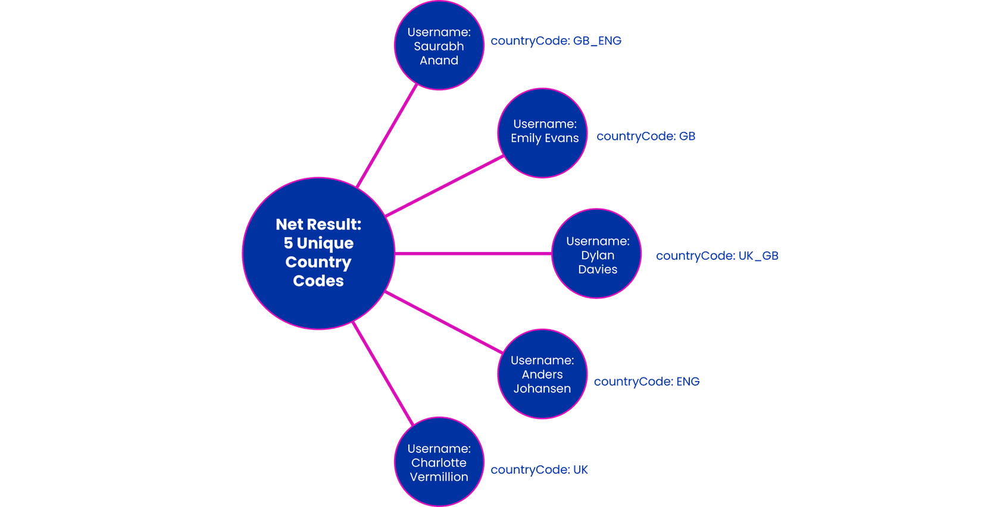

The course also recommends reviewing the access model for obsolete or incorrect access items, since poor access data can disrupt clustering and AI calculations.

**Coverage:** all seven numbered markers and the three data-cleaning tabs were inspected. The course's external Transforms material was not downloaded.

## 5.4 Configure authoritative sources

### Source types and common configuration

The authoritative source is the trusted reference used to create identities. Non-authoritative systems supply other account and access information to govern.

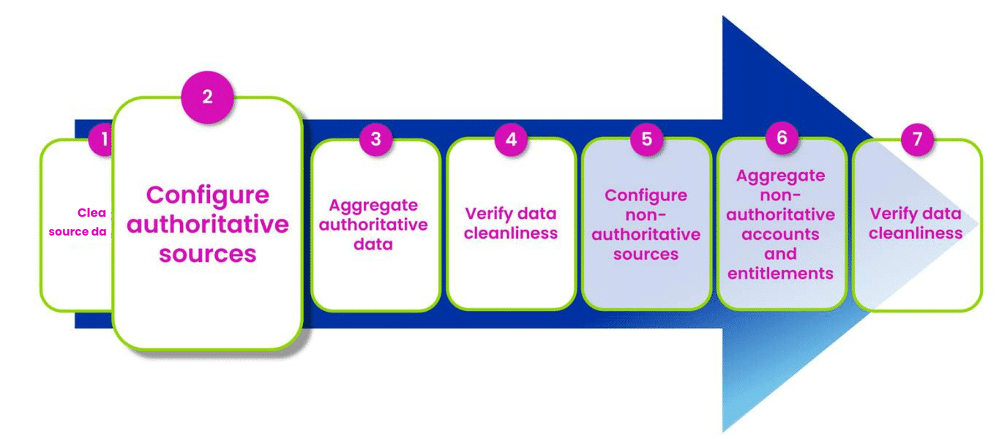

The five source-configuration markers describe metadata, connectivity, account schema, aggregation settings and the configuration specific to source type.

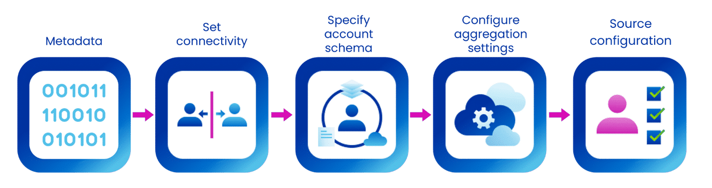

Metadata identifies the source and its connection context. Connectivity may use a connector or a CSV feed. The schema lists the attributes stored for each account. Aggregation settings control how records are loaded. Authoritative and non-authoritative sources require different additional configuration.

### Identity profiles

An identity profile establishes that a source is authoritative for creating identities. Each authoritative source has its own profile, even when several profiles use similar settings. Its configuration covers security, mappings and lifecycle management.

The course navigation is Admin > Identity Management > Identity Profiles > Create New. The screenshot shows the form; these notes describe the course example without creating a profile.

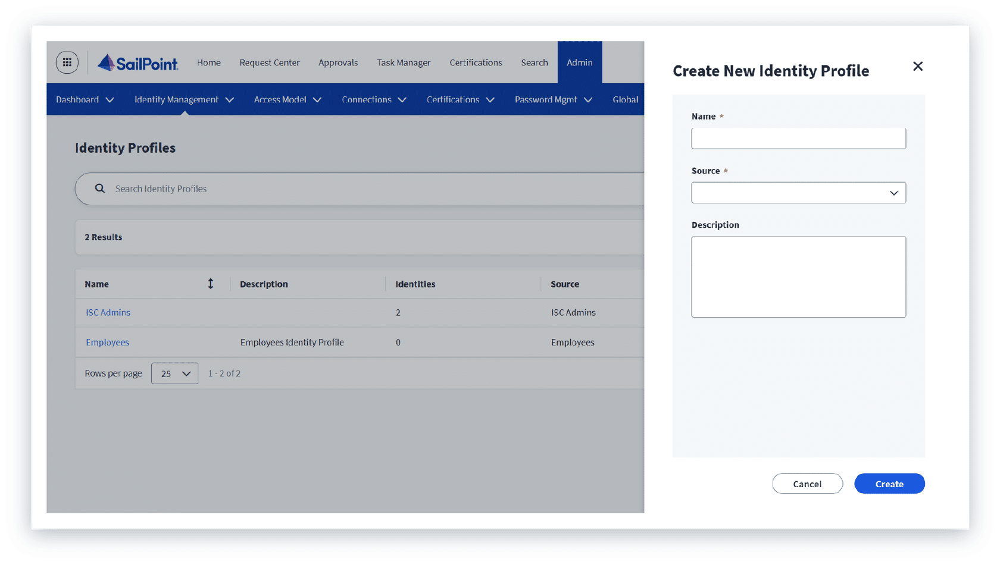

### Settings: all five markers

**Invitation options.** Unless an external authentication option such as pass-through authentication or SSO is configured, only invited users can sign in.

**Sign-in method.** Select the authentication method for the population governed by the profile.

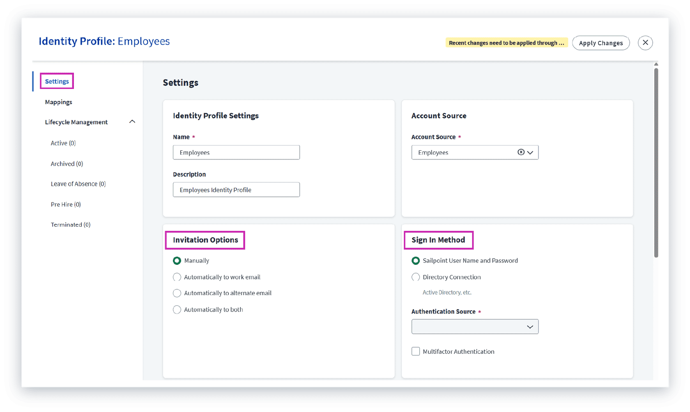

**Block Access From.** Configure restrictions involving addresses outside specified networks or countries on an untrusted list.

**Password reset and unlock methods.** Choose which recovery options users can use.

**Password reset and unlock settings.** The lesson discusses two-factor authentication and masking phone numbers during recovery.

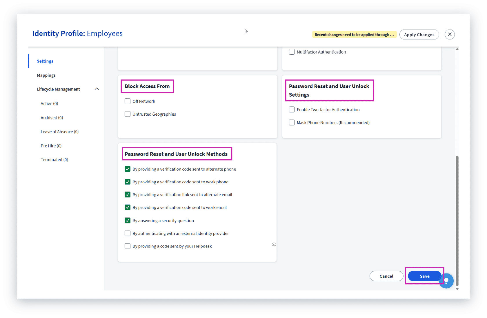

### Mappings: all four markers

Mappings define where identity attributes receive their values. Populations can have different attributes, but each profile remains a separate configuration.

Three required attributes are User Name (`uid`), Work Email (`email`) and Last Name (`lastname`). The lesson requires the username and work email to be unique.

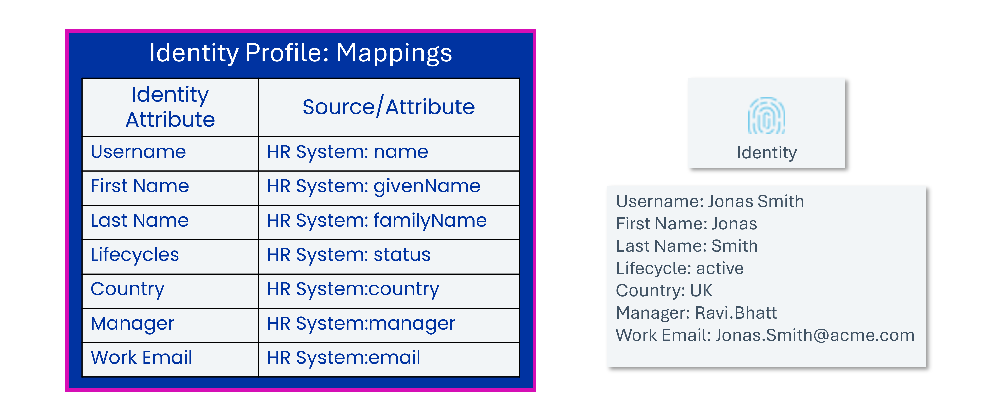

For each mapping, select the source and its account attribute. When a value cannot be read directly, use a transform or rule to calculate it. Add an attribute when the profile needs information not already listed; the course gives birthday as an example.

### Lifecycle management: all six markers

Lifecycle states represent relationships such as pre-hire, active, leave of absence, terminated and archived. Custom states can represent other business situations, including contractor relationships.

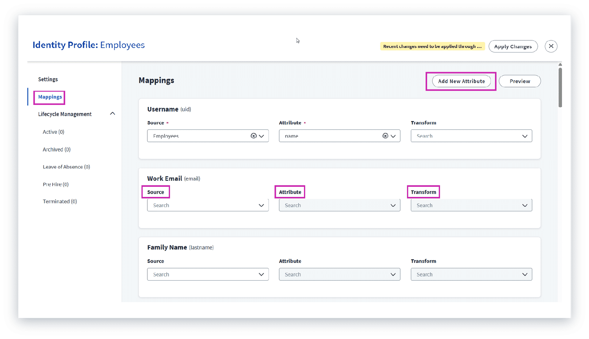

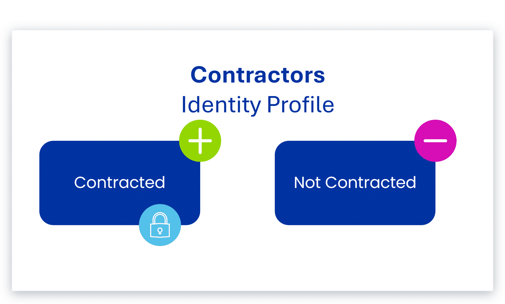

In the lifecycle menu, select the state to configure. Its settings can assign access profiles, enable or disable source accounts, select the identity state, and notify recipients when an identity changes state. A separate control creates additional lifecycle states.

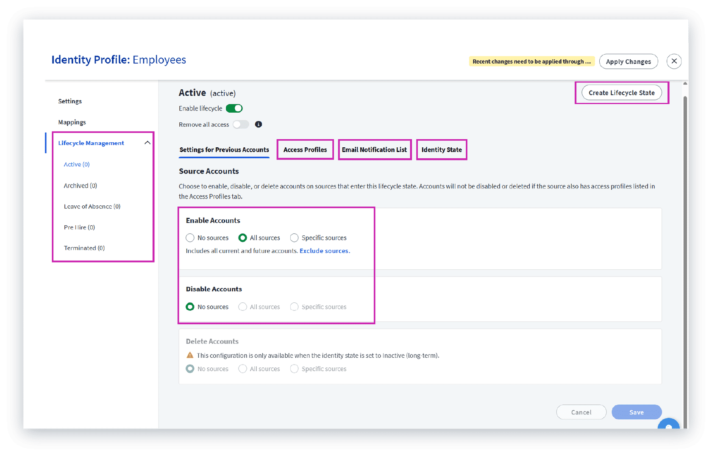

Lifecycle-driven changes can grant access to new workers and revoke access or disable accounts when workers leave. The source page's cross-references use older module numbers; this study set follows the verified current course order, where access modeling is Module 7 and provisioning is Module 8.

### Manager correlation

Manager correlation links an employee identity to the identity of their manager. That relationship supports manager approvals and certification reviews.

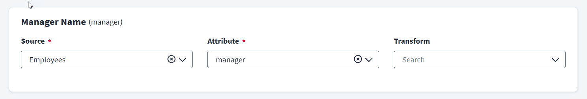

Two configurations are required: map Manager Name in each identity profile, and define Manager Correlation on the source that contains the matching account data. The usual match compares a manager-identifying field on the employee's authoritative account to a corresponding attribute on the manager's identity.

The illustrated navigation is Admin > Connections > Sources, select the source, open Account Management > Account Correlation, then locate Manager Correlation near the bottom.

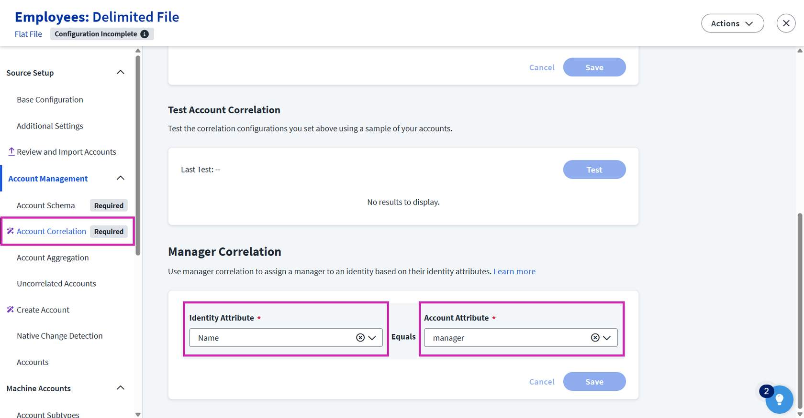

The Identity Attribute field identifies the attribute on the manager's identity. The Account Attribute field identifies the field on the employee's account that names that manager. Save stores the configuration in the course example; no live settings were saved during this capture.

**Coverage:** five source markers, five security markers, four mapping markers, six lifecycle markers and three manager-correlation markers were inspected. All continuation sections were opened without submitting knowledge checks.

## 5.5 Aggregate authoritative data

### From source records to identities

Aggregation reads source account data using the source connection and schema. For each source account, the configured attributes become an account record in ISC. Connected systems can support manual, scheduled, timed or event-driven processing as appropriate. The lesson describes disconnected delimited-file imports as manual operations.

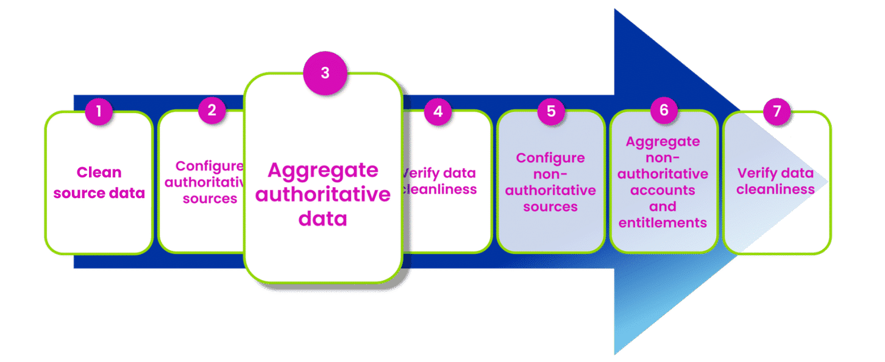

The six-panel timeline shows the data path:

**1. Request collection.** ISC asks the VA to collect source account information on demand or on schedule.

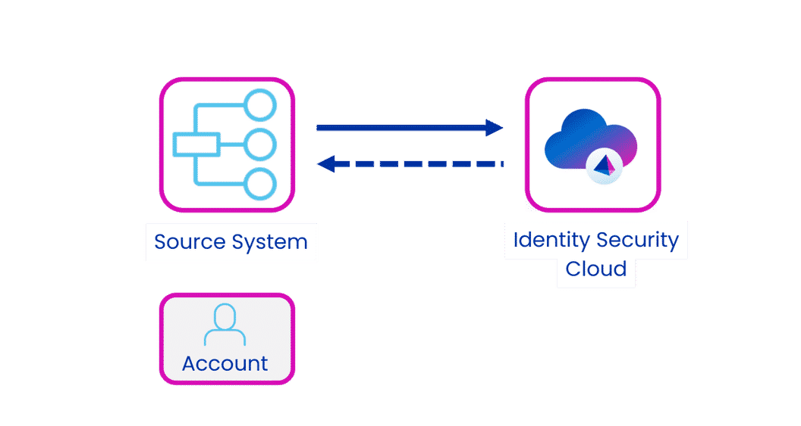

**2. Read the source.** The external system holds the records needed for governance.

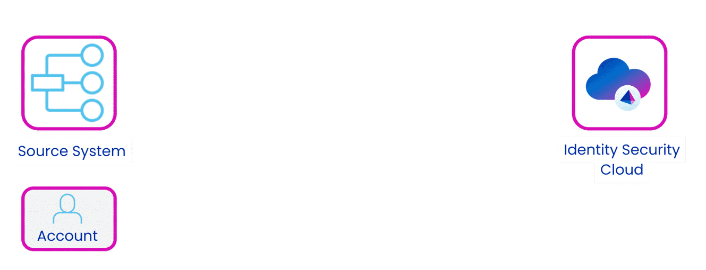

**3. Import the defined attributes.** The account schema controls which fields are brought into ISC.

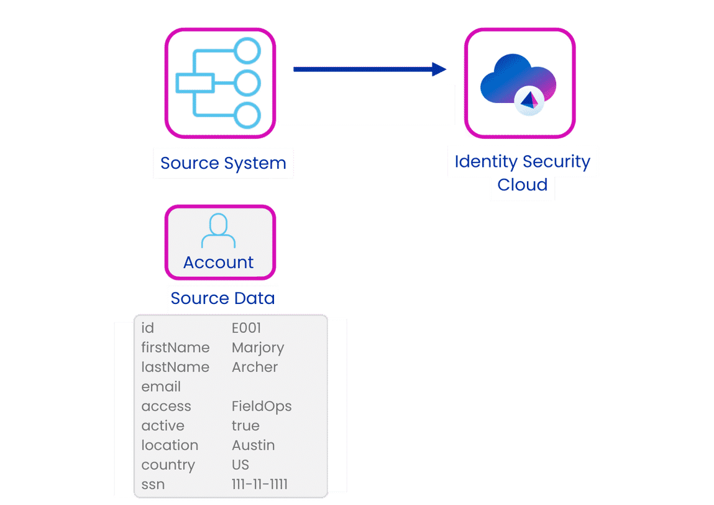

**4. Exclude fields outside the schema.** In the course example, an `ssn` field is not transferred because it was not defined in the schema. This illustrates that the schema shapes the imported record.

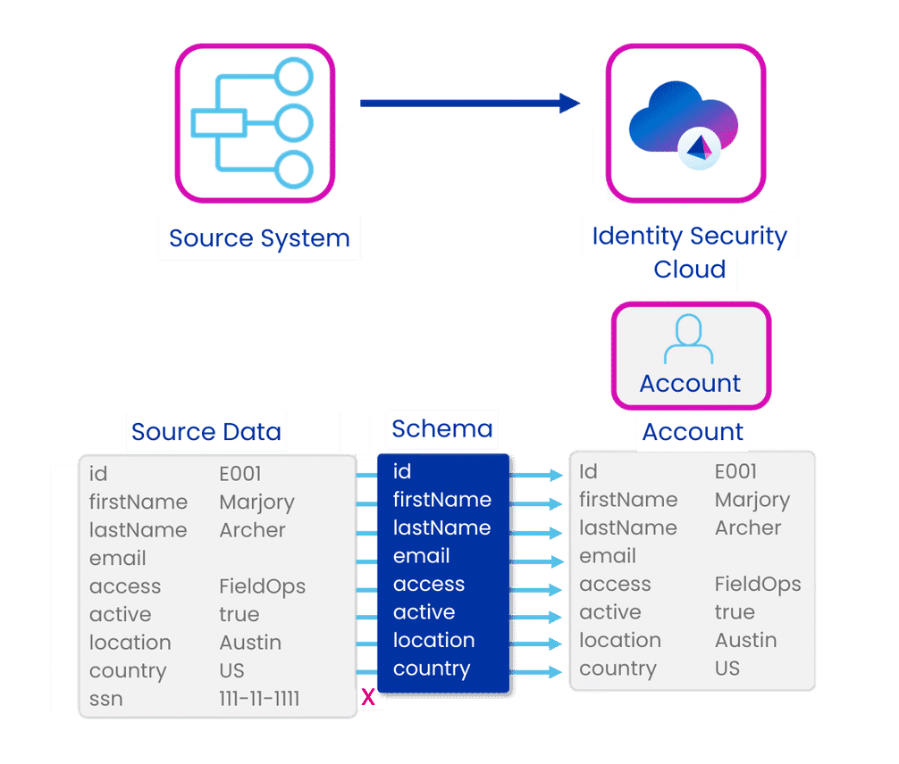

**5. Apply identity mappings.** The identity profile maps account attributes into identity attributes.

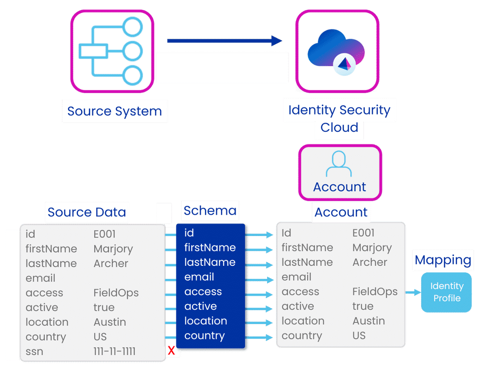

**6. Create or update identities.** The resulting identity records reflect the configured profile and imported account values.

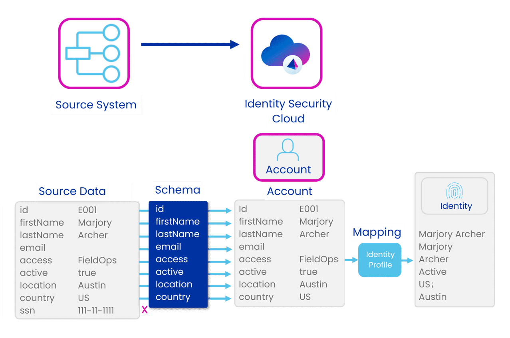

### Manual identity processing

The lesson instructs administrators to apply profile, role or access-profile changes through identity processing. After saving and reviewing the profile configuration, Apply Changes initiates recalculation for identities.

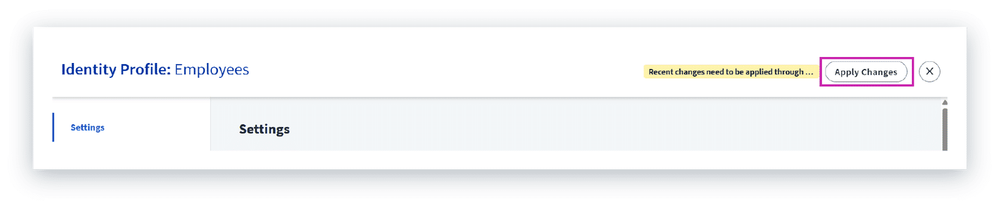

### Optimization and testing

Optimized aggregation skips unchanged source data. This can matter after a configuration change: a record may need recalculation even when its original source values are unchanged. The lesson identifies non-optimized aggregation as an available approach when needed.

Aggregation consumes time and resources. Complete related role, access-profile and application changes before recalculating them together. Save and preview identity-profile changes to verify expected values before applying them. No aggregation or identity processing job was run while preparing these notes.

## 5.6 Identity exceptions

### Two exception categories

Incomplete identities result from invalid or missing creation data, such as a duplicate `uid` or an absent last name, work email or username. Identities with errors commonly indicate a failed or incorrect transform operation.

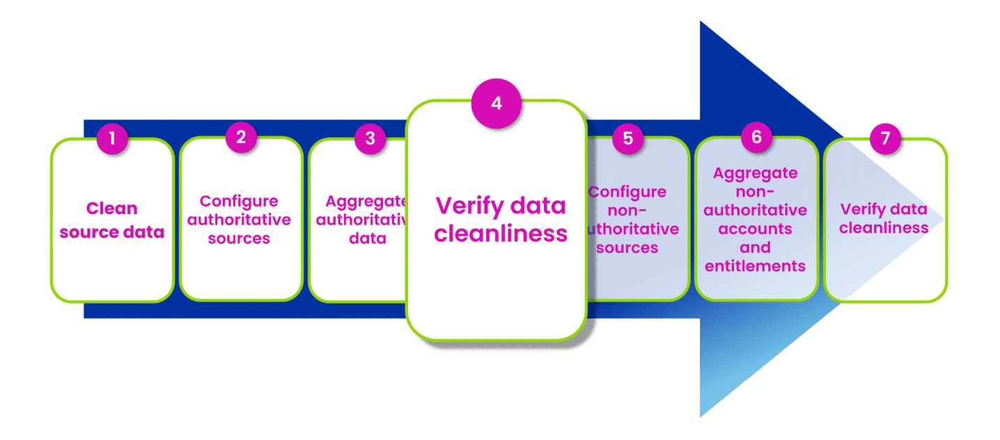

### Identify, inspect and resolve: all three accordions

**1. Identify the exception.** Open Admin > Identity Management > Identities and select the incomplete-identity or error list.

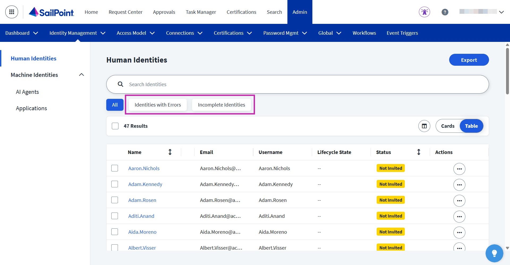

**2. Review details.** Use the exclamation indicator beside an identity to inspect the problem. The lesson also points to information on the Identity Profiles page and a CSV report download.

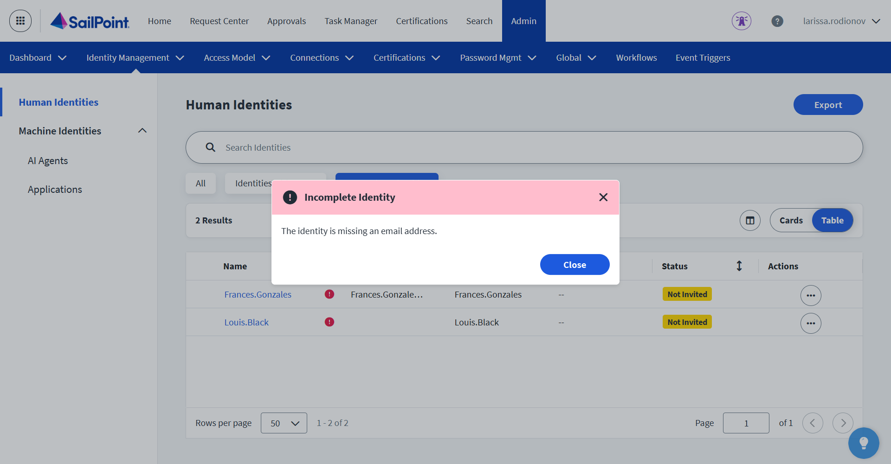

**3. Correct the cause.** The preferred approach is to repair the authoritative source data and aggregate again. If the source cannot be edited, or the required value is not yet available in HR, a transform can calculate the needed identity attribute.

The example is a pre-hire worker without an email address. A transform can derive a temporary address from name components and an agreed domain. The full transform definition, collision handling and production naming policy are not supplied in this lesson.

Reviewing exceptions and diagnosing missing or invalid values is more useful than indiscriminately deleting affected accounts. Knowledge-check answers were not submitted.

## 5.7 Recap

The module concludes with understanding the identity, describing authoritative onboarding and resolving identity exceptions. The practical sequence is clean data, configure source and profile, map managers, aggregate, inspect outcomes and correct the cause of errors.

**Missing artwork:** the recap banner and common photograph were not saved. The retained footer appears below.

## Module coverage and missing materials

All seven lesson bodies and continuation sections were read. Thirty-nine unique inline image URLs were retained. Expanded content includes four identity markers, three identity-component tabs, seven onboarding-step markers, three data-cleaning tabs, twenty-three source/profile/manager markers, the six aggregation panels and three exception accordions.

Four background-only files were not saved: the common photograph, two Mateo lesson-banner variants and the recap banner. Exact paths are in coverage.json. External transform training, complete connector deployment manuals, separate audiovisual transcripts and executable interactions are not included. No quiz was submitted, and no live tenant configuration or source data was changed.
