# Define and maintain an access model

**WORKING EDITION — IMAGE COVERAGE INCOMPLETE.** Detailed paraphrased notes are available for the five lessons, with 26 retained images. The original module's complete decorative/background image inventory and any separate audio/video transcripts have not been verified. See the course coverage report for the exact status.

Searchable study notes from SailPoint Identity University, **Set Up and Administer Identity Security Cloud**, module 7. Listed duration: **1 hr 5 min**. Captured through the signed-in course player on **14 November 2026 (Hong Kong)**.

[Open the source module](https://university.sailpoint.com/set-up-and-administer-identity-security-cloud/275069/scorm/1hiev2w40cc8l)

These are paraphrased study notes, not a verbatim course transcript. Product behavior below reflects this course version; no separate product-documentation verification was performed.

## Contents and capture coverage

| Lesson | Topics captured | Coverage |
| --- | --- | --- |
| 1. Overview | Purpose, learning objectives, guiding questions | Read |
| 2. Access model overview | Definitions, benefits, controls, bank example, Access Modeling | Read; all five explanatory accordions opened; continuation sections expanded |
| 3. Components and relationships | Entitlements, access profiles, roles, dynamic roles, lifecycle states, construction, assignment/detection, evaluation | Read; grant-method accordions opened; continuation sections expanded; process-step text captured |
| 4. Access model best practices | Planning, AI assistance, design, implementation, ownership and maintenance | Read; all three accordions and all three implementation tabs opened; continuation section expanded |
| 5. Recap | Expected outcomes | Read |

Knowledge-check topics are summarized below. No answers were submitted, no attempts were intentionally consumed, and no completion/reset controls were used. Opening and navigating lessons can update the platform's normal viewing progress.

## 1. Overview

The module introduces how to build, define, and maintain access models in Identity Security Cloud (ISC). It connects the access building blocks with security policies and ongoing administration.

Questions to be able to answer:

- What is an access model, and how does it help manage access?
- What controls determine a user's access within a system?
- Which components are needed to build an effective model?
- How is access established for a population of identities?
- How does the model support security and organizational policy compliance?
- How is the model kept current as the business changes?

## 2. Access model overview

### Purpose and vocabulary

An access model organizes related permissions into logical units. Requests, approvals, reviews, and audits can then operate on meaningful groups instead of requiring decisions about every individual permission.

| Component | Meaning | Bank analogy |
| --- | --- | --- |
| Entitlement | A specific access right on a source system | One key, such as permission to use a loan system or access an audit log |
| Access profile | Related entitlements grouped for management and provisioning | A key ring, such as teller-system access |
| Role | A business function that determines which access profiles an identity receives | A Branch Manager job template |
| Lifecycle state | An identity's organizational status, which influences birthright access and account actions | Prehire, active, leave, or retired status |

The model supports authorized access for both human and machine identities. Regular review is needed because business responsibilities and access requirements change.

Design requires balance: very broad profiles can grant excessive access, while excessive numbers of narrow profiles increase administrative complexity. The goal is effective security with manageable scale.

### Efficiency benefits

- **Reviews:** business-friendly names make collections of access easier to understand.
- **Requests:** expected job needs provide context for requesting access. An accounting data-entry employee, for example, would not normally need access to the software company's code base.
- **Division of expertise:** business stakeholders understand people and responsibilities; technical teams define the access points that belong in each logical group.

### Control benefits

- Connect entitlement assignment to lifecycle states and roles, supporting automated grants, removals, and approval workflows.
- Apply a common security/approval approach to collections of entitlements instead of handling each separately.

### Running example: Sam's bank branch

Sam needs access to customer accounts, loan tools, reporting, physical-security feeds, and vault-related systems. These include different rights such as viewing, editing, or approving. Managing hundreds of individual permissions for Sam and combinations of permissions for more than one hundred staff members would be difficult, particularly when people leave. The access model organizes those rights into meaningful sets.

The example is illustrative: grouping access reduces the administrative burden without implying that every employee should receive the same permissions.

### Access Modeling tool

The course describes SailPoint Access Modeling as an AI and machine-learning capability for discovering enterprise roles and providing role insights. It can suggest new roles and help develop a least-privilege model. Later best-practice guidance also describes suggestions for entitlement updates and improvements to existing roles.

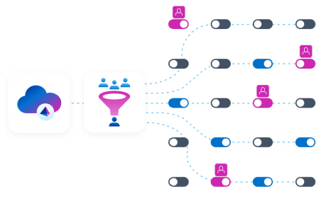

## 3. Components and relationships

### Entitlements

An entitlement represents a point of access held by an identity on a source. Examples include read/write permission, administrative privileges, access to scheduling software, or authority to approve loan applications.

Entitlements are collected from sources together with account data. They describe access that users already hold on those systems and supply the building blocks for access profiles.

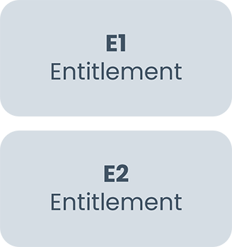

### Access profiles

An access profile bundles related entitlements **from one source** so that ISC can manage and provision them as one unit.

Bank examples distinguish ordinary employee access from managerial rights:

- Facility access may allow staff to enter the bank while limiting security-setting changes to managers.
- Personnel access may let employees view their own records while allowing managers to update staff information.
- Banking access can distinguish cash-operation tools for tellers from loan-processing tools for loan officers.

The course uses these examples to illustrate grouping; the single-source boundary still applies to each individual access profile.

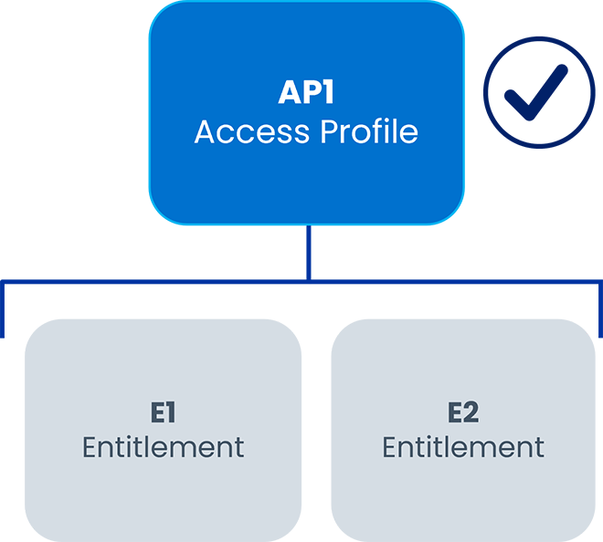

#### How access profiles reach identities

| Method | Course explanation |
| --- | --- |
| Detection during processing/aggregation | ISC recognizes an access profile when the identity already holds its complete set of entitlements. This makes existing access visible at the profile level. |
| Access requests | Users request profiles through Request Center. Configured policies may involve several approval stages or automatic approval. Requesting a role can indirectly grant its profiles. |
| Automated provisioning | Lifecycle-state configuration or role criteria can drive grants. The course describes removal when lifecycle changes mean that access is no longer appropriate. |

Distinguish **provisioning** from **detection**: provisioning changes access; detection recognizes entitlement combinations that the source reports. The later aggregation step confirms what is actually present.

### Roles

Roles represent business functions based on factors such as job title, department, or location. A role can combine multiple access profiles, including profiles from different sources. The individual profiles each remain restricted to a single source.

Membership can follow configured criteria or an approved role request. ISC then provisions the entitlements included in the role's access profiles.

The bank example compares Rico, a Head Teller with reconciliation-approval rights, with Janae, a part-time Teller without those managerial rights. Similar work does not require identical access.

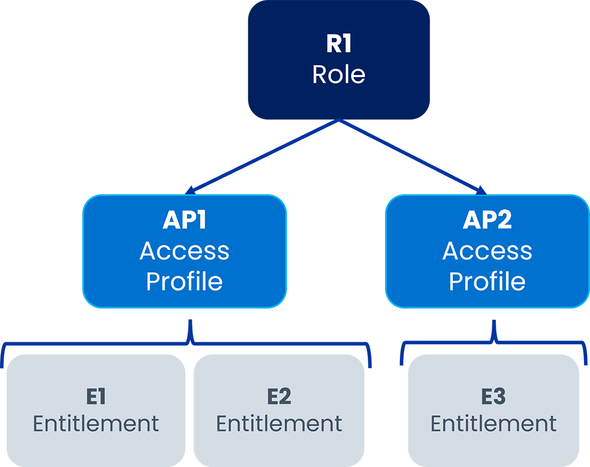

#### Membership configuration

- **Identity List:** explicitly select the identities to assign; this is the more manual approach.
- **Standard Criteria:** use logical criteria groups. For example, manager job information combined with active employment status can select identities for a managerial role.

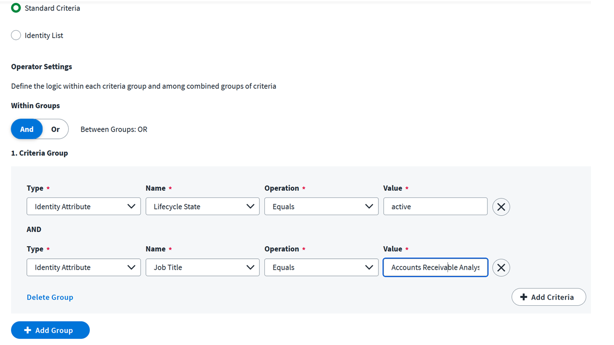

#### Dynamic Roles

Dynamic Roles use attribute dimensions to make birthright access more granular within a role. This can reduce the need for many separate roles that have overlapping access.

For example, a Branch Manager role can include a location dimension. Managers receive access for their own branch rather than gaining unnecessary access to other branches. The saved diagram illustrates Fourth Street, Main Street, Avenue A, and Garden Street as location variants.

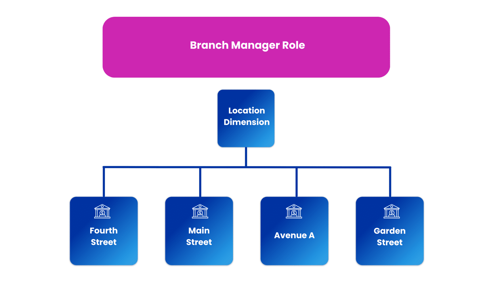

### Lifecycle states

Lifecycle states define birthright access in the context of an identity profile and authoritative-source information. Employment status can change the access a person needs; an active employee and someone on leave may need different treatment.

A state's configuration can combine access profiles for multiple sources and define provisioning behavior. The course describes granting/removing profiles and enabling/disabling accounts through lifecycle-state configuration.

**Cardinality to remember:** an identity has one lifecycle state at a time, but can hold multiple roles, access profiles, and entitlements.

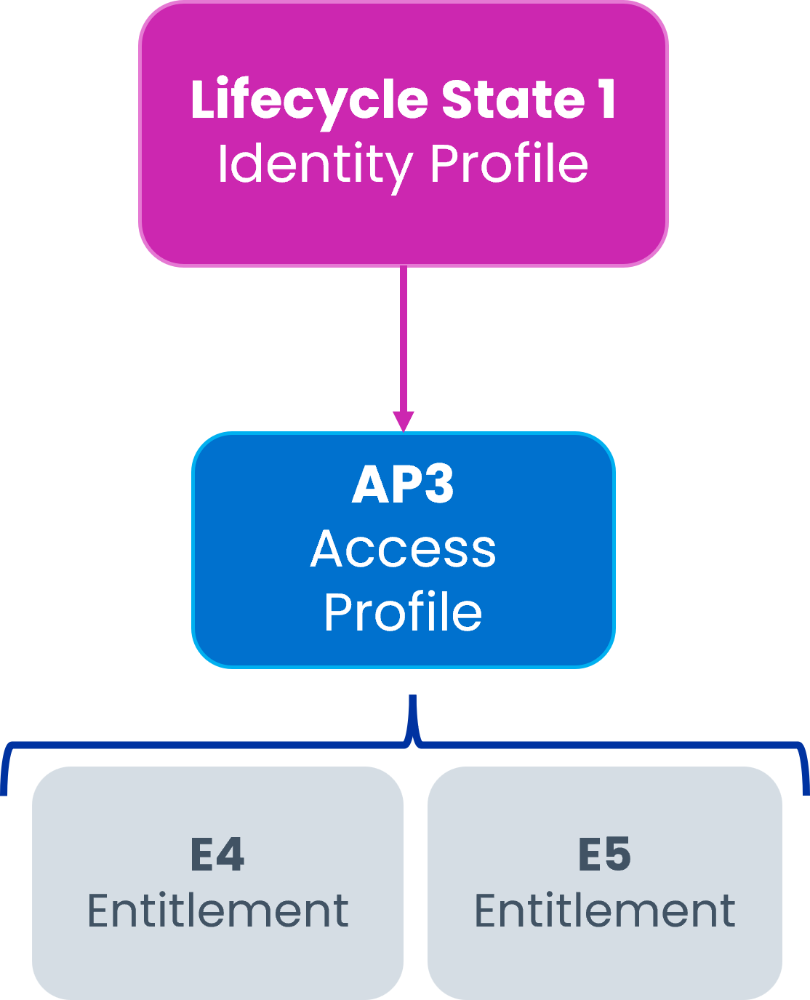

### Building the model

The five-panel process presents this sequence:

1. Introduce the access-model building blocks.
2. Aggregate entitlement data into ISC.
3. Define access profiles containing one or more related entitlements from a single source.
4. Configure lifecycle-state provisioning behaviors through identity profiles to grant or remove access profiles.
5. Configure roles that grant one or more access profiles to members.

Lifecycle-state access and role-based access are complementary ways of assembling an identity's overall access. They should not be treated as a requirement that every grant must pass through a role.

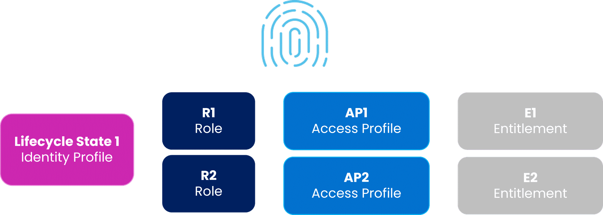

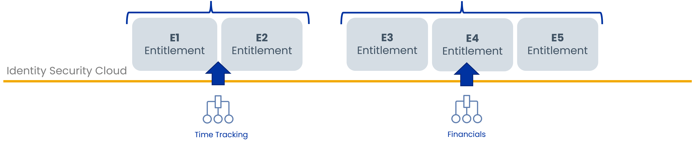

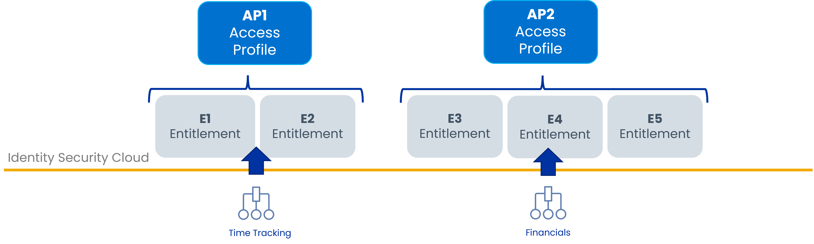

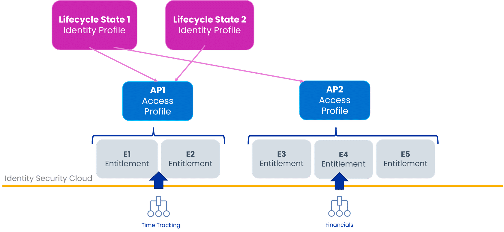

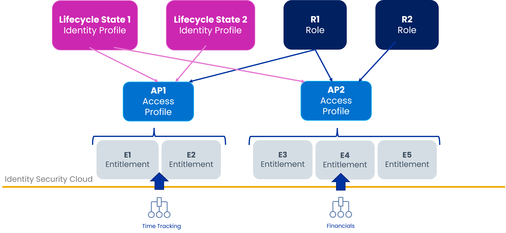

### Applying the model: assignment and detection loop

The lesson identifies role assignment, access-profile detection, and access-model evaluation as the three processes involved in applying a model.

Its seven-panel assignment/detection process consists of an introduction and six substantive stages:

1. Aggregate or calculate identity attributes and existing entitlements.
2. Evaluate role membership criteria and check for the profiles associated with assigned roles.
3. Provision the access represented by those profiles and their entitlements.
4. Aggregate updated entitlement data from the sources to confirm the resulting access.
5. Detect profiles by matching the identity's observed entitlements.
6. Associate the detected access with relevant roles and the access appropriate to those role assignments.

In the example, Sam's title and Main Street location select a Branch Manager role. Profiles for personnel management, branch operations, and loan/account oversight are provisioned. Reaggregation then verifies the access. Leftover access from Park Street can be detected and surfaced for security review rather than disappearing from view simply because it is outside Sam's current role.

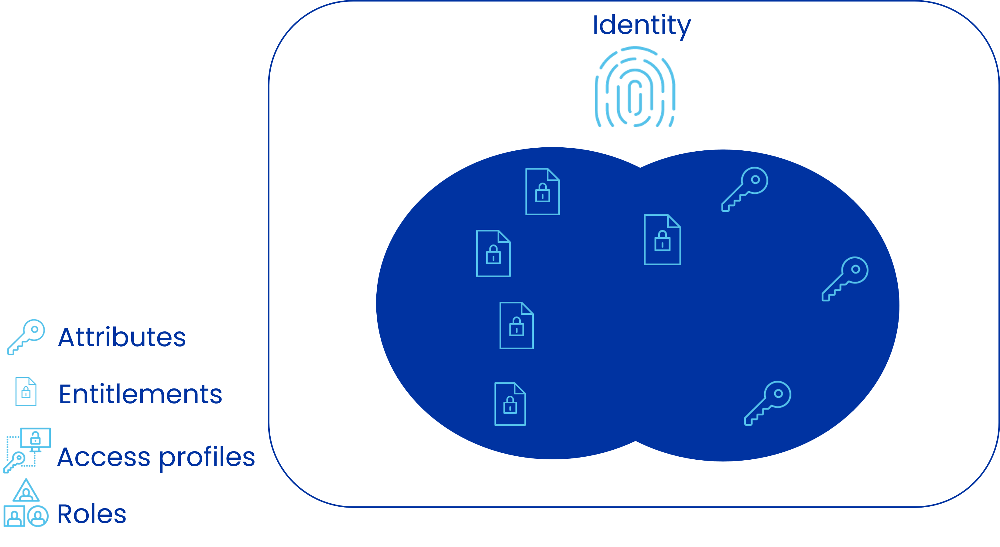

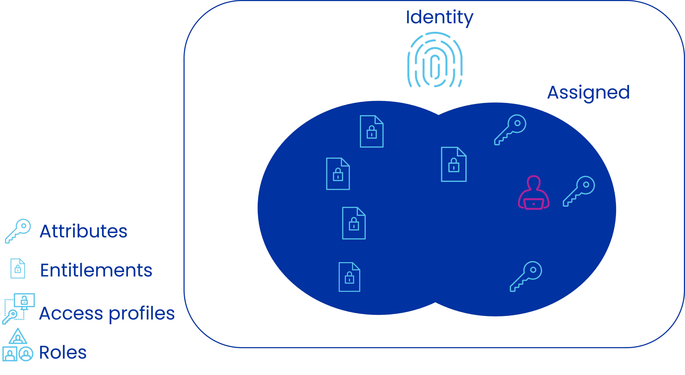

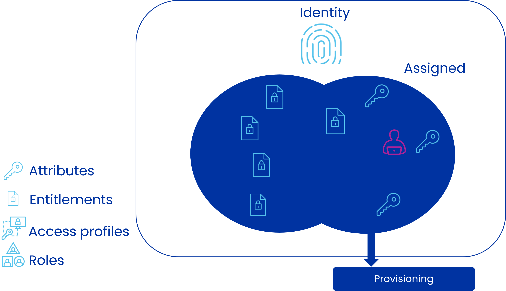

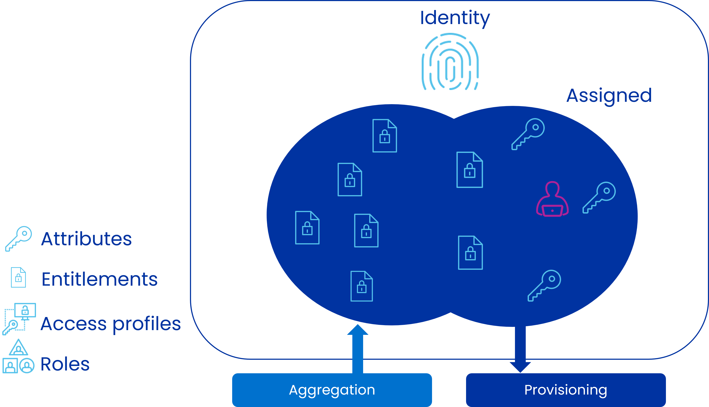

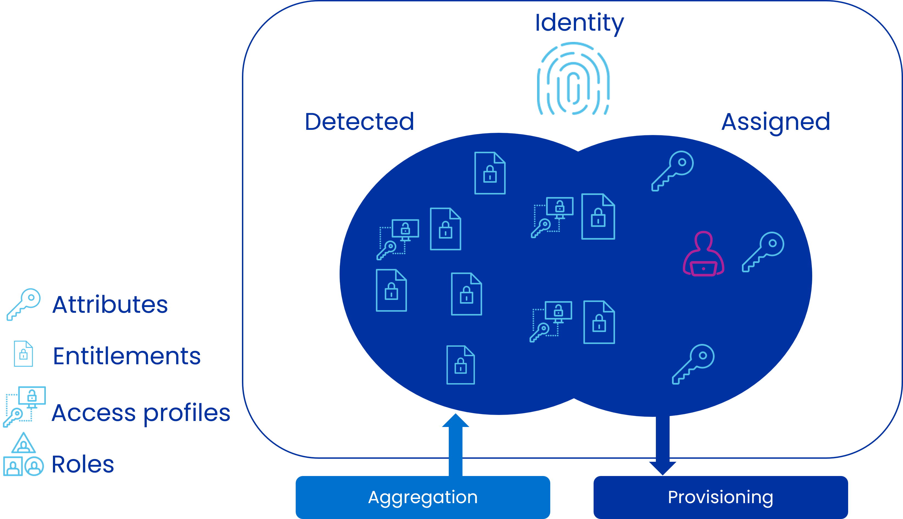

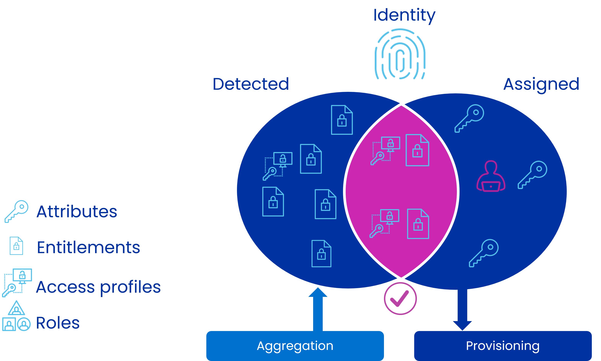

### Access-model evaluation

The course states that source aggregation evaluates role assignments, lifecycle-state assignments, and access-profile detection. This evaluation/enforcement occurs automatically with aggregation and does not require a separate evaluation configuration.

The lesson also names two ways to initiate evaluation independently:

- Use **Apply Changes** in the interface.
- Initiate it programmatically with a REST API.

No API endpoint or request payload was supplied in the captured lesson. The saved UI illustration highlights Apply Changes on the Roles page.

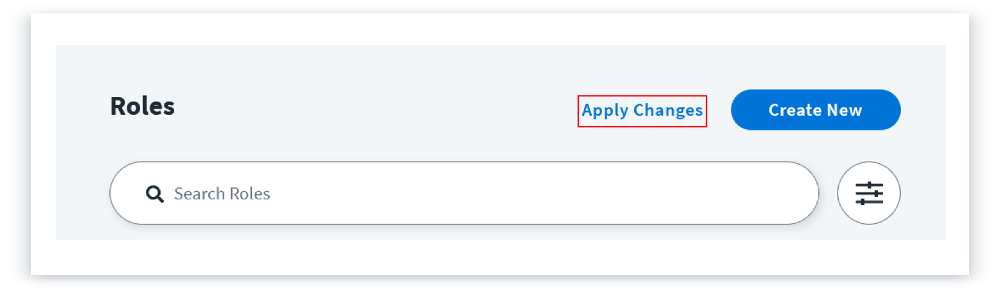

## 4. Access model best practices

### Plan before configuring ISC

Treat the model as a blueprint. Develop and maintain a version outside ISC so stakeholders can refine it before implementation.

- Involve security teams and other relevant business stakeholders.
- Document access requirements for each job function before configuration.
- Keep an accessible documentation repository for the people responsible for the model.
- Use Access Modeling suggestions to help discover roles, identify entitlement changes, and improve the role program.

### Design for security, clarity, and scale

- Give roles, profiles, and states understandable names and descriptions; avoid unnecessary jargon and acronyms.
- Use metadata to preserve context for future stakeholders.
- Apply least privilege: grant the access needed for the job.
- Review duplicate and overlapping access sets.

The course's overlap example uses profiles containing `ABC` and `ABCD`. An identity with `ABCD` can match both. If `ABC` is a meaningful standalone unit, separating the groupings into `ABC` and `D` can avoid that overlap.

### Implementation approach: all three tabs

| Approach | Guidance |
| --- | --- |
| Clean data | Improve entitlement data quality so patterns are easier to identify. The course notes that entitlement certifications commonly precede profile and role certifications. |
| Small, familiar starting point | Begin with a manageable model you understand. Avoid launching a large role/RBAC project immediately; learn from business users and expand automation for common requests. |
| Ongoing program | Roles change with the business. Build recurring maintenance cycles instead of treating initial implementation as the end of the work. |

### Ownership and maintenance

Each component needs an accountable owner. Owners must understand its requirements, coordinate updates with the business, and agree on a management philosophy as operations evolve.

Access maintenance involves IT, security, business stakeholders, and appropriate administrators/access managers. Individual users should not control their own access without oversight. Administration and auditing remain necessary to ensure access is provisioned appropriately.

## 5. Recap

Expected outcomes are the ability to explain why access models matter, identify the components and construction steps, and recognize how the model supports management of identities and their access.

The recap presents an exit/next-module action. The separate course assessment and other course modules were outside this capture's scope.

## Knowledge-check study guide

These paraphrased prompts and answer concepts support revision; they are not a record of submitted responses.

| Topic tested | Answer concept |
| --- | --- |
| Name for a related collection of permissions | Access profile |
| Efficiency and control benefits | Entitlement lifecycle management, simpler access reviews, and assignment informed by expertise |
| Component matching | Entitlement = source access point; profile = same-source bundle; role = business-function grouping; lifecycle state = birthright-access context within an identity profile |
| Source limit for a profile | One source |
| How entitlements are assembled into roles | Entitlements belong in profiles, and profiles are associated with roles |
| Claims that do not describe sound maintenance | IT-only responsibility and user-managed access without oversight |

## Glossary and quick lookup

| Term | Quick reference |
| --- | --- |
| Aggregation | Source-data collection that supplies account/entitlement information and triggers the evaluation described in this module |
| Birthright access | Access assigned from lifecycle-state or role conditions rather than requiring an individual request for every permission |
| Detection | Recognizing a profile from the entitlements actually reported for an identity |
| Provisioning | Applying configured access changes to a source |
| Deprovisioning | Removing access that should no longer be held |
| Dynamic Role dimension | An attribute such as location that determines the appropriate access variant within a role |
| Least privilege | Limiting access to what the identity needs |
| Access Modeling | The AI/ML capability described for role discovery, insights, and model improvement |

## Diagrams and media

The accompanying gallery preserves **26 image assets** downloaded from the rendered, authenticated lessons: **25 PNGs and one SVG**. Some are conceptual diagrams, some are interface illustrations, and a few are supporting illustrations/icons. Original source filenames are retained with spaces normalized to hyphens.

- Component illustrations: entitlement, access profile, roles, lifecycle.
- Detailed component illustrations: slides 11–16, role, and the location-dimension diagram.
- Construction steps: slide17-1 through slide17-4.
- One-state/multiple-access illustration: slide18.
- Assignment/detection sequence: slide20-1 through slide20-6.
- Evaluation UI: slide21.
- Maintenance illustration: slide26.
- Overview examples and Access Modeling illustrations.

All images remain SailPoint course material. This capture does not grant redistribution rights.

## Limits and inaccessible or unverified content

- **No module access block encountered:** all five lessons opened in the authenticated player.
- **No standalone transcript export captured:** the notes summarize lesson text. No separate narration transcript was exposed in the inspected lesson content; an unexposed audio track cannot be ruled out.
- **No video file captured:** no video player was observed in the inspected material. The best-practice lesson's DOM contained no video/audio elements when checked.
- **Not a SCORM archive:** execution code, tracking state, scripts, fonts, and decorative page chrome were not exported. Interactive behavior is represented by notes and saved images, not an offline executable course.
- **Process panels:** the rendered lesson exposed text for all construction and assignment/detection panels; their associated PNGs were saved. The capture does not claim to reproduce the original interactive animations.
- **Assessments:** knowledge-check concepts were read, but no responses were submitted and no course-level assessment was taken. Feedback text exposed by the player was not treated as evidence of the user's answers.
- **Excluded scope:** other course modules, the course assessment, course rating, and Next Steps.
- **No bypass:** navigation and image downloads used the authenticated browser's ordinary exposed content. No access controls or DRM were bypassed.
