# Module 8 — Provisioning overview and monitoring

Eight lessons in course order, with paraphrased explanations and original English illustrations. Descriptions reflect the course version viewed; retention periods and interface behavior are course claims rather than independently verified current service specifications.

## 8.1 Overview

Katie introduces how provisioning grants, changes and removes access, how its phases fit together, and how administrators configure and monitor the resulting actions. Attribute synchronization is included because accurate account data is another form of downstream change.

**Missing artwork:** the shared photograph and Katie lesson banner were not saved.

## 8.2 The provisioning process

### Four stages

Provisioning changes a user's access to applications, systems or databases according to identity information and source configuration. It can affect several target systems, but a provisioning plan is specific to one identity.

### 1. Trigger provisioning: both tabs expanded

Automated events include lifecycle-state changes, changes in role membership and synchronization of identity attributes to accounts. Request-driven events include approved access requests, certification revocations and password-change requests.

The distinction is what initiates the change; the downstream action still needs to be represented in a plan and fulfilled.

### 2. Package the plan: five markers expanded

The plan standardizes the requested actions regardless of trigger or target.

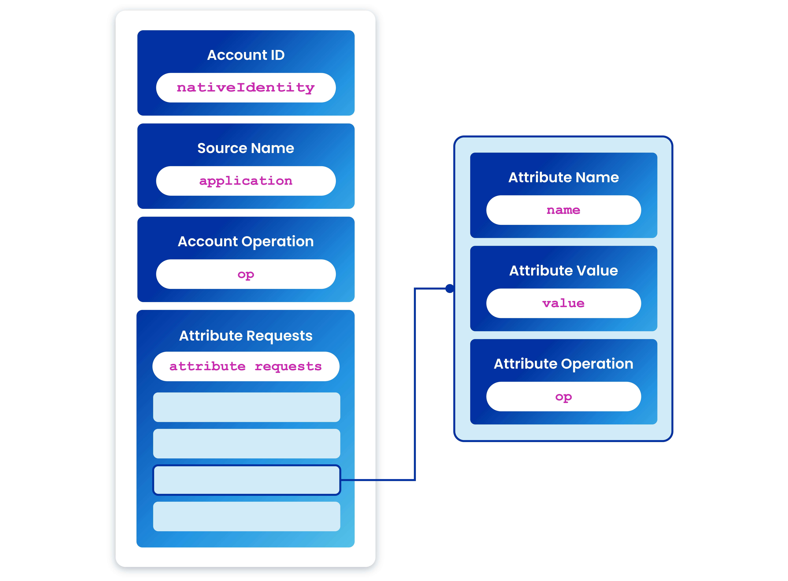

Account ID identifies the account affected. Source Name identifies the target source. Account Operation describes a create, update, enable or disable operation. Attribute Request identifies the attribute, the operation such as add/remove/replace, and its intended value. The example-operation marker illustrates the changed field, its new value and the corresponding operation. These details also help interpret activity logs.

### 3. Manage fulfillment

Fulfillment carries out the account or access change. ISC checks the appropriate operation; the lesson's example changes a modify operation to create when no account exists. Existing access is filtered so it is not provisioned again unnecessarily.

A direct connector sends the change to the target and returns a result. A manual task assigns the work to an administrator when an automated connector path is unavailable. An external ticketing integration, such as ServiceNow, sends the plan into the organization's ticket workflow and reports completion back to ISC.

### 4. Verify the change

A connector or integration's reported status is useful, but verification uses subsequent aggregation to observe the resulting account data. This distinguishes a reported execution result from confirmation of the state actually present on the target.

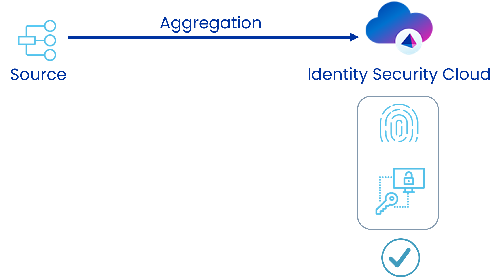

### Bank example: all five process panels

Sam hires Thomas as a teller. The course example changes his lifecycle state from prehire to active, initiating the access workflow.

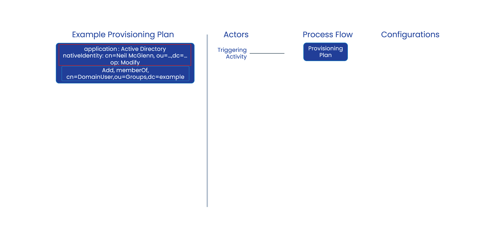

The request is analyzed and the example prompts Sam's manager approval.

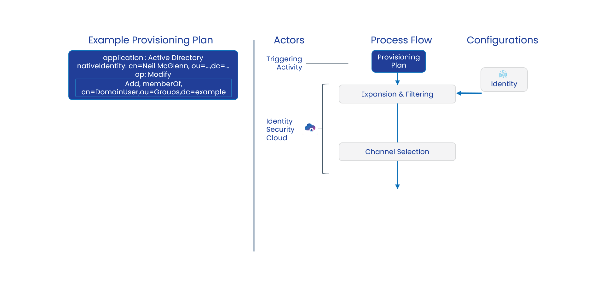

The provisioning plan is sent downstream to apply the access.

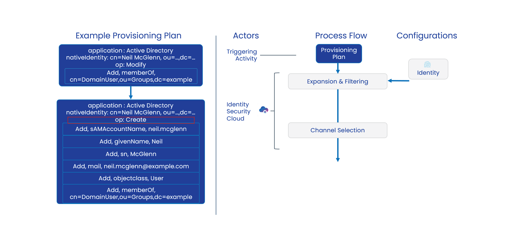

Aggregation refreshes account data and confirms Thomas's resulting access.

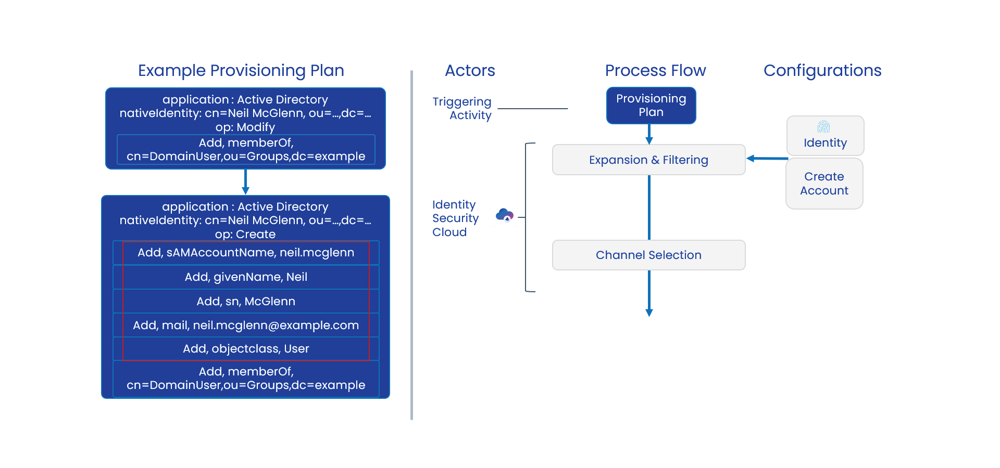

The manual-request example gives Thomas project-management access for a project. Sam requests it on his behalf; ISC processes the request and sends confirmation notifications to both participants.

**Coverage:** both trigger tabs, five plan markers and all five example panels were inspected. The sorting activity's items were visible, but no sorting or quiz answer was submitted.

## 8.3 Provisioning processes within the fulfillment phase

### Create Account configuration

When access is granted on a source where the user has no account, account creation supplies the required attributes. Each source can define its own values; predefined configurations can be reviewed and customized. The lesson distinguishes this interface-based creation configuration from other operation profiles, which may require REST API configuration.

Open the source under Admin > Connections > Sources and choose Account Management > Create Account in the course example.

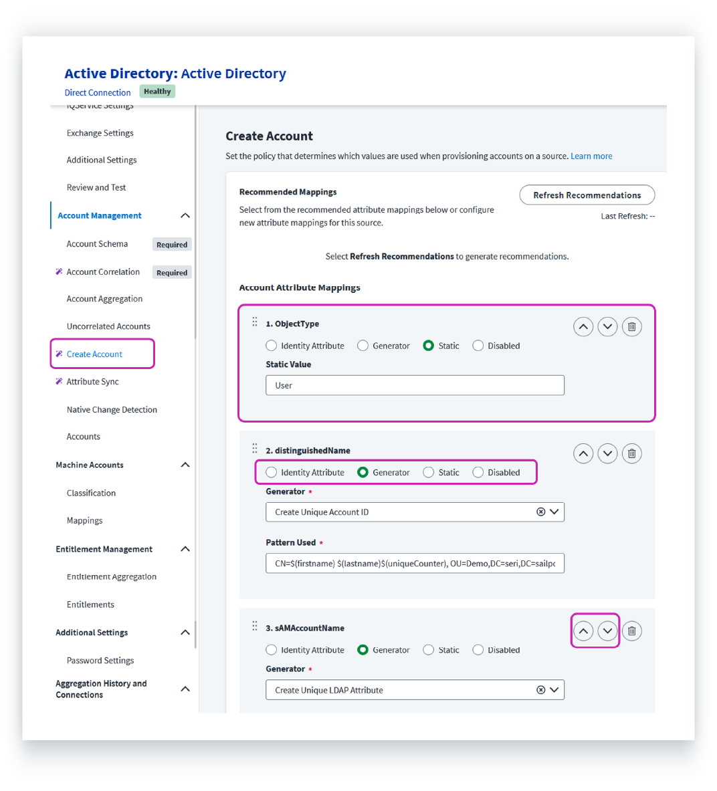

The three markers identify mapping-type selection, how the provisioning value is defined, and attribute ordering. Calculate a dependent value after the field on which it depends.

### Four mapping types

Identity Attribute copies an identity value, such as Work Email. A Generator calculates a value from a pattern; the lesson gives Create Unique Account ID as an example. Static supplies literal text or an Apache Velocity template. Such a template can reference earlier account attributes with `$attributeName`, but the course states that static mappings cannot reference identity attributes directly. Disable omits the field from account creation.

### Attribute maintenance: all three tabs

Existing schema attributes can be added to the creation configuration. A creation attribute not included in the account schema can also be defined if it exists on the source and supports the Create Account operation. Reorder or remove attributes to produce the intended calculation sequence. Licensed application onboarding can suggest mappings.

### Initial passwords: all three accordions

The lesson states that ISC does not email initial passwords. It describes three approaches:

**Static.** An administrator supplies the same initial text for accounts on the source. The course discusses IT laptop preparation and regular rotation of this shared starting value.

**Dynamic known.** The initial value is derived from identity attributes. The course illustrates an employee-number-based value and requires a change at first sign-in. This is the course's example, not a recommendation to use predictable production passwords.

**Dynamic unknown.** ISC generates a random initial password, and the user uses the password-reset process after provisioning. The course identifies this as the most secure of its three options.

No password was generated or changed while preparing this book. The three configuration markers, all attribute tabs and all password accordions were read.

## 8.4 Setting up lifecycle states

### Relationship to the organization

A lifecycle state represents an identity's current organizational relationship. Profiles can define different state sets: a contractor population may have Contracted and Not Contracted, while employees may need Active, Leave of Absence, Terminated or Retired.

An identity occupies one state at a time. On transition, state-granted access is removed unless it is also included in the new state. Account enable/disable behavior follows the configured actions.

The example has Ava hiring Maria, who needs baseline email and time-reporting access; leave requires a different access arrangement. Configure states through Admin > Identity Management > Identity Profiles, select the profile and its Lifecycle Management entry.

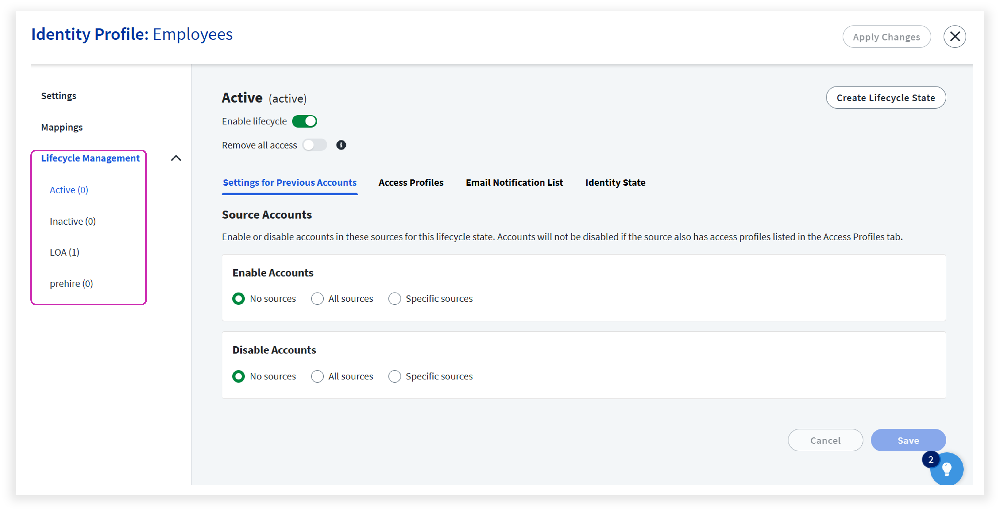

### Assignment methods: both tabs

Automatic states come from authoritative attributes, either directly mapped or calculated from values such as start and end dates. Aggregation updates the lifecycle value.

An organization administrator can set a state manually through the identity page or API, for testing or urgent changes. The manual method remains until the underlying source lifecycle value changes. The course's example changes Maria from automatically Active to manually Inactive, then a later HR value of Leave of Absence restores automatic assignment.

### Three action groups

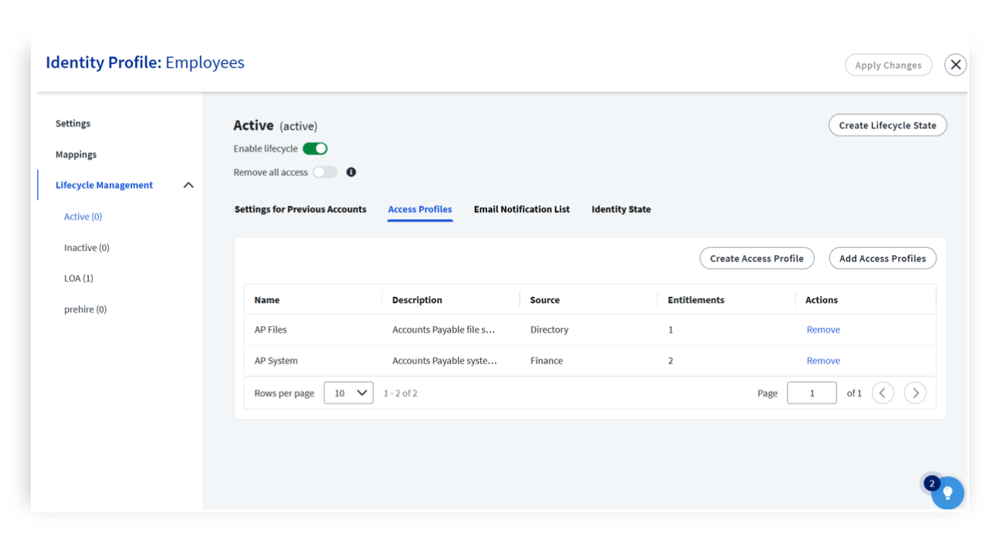

The markers cover account configuration to enable or disable accounts, access profiles assigned for the duration of the state, and notifications to managers or administrators. State technical names are case-sensitive and must match the lifecycle attribute values. Define the states separately for each identity profile.

### Contractor example: all three panels

The model grants two access profiles and enables accounts while Contracted. It removes those state-granted profiles and disables accounts when Not Contracted.

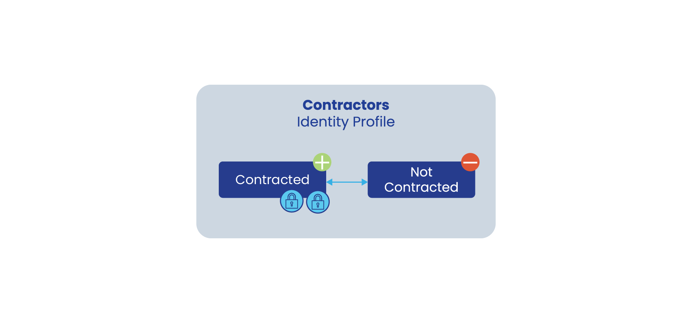

Amy Green begins in Contracted and receives those profiles and enabled accounts.

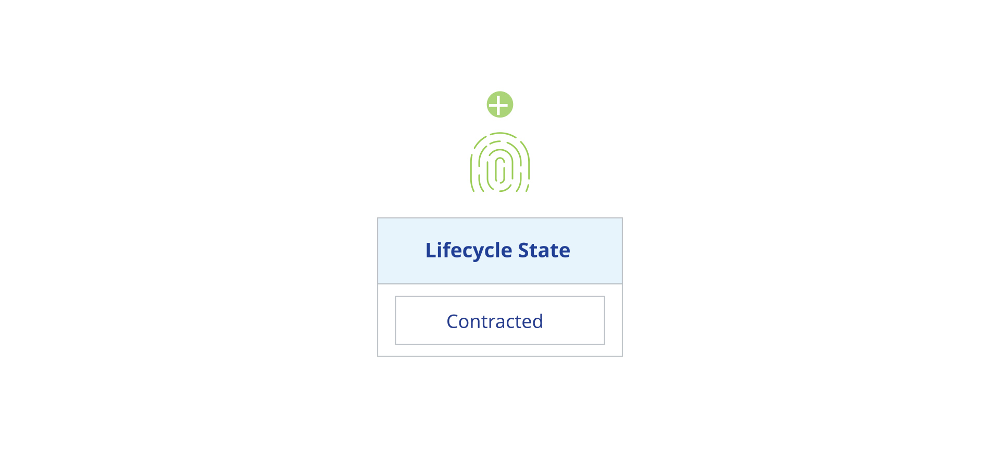

When the contract ends, her state changes, notifications are sent and the configured removals and disabling actions occur.

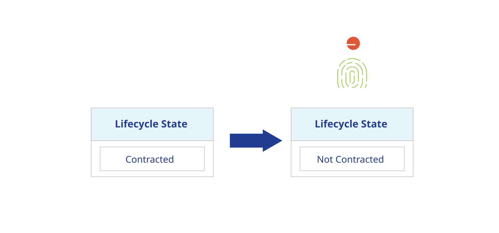

### Employee example: all six panels

The model defines Pre-hire, Active, Leave of Absence, Retired and Fired. Pre-hire grants no profiles and makes no account changes. Active grants A and B and enables accounts. LOA retains A without account changes. Retired removes A/B, grants C and disables accounts. Fired removes access and disables accounts. A profile must be listed in every state in which it should be retained.

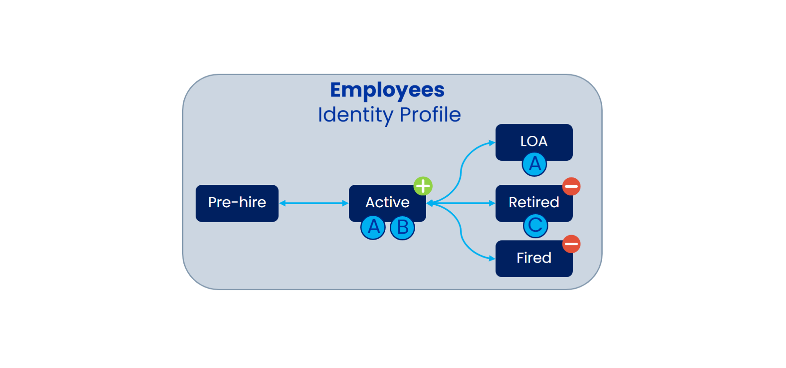

Blanca Lopez starts in Pre-hire. Existing account state is unchanged.

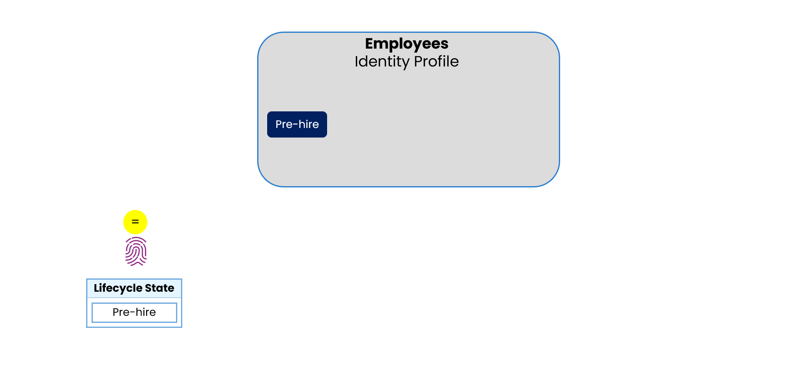

On becoming Active, A/B are granted and accounts enabled; required new accounts are created as part of provisioning.

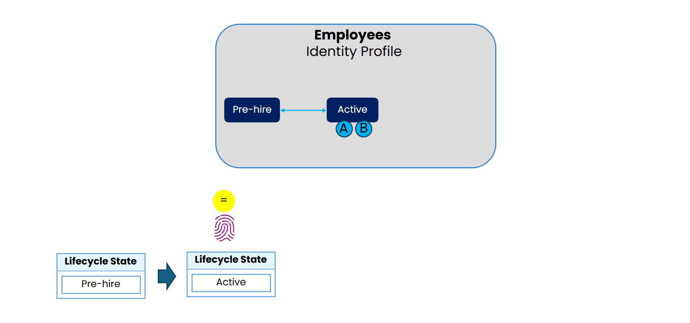

On LOA, B is removed while A remains because it is also assigned to LOA. Account states are unchanged.

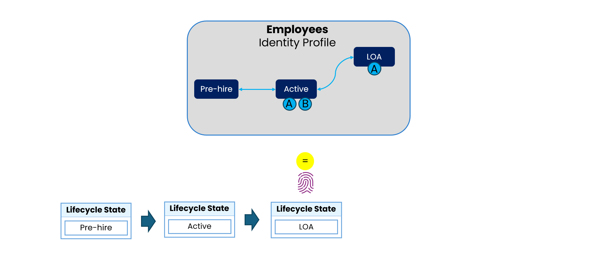

Returning to Active restores its configured access.

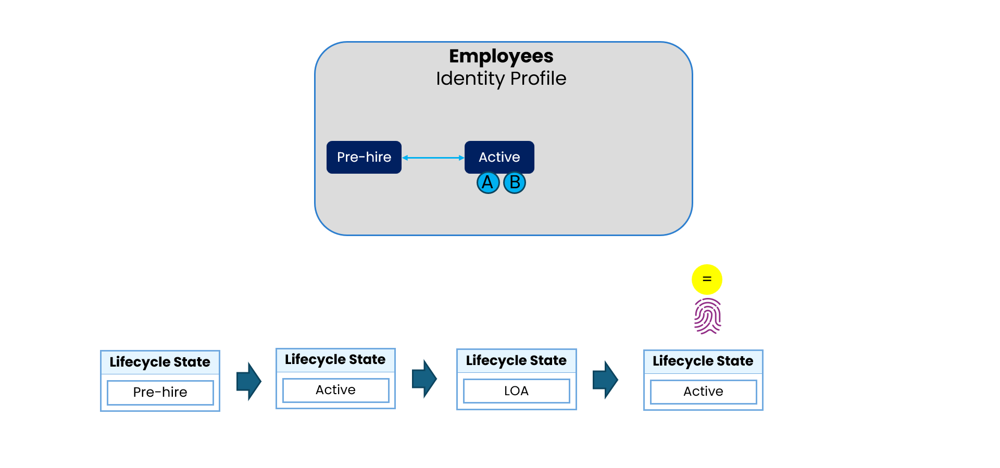

At retirement, A/B are removed, C is granted and accounts are disabled. The source calls the person Bianca in its final panel; the illustration sequence is retained as one employee example.

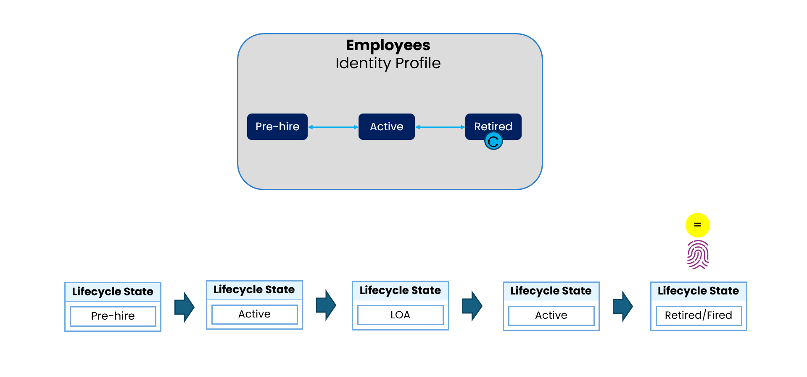

**Coverage:** assignment tabs, three action markers and all nine contractor/employee panels were read. The classification exercise was not completed.

## 8.5 Automating role assignments

### Membership and duplicate-access filtering

Role membership follows assignment criteria, with evaluation during the course-described daily processing, source aggregation or an explicit Apply Changes action.

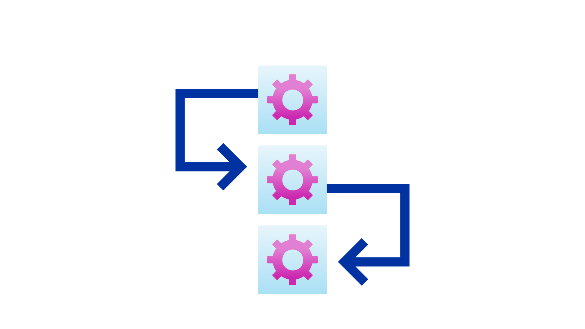

The example role R1 contains access profile AP1, with E1, E2 and E3 on one source.

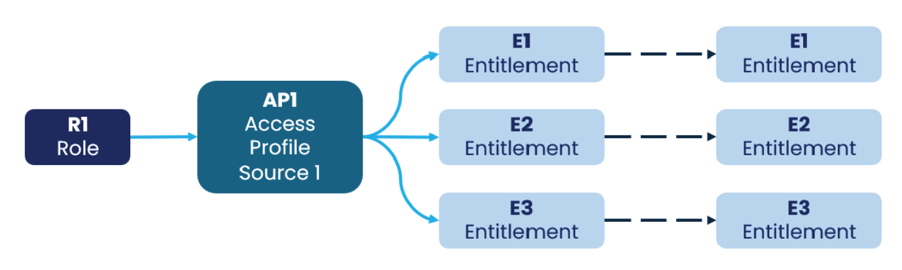

Johan already has E1.

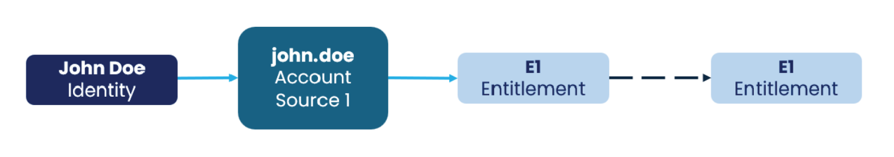

Assigning R1 adds E2 and E3. Existing E1 is filtered out of the required actions.

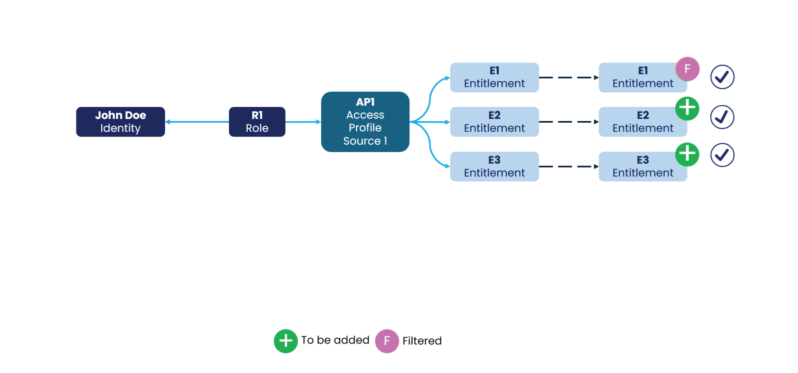

### Role transitions and overlap

When Johan changes jobs and no longer qualifies for R1 but qualifies for R2, ISC evaluates the removals and additions in one provisioning flow.

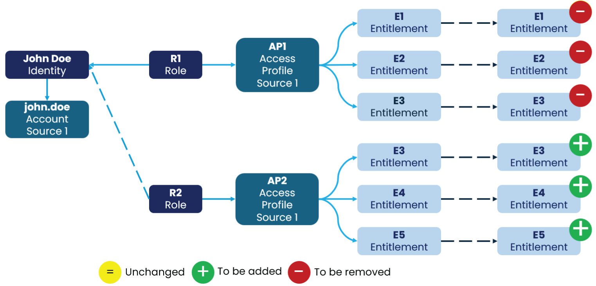

E3 appears in both roles, so it remains rather than being removed and re-added.

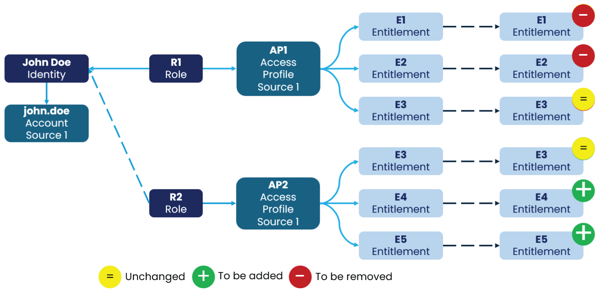

### Revocation: both accordions

The lesson describes automatic revocation when an identity no longer meets membership requirements, including after criteria or identity data changes. Entitlements are removed while the account can remain.

By contrast, detaching access profiles from a role definition or deleting the access profile or role does not itself guarantee revocation of already-held rights. The lesson's migration sequence creates the replacement role, changes the old membership requirements so identities transition, verifies correct access and only then removes the old definition. No such changes were performed during capture.

### Roles and lifecycle states: both accordions

Roles represent functional access based on facts such as job, department, location or approved requests.

Lifecycle states represent employment or engagement status and commonly control baseline access. Use both models to describe what a person does and their relationship to the organization.

All four accordions and the timeline examples were read.

## 8.6 Synchronizing attributes

### Keep account data aligned

Attribute sync carries changes such as telephone number, title or department from an identity attribute to configured target accounts. It maintains data, rather than granting or removing permissions.

Sam changes her phone number in HR in the course example.

Aggregation updates the identity value. The source of that value need not always be the authoritative application, although HRIS commonly supplies it.

A provisioning-capable connector pushes the change to the selected target account. The account must already exist; non-provisioning sources such as delimited files do not support this synchronization path.

### Configure eligible attributes: three markers

The account attribute must be in Create Account and mapped directly from an identity attribute. The sync copies that identity value; the lesson cautions against modifying it during provisioning in a way that would create a persistent difference.

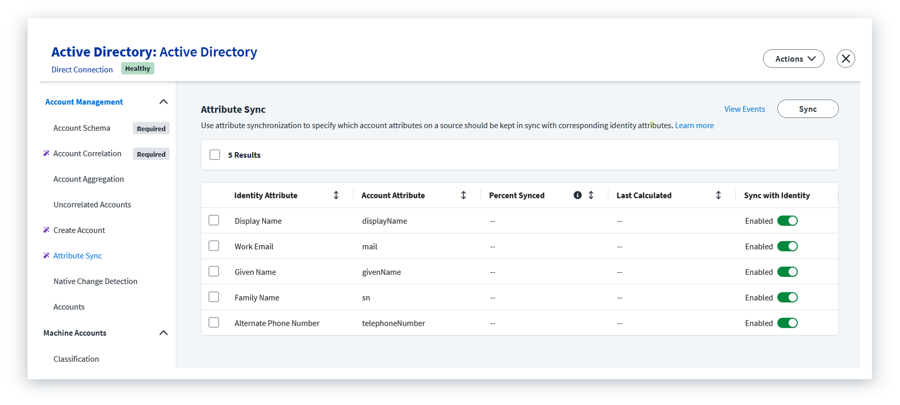

The Identity Attribute column lists eligible mappings. Sync with Identity selects the fields to keep aligned. Sync initiates a bulk operation when first applying a new configuration. Subsequent automatic synchronization is triggered when the identity value changes, rather than by every login or role assignment.

All three markers and the three-part example were read; no live sync was started.

## 8.7 Monitoring provisioning

### Four monitoring accordions

**Dashboard.** Admin > Dashboard > Overview contains a provisioning summary. View All runs a predefined activity search. The course describes seven days of relevant account creation, enable/disable, entitlement, request and password events.

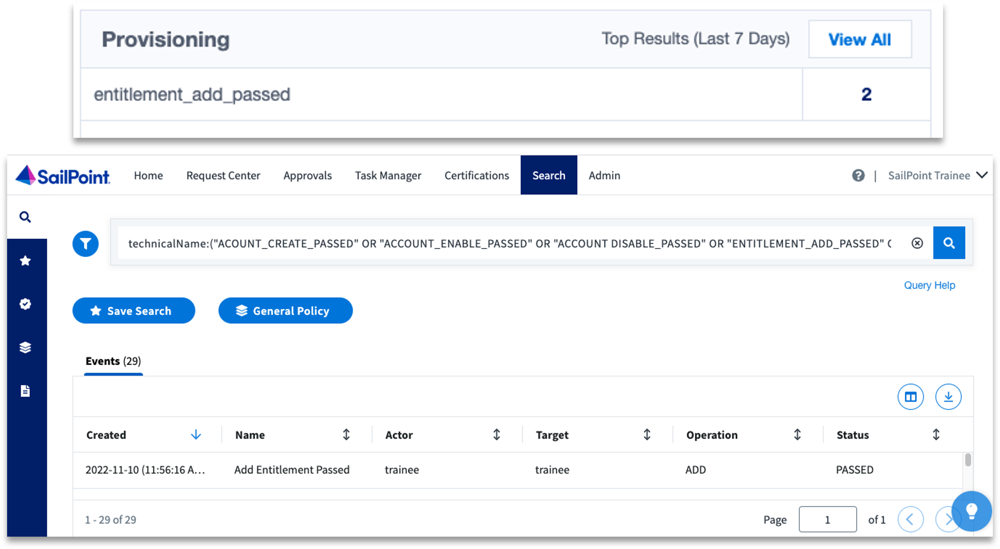

**Account Activity.** Search's Account Activity tab provides the course-described sixty-day view. Open an entry for request details and provisioning errors.

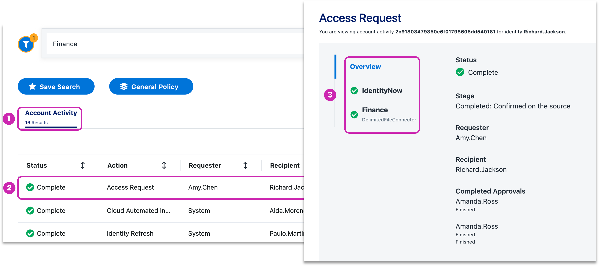

**Events.** Identity activity shows automated and manual activity for one identity. The course describes a seven-day audit window for the relevant events.

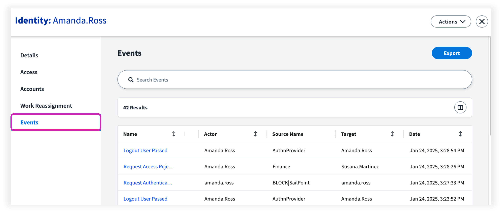

**Provisioning Activity report.** The course describes an on-demand CSV with up to thirteen months of audit records, including access-change details, status, timestamp and errors.

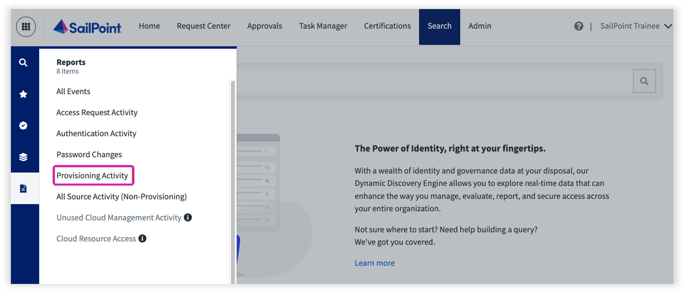

These time windows are recorded from the lesson and may depend on the current product offering. All four accordions were inspected; no report containing live user data was generated.

## 8.8 Recap

The outcomes are understanding the provisioning sequence, its fulfillment subprocesses, lifecycle and role changes, attribute synchronization and monitoring. The recap's introductory sentence incorrectly names authoritative-source onboarding; its listed outcomes correspond to provisioning and are summarized here.

## Module coverage and missing materials

All eight lessons and continuation sections were inspected. Fifty unique inline image URLs were saved. The notes expand trigger tabs, plan markers, account-creation markers, attribute tabs, password accordions, lifecycle assignment tabs and action markers, both lifecycle examples, role accordions, sync markers and all monitoring accordions.

Five background-only assets were not saved: the common photograph, three Katie banner variants and the recap banner. Exact paths are in coverage.json. External documentation, separately exported audiovisual narration and executable activities are not included. Sorting and knowledge checks were not submitted. No live account, role, lifecycle state, password or provisioning configuration was changed.
