# Module 10 — Search and reporting

English study notes in the original five-lesson order. Course explanations are paraphrased; screenshots and cards retain their original English. Query examples are study examples from the course, not queries executed against a tenant.

## 10.1 Overview

Mia introduces searching identity and access information and turning results into reports. The module covers searchable objects, managing useful queries, constructing syntax, reporting security and user activity, and using results for oversight.

**Missing artwork:** the common photograph and Mia lesson banner were not saved.

## 10.2 Understanding Search

### Purpose and examples

Search helps locate, analyze and act on identity-governance data. Queries can identify managers, certification administrators, users with privileged access or administrative accounts, certification reassignments, pending registrations and access-request history. Results can be identities or other objects such as entitlements and events.

The example `attributes.cloudStatus:PENDING OR attributes.cloudStatus:UNREGISTERED` finds identities in either registration state. The screenshot's forty-seven results belong to the course's sample environment.

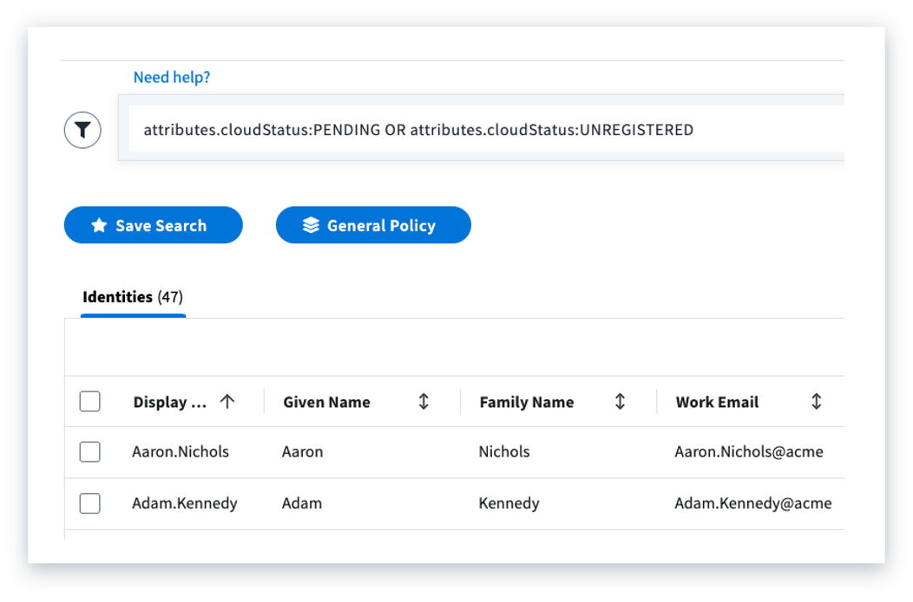

### Four other uses: accordions expanded

Save useful queries for reuse and subscribe to scheduled result emails. Search results can define the scope of identity, access-item or role certification campaigns. Search also supports compliance activities such as Separation of Duties and general policies. Event searches can produce audit information about actions such as authentication and password changes.

### Security and availability

The lesson restricts Search to elevated users and lists organization, certification, report, role and source administrators among the relevant administrative types. Actual visibility remains subject to the configured access model.

The data-availability cards describe up to fifteen minutes for newly aggregated data to propagate into Search and thirteen months for event/account provisioning activity. These are course-version statements; the module recommends consulting the external Search documentation as behavior evolves.

### Search categories

The six top-level indices are Identities, Roles, Access Profiles, Entitlements, Events and Account Activities. Filter by one or more categories. The course describes a query with no explicit category as searching all object types.

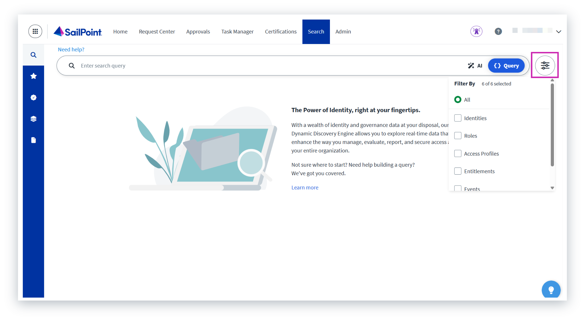

### Search management: four accordions

Recent Searches appear when selecting the empty query field.

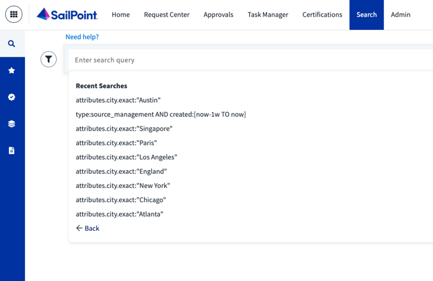

Save Search stores a useful query; the star control opens saved queries.

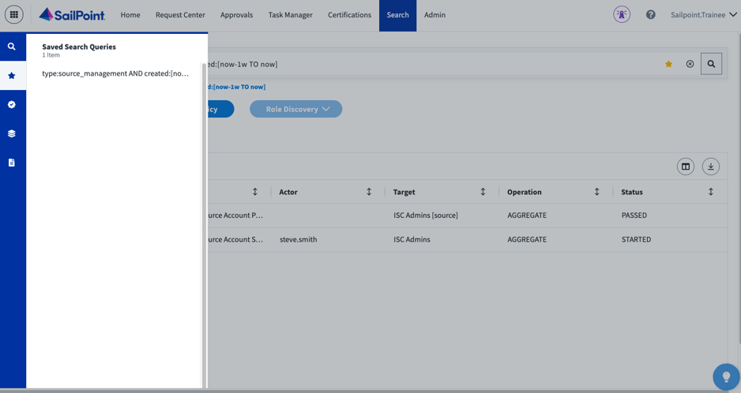

Suggested Searches provide predefined starting points.

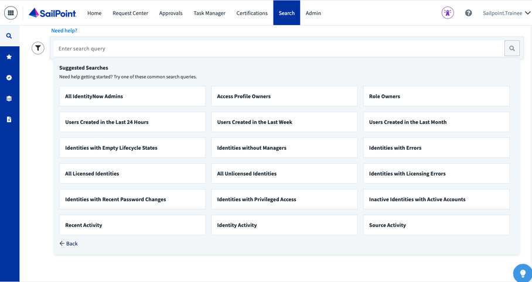

Subscriptions deliver a saved query's results by email on a selected schedule.

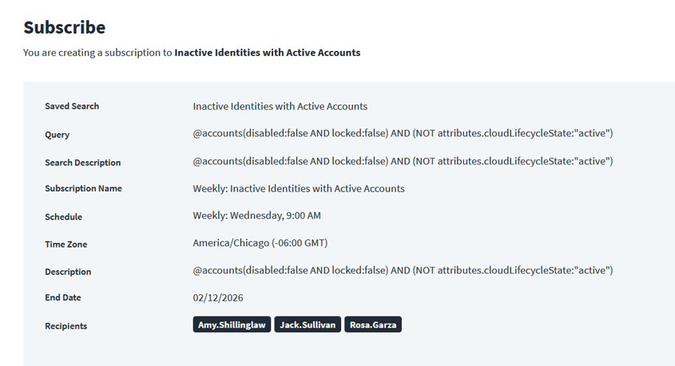

**Coverage:** all eight use/management accordions and both availability-card explanations were read. The [Search documentation](https://documentation.sailpoint.com/saas/help/search/index.html) and the separate Search course are external resources, not included offline. No subscription was created.

## 10.3 Structuring a search

### Fields, terms and phrases

A field identifies what to search and a term supplies the value: `field:term`. Avoid unintended spaces in the field name or after the colon. A bare term such as `sydney` can match names, locations or access information rather than only a city field.

The four quotation cards compare these cases:

**Unquoted words** are treated as separate terms; the course describes a match on either word.

**Single quotes** do not provide the phrase behavior illustrated for double quotes; the card still describes matching either word.

**Double quotes** request the phrase together, as in `"sao paulo"`.

**A field plus a quoted phrase** narrows the match to that attribute: `attributes.location:"sao paulo"`.

### Field levels and case

The course uses `status:ACTIVE` as a first-level example and `attributes.location:london` as a second-level example. Field and object names are case-sensitive, including camelCase names such as displayName. Ordinary terms are described as case-insensitive, so Flores and flores match in the same way unless exact matching is requested.

### Nested objects

Nested queries constrain values inside a repeated child-object collection using the pattern `@nestedObject(field:term)`. The lesson's example `@access(privileged:true)` returns identities with privileged access. It also displays an account-request example, `@accountsRequest(result.status:failed)`; that object name was not independently validated in this capture and should be checked before reuse.

### Logical operators: all three tabs

AND (`&&`) requires both conditions. OR (`||`) accepts either. NOT (`!`) excludes the following condition. Spell operator words in uppercase. The course describes an omitted operator between words as OR, so an unquoted two-word name can broaden results unexpectedly.

Parentheses group alternatives within a larger query. A study example following the lesson's intent is `attributes.location:london AND manager.name:amanda.ross AND (lastName:trent OR lastName:primrose)`.

**Editorial correction:** the source prints the combined example with uppercase `Attributes` and misspells Primrose as `primose`. The version above normalizes those obvious inconsistencies; it was not executed. Another source example uses typographic quotation marks. Use ordinary straight quotes when entering a query rather than copying curved punctuation from styled text.

A nested-access example with straight quotes is `@access(displayName:"Engineering_Access") AND manager.name:"amanda.ross"`.

### Additional syntax: five accordions

**Wildcards.** `*` substitutes multiple characters and `?` substitutes one character in text fields. The lesson compares `name:j*n` with `name:j?n`; wildcard matching does not apply to numeric or date fields.

**Exact matching.** `.exact` requests case matching for supported first- and second-level fields. The example `lastName.exact:Ross` distinguishes the capital R.

**Field existence.** `_exists_` finds non-null values. Negate an existence condition to find missing data. The course writes `NOT_exists_:startDate` without a separating space; this potentially malformed spelling has not been validated and is flagged rather than presented as tested syntax.

**Comparisons.** Use `>`, `<`, `>=` or `<=` with applicable numeric and date fields. The course's `appCount:>12` example finds more than twelve applications.

**Ranges.** Square brackets include endpoints; curly braces exclude them. `accountCount:[1 TO 4]` includes one through four, while `accountCount:{1 TO 4}` includes two and three. The lesson's relative-date example is `created:[now-1M TO now]` for the preceding month.

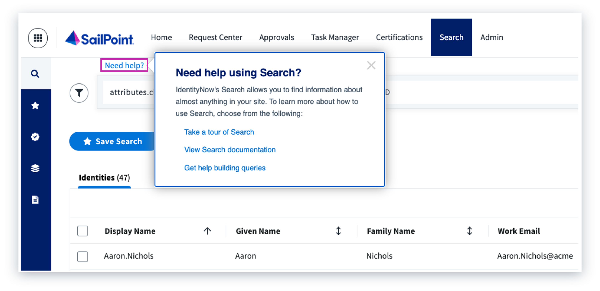

### Harbor Pilot

The course introduces Harbor Pilot as natural-language assistance for administrative search, product documentation and workflow creation, accessible through the interface icon. Its external usage guide is not saved here, and no assistant was enabled or queried during capture.

**Coverage:** all three operator tabs, four phrase-card explanations and five additional-syntax accordions were inspected. Source spelling/punctuation issues are identified above. No syntax example was validated against live tenant data.

## 10.4 Creating data reports

### Export Search results

Custom queries, suggested queries and predefined audit searches can produce downloadable results. The lesson distinguishes Events, Account Activities and audit-report shortcuts.

For access-request events, search the phrase `"request access"`, optionally combine it with a user using AND, select Events and use Get Report. The example adds Dennis Barnes's sample username.

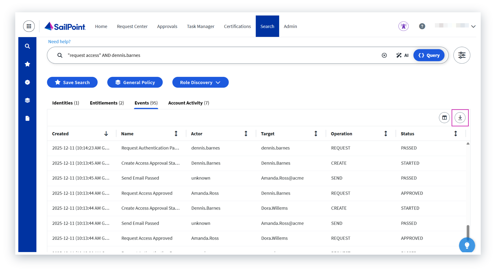

The event sequence distinguishes the request's start, approval, rejection, cancellation and processing. Each record helps identify who acted and what happened; processing is distinct from the original submission.

Account Activity provides richer provisioning details and can be searched using subjects such as source, entitlement or identity.

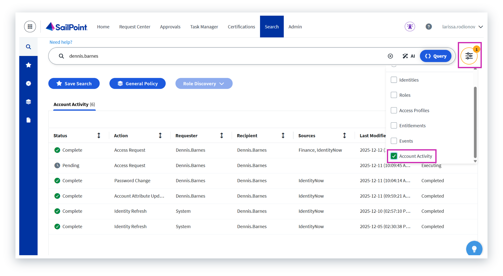

### Audit report shortcuts

Selecting a predefined report runs the associated event query. The course lists All Events, All Source Activity (Non-Provisioning), Access Request Activity, Authentication Activity, Provisioning Activity and Password Changes. It also includes privileged-entitlement requests, requests for privileged entitlements without expiry, and CIEM-dependent cloud resource, cloud scope and unused cloud-management reports. Availability of service-specific reports depends on subscriptions.

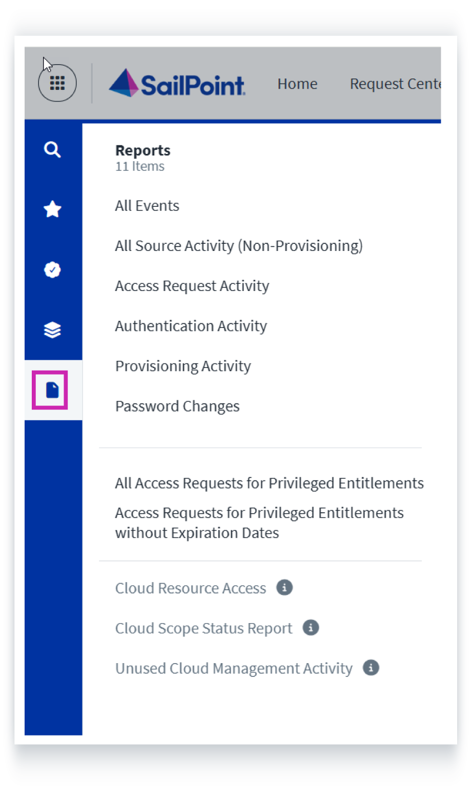

The lesson describes event retention as the preceding twelve months plus the current month, complementing its earlier thirteen-month description. A selected identity's Events page is a shorter, seven-day view in the course example.

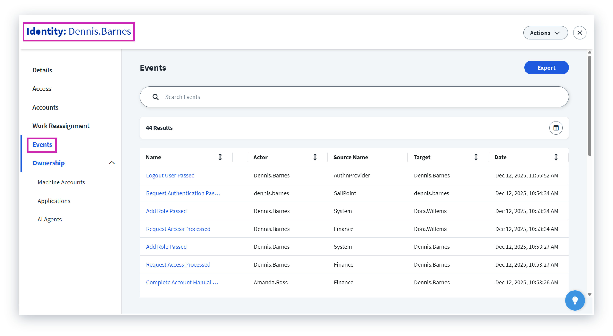

### Certification campaign reports: four accordions

Open Admin > Certifications > Campaigns, choose All when needed, then the campaign's Actions > Download Reports. Select the report and CSV or PDF output. Reports exist for active and completed campaigns; the course notes that deleting the campaign also deletes its reports.

Composition describes the campaign's configuration, including description, due date and filter. Status shows the current state of its access items. Certification Sign Off lists reviews and records who signed off and when. Remediation Status is available after campaign completion and shows the current state of items rejected during review.

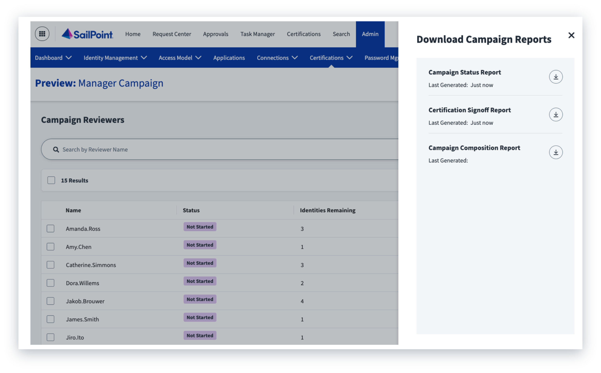

**Coverage:** all four campaign-report accordions were read. No live user-data report was generated or downloaded; the retained files are course illustrations.

## 10.5 Recap

The outcomes combine finding relevant data, selecting object categories, saving/scheduling searches, constructing precise criteria and producing reports for security oversight. A useful review is to explain why a quoted phrase, a field restriction, a nested query and a reporting view can each change what a result means.

## Module coverage and missing materials

All five lessons and continuation sections were inspected. Twenty-four unique inline image URLs were saved. The notes include eight search-use/management accordions, both availability cards, four quotation cards, three operator tabs, five syntax accordions and four campaign-report accordions.

Four background-only assets were not saved: the common photograph, two Mia lesson-banner variants and the recap banner. Exact paths are in coverage.json. External documentation, separate courses, complete audiovisual narration and executable interactions are not included. Data-retention statements reflect the course version. Query typos and unvalidated syntax are flagged in context. Knowledge checks were not submitted.
