# Module 12 — Governance

Six lessons in the original course order. English study explanations are paraphrased and interactive descriptions are expanded. Retained illustrations keep their original English text. No campaign, certification decision or policy was created or changed during capture.

## 12.1 Overview

Lina introduces governance as keeping access aligned with business policy, reducing risk and supporting compliance. Certification campaigns review existing access; policies identify unwanted combinations and data conditions. The module develops the administration and reviewer sides of these controls.

**Missing artwork:** the common photograph and this lesson's Lina banner were not saved.

## 12.2 What is governance?

### Three definitions: accordions expanded

Governance manages who can access organizational applications, systems and data. Certifications and policies complement each other within that process.

A certification is one review assigned to a reviewer, such as a manager or system owner, who assesses whether the access remains appropriate.

A campaign groups certifications across the chosen identities, rights or applications.

A campaign filter defines the inclusion or exclusion rules that determine the review scope in a filter-based campaign.

### Why review access?

Reviews provide visibility into who holds which rights, support evidence for audits and help identify access that is no longer justified. Clear information and appropriate reviewers are prerequisites for meaningful decisions.

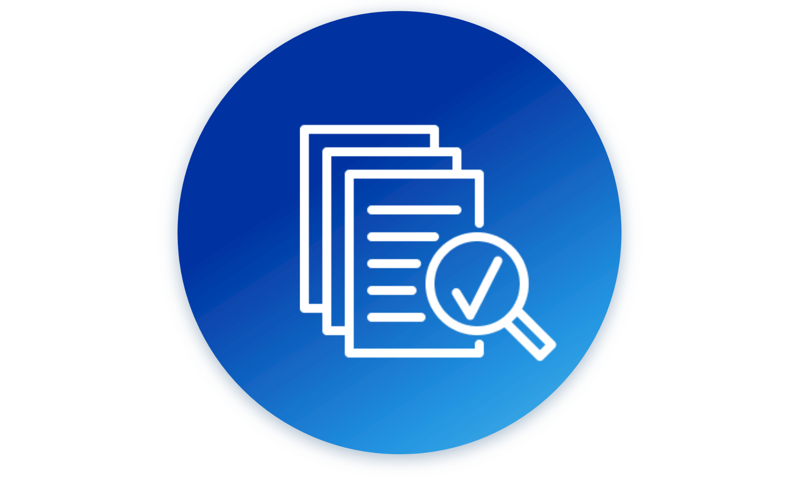

### Policies

Separation of Duties policies identify conflicting or excessive combinations in business processes. General policies identify unwanted data or access conditions, including integrity problems. Detection needs an owner who can assess and address the result; not every violation can be resolved by the ISC administrator alone.

All three definition accordions and continuation sections were read.

## 12.3 Certification campaigns

### Prepare first

Validate source and identity data, ensure managers are populated, and give access items understandable business descriptions. Reviewers should be able to decide without having to decipher technical names or repair basic ownership data.

### Campaign phases: all four tabs

Generation collects the configured data and creates individual reviews. Duration depends on volume and complexity.

Preview lets administrators inspect reviewers and pending work before launch, make assignments, start the campaign or cancel it.

Active notifies reviewers, makes their work available through Certifications and supports reassignment. Reviewers decide on the items and sign off. Several campaigns can be active concurrently.

End brings the campaign to its completion process, handles revocation work and exposes results and reports. Completed reviews no longer accept new decisions. The lesson separately discusses due-date handling and administrators finishing a campaign; the available options depend on its original configuration.

### Search-based campaigns: five object markers

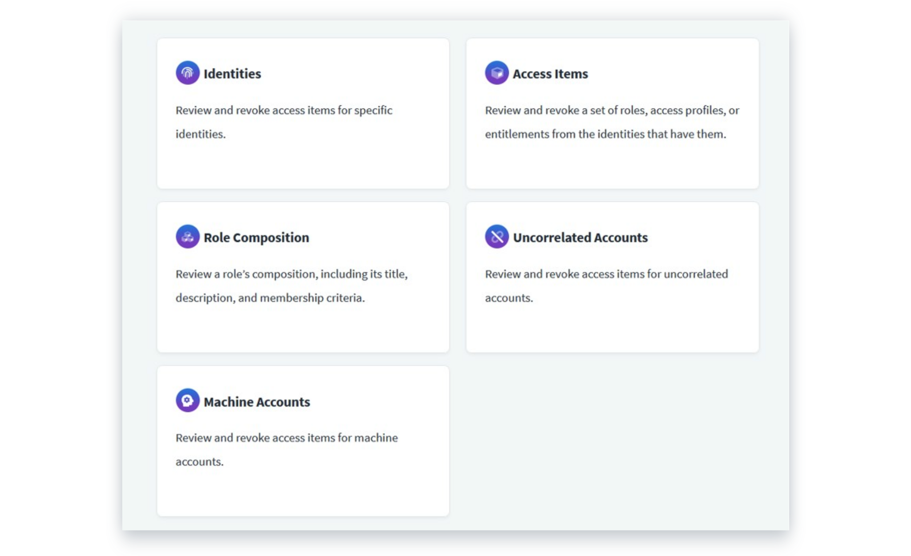

Identities scopes reviews to selected people's access. Access Items scopes a set of roles, access profiles or entitlements and their holders. Roles reviews composition, including title, description, membership and included access. Uncorrelated Accounts reviews source accounts without an authoritative identity link. Machine Accounts reviews access for application identities grouping service accounts, bots or other non-human accounts.

The illustrated route is Search > Certification Campaigns > New Campaign, then the relevant object tile.

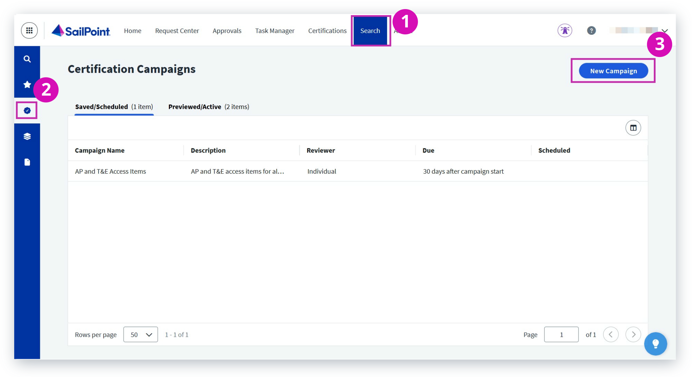

Role Composition campaigns evaluate the model itself, rather than only an identity's access. Requested composition changes are handled through administrative work.

### Filter-based campaigns: three markers

Manager and Source Owner campaigns can use predefined filters. Open Admin > Certifications > Campaign Filters > + New in the course example.

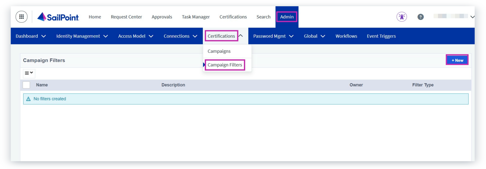

An inclusion filter on Department = Engineering includes that population. The lesson mentions seven filter-criteria types, including identities, roles and entitlements. Its multi-criteria marker states that combined criteria use OR: a match on an individual criterion can include or exclude the corresponding item. Check the preview to confirm the intended scope.

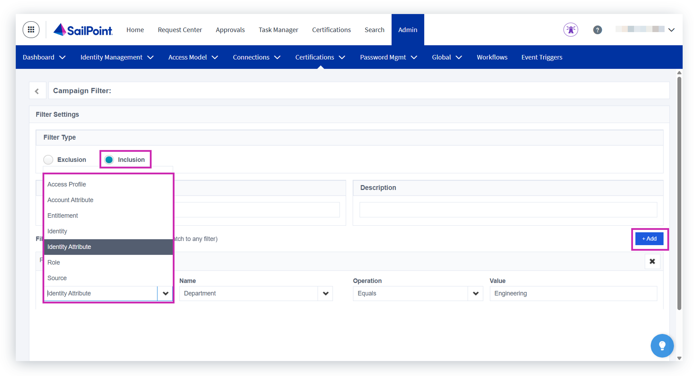

### Four notification templates

The templates are available through Admin > Global > Email Templates. Pre-Generation Notification goes to the scheduled campaign creator one week before generation. Certification notifies assigned reviewers. Certification Due is described as recurring weekly after the start until sign-off or campaign end. Certification Reassignment informs a new reviewer of their assigned work. These intervals are course-version descriptions.

### Reassignment: all three panels

Reassignment removes the old assignment and creates a review for the new reviewer, who receives an email.

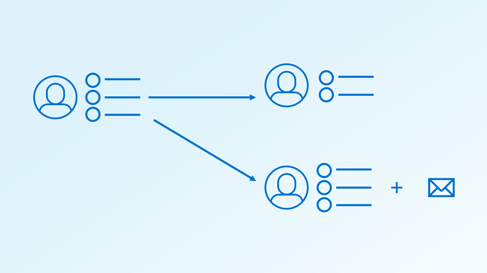

A reviewer cannot certify their own access, and a signed-off certification cannot be reassigned. Unsigned work can move more than once, including back to its original reviewer.

Work reassignment can also be automated.

The Work Reassignment feature supports temporary or permanent redirection of certification and approval work, for example during leave.

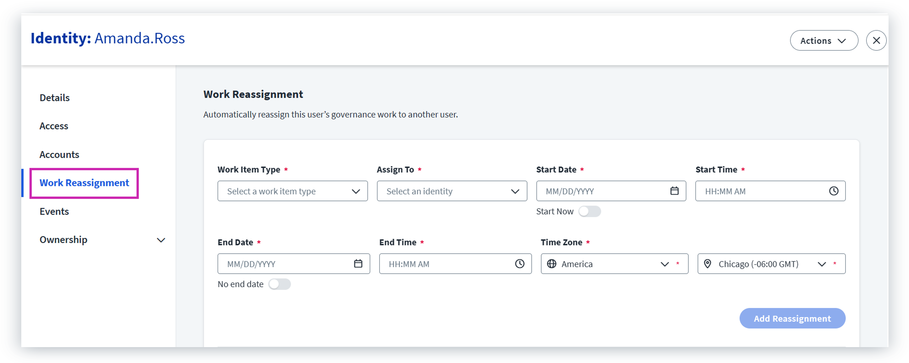

### Monitor and complete the campaign

The administrative dashboard presents progress, completion rates and decision trends. The campaign administrator oversees reviewers and can open campaign-specific summaries.

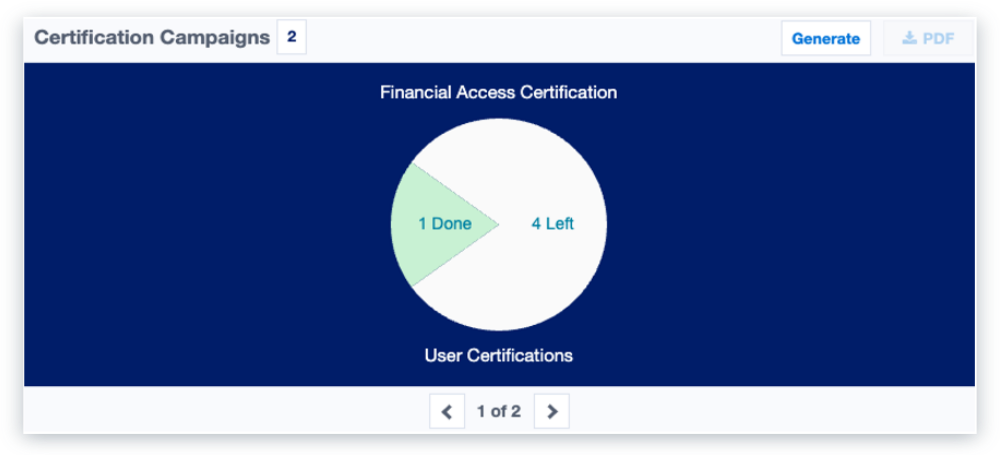

Reports provide detail during the campaign and help track access that needs removal.

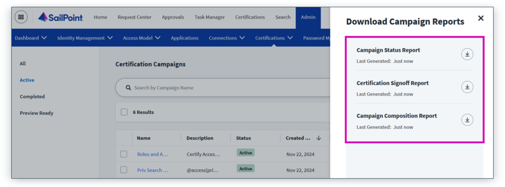

The four completion accordions cover reminders, outstanding decisions, revocation verification and deletion. ISC can send recurring reminder emails, and administrators can send manual reminders. For unresolved items after the deadline, behavior can include retaining access, using configured approve/revoke handling or waiting for review, depending on campaign settings. After completion, verify that rejected access was actually removed; some fulfillment may require manual action.

Deleting a campaign removes its records and reports and makes it disappear from participants' views; the lesson says participants are not notified of deletion. This is described as source content, not an action taken during capture.

All phase tabs, five object markers, three filter markers, four email accordions, three reassignment panels and four completion accordions were inspected.

## 12.4 Reviewing certifications

### Enter and inspect the review

Reviewers can open Certifications from the navigation menu or use a notification email link.

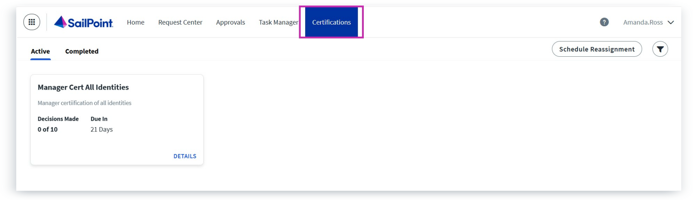

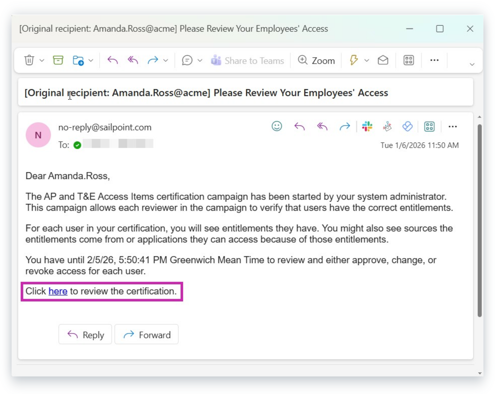

Details provides context about the campaign before the reviewer continues into its work.

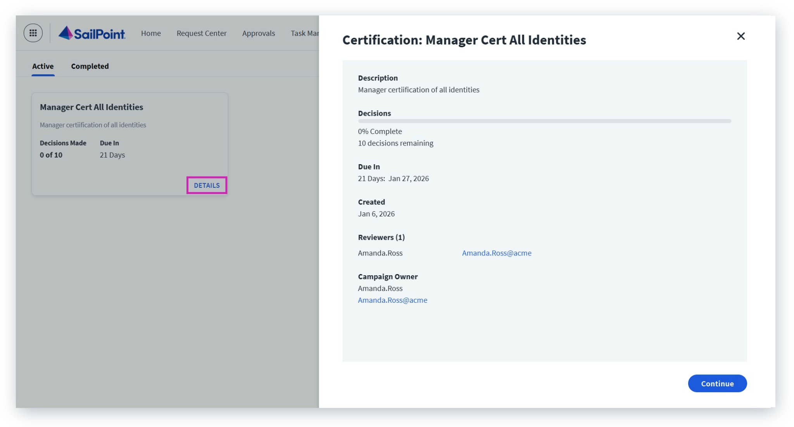

### Reviewer interface: eight markers

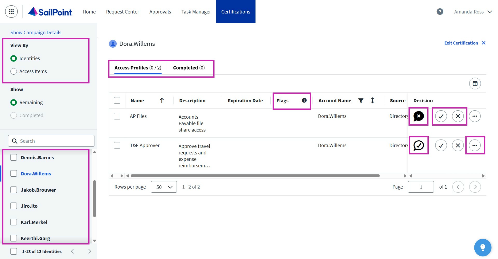

View By switches between identities and access items. The list follows that selection, and the available tabs depend on the certification type. Flags call attention to information relevant to a decision. Recommended and Not Recommended icons explain the model's suggestion. Approve/Revoke records a decision for the item. More Options supports comments, reassignment or a revocation date.

Recommendations draw on peer analysis, organizational identity attributes, shared AI-core attributes and threshold calculations. A recommendation is supporting evidence for the reviewer rather than an automatic replacement for their judgment.

### Sign off

After deciding on the items, the reviewer signs off. The lesson describes this as locking decisions and triggering follow-up actions such as revocation. Complete the work before the deadline; unfinished items are handled under campaign settings when the administrator completes the campaign.

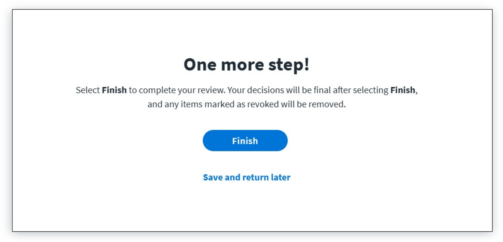

All eight interface markers were read. No certification was approved, revoked or signed off during capture.

## 12.5 Policy overview

### Establish the rule and response

Understand organizational security requirements, obtain the relevant internal policy documentation and learn the searchable data model and query syntax. A policy's detection should lead to assessment and a responsible owner; the security team may need to handle issues outside an ISC administrator's remit.

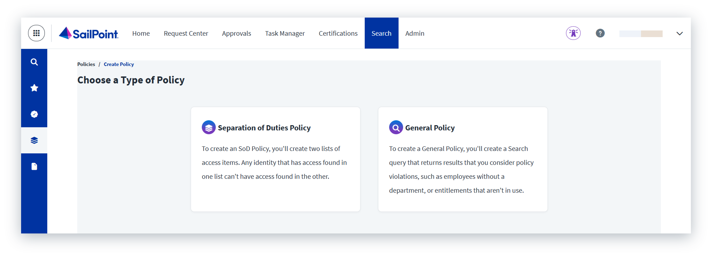

### Separation of Duties

SoD detects a toxic combination of access that could allow one person to bypass a business control.

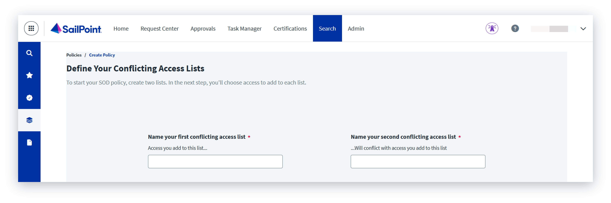

The example combines Accounts Payable with Vendor Contract Creation, allowing a person to create a vendor and pay it. Comparing two conflicting access sets identifies identities holding both.

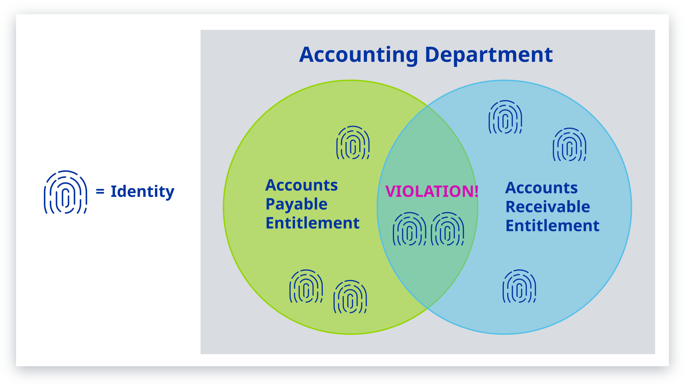

### Preventative SoD

During a request, the approver can be warned that the proposed access would create a violation. The lesson explicitly says that this warning does not necessarily block the request: an authorized exception may be approved and recorded for audit.

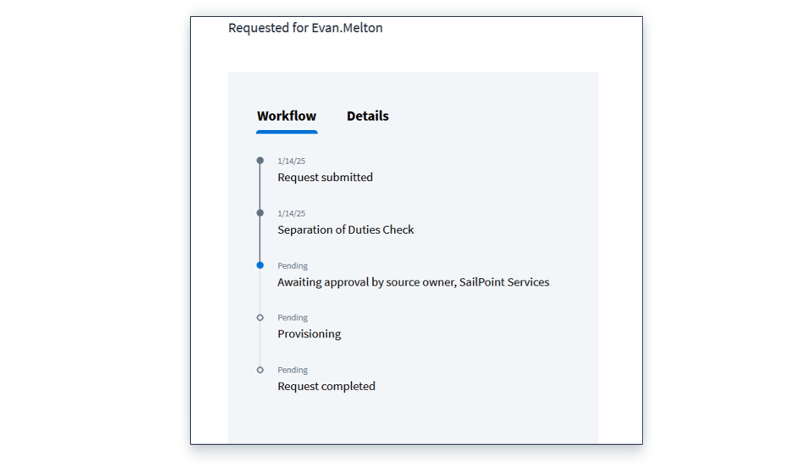

**Source wording caveat:** an earlier paragraph says conflicting access is stopped, while the later preventative section explains warning-and-exception behavior. These notes follow the more specific explanation and do not promise an unconditional technical block.

### General policies

General policies use search queries to identify unwanted conditions. Examples include identities without managers or people in one department holding access meant for another. Saved criteria can run on a schedule, flag issues and, in supported scenarios, lead to certification work.

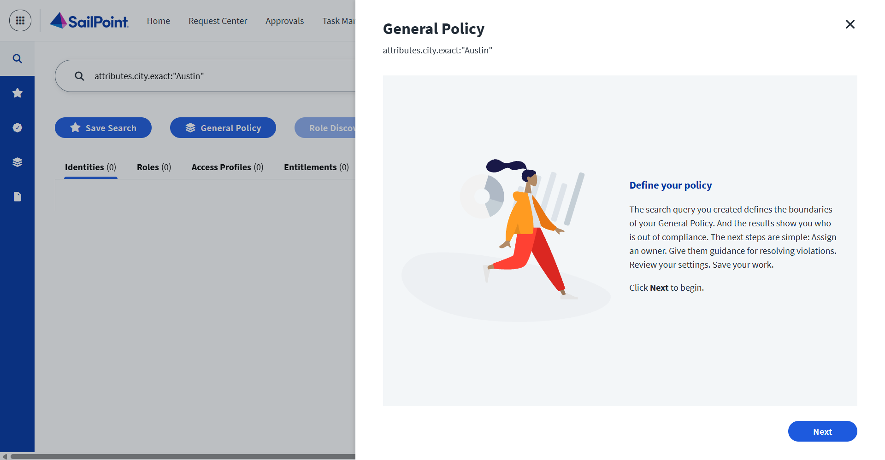

### Create a policy: two panels

The first panel opens Search, selects Policies and chooses Create New Policy.

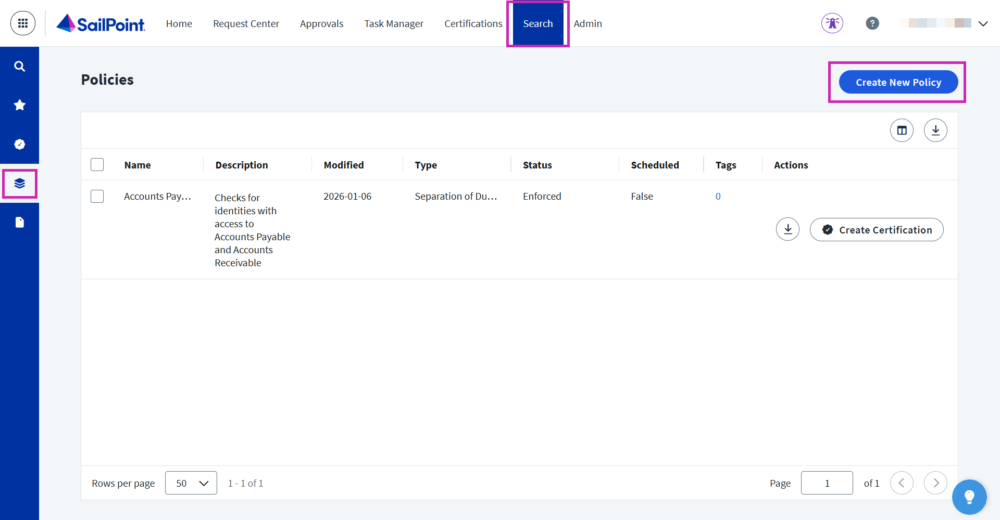

The second selects the policy type. The lesson does not provide a complete configuration walkthrough for every possible rule.

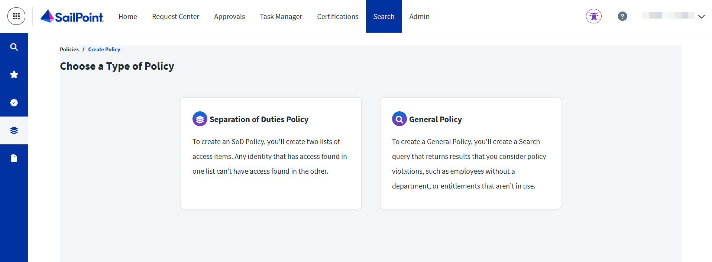

### Violations and subscriptions

A scan evaluates identities against the defined rule. Review the affected identities and details in ISC or in the violation report, then prioritize remediation.

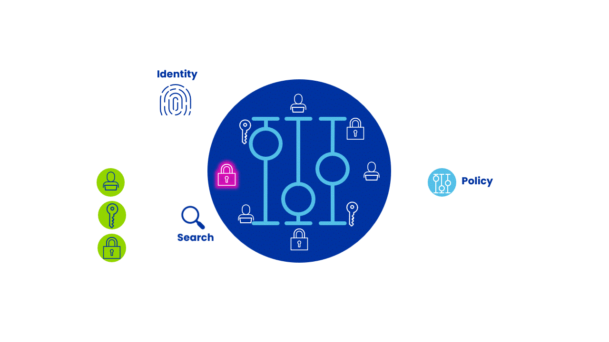

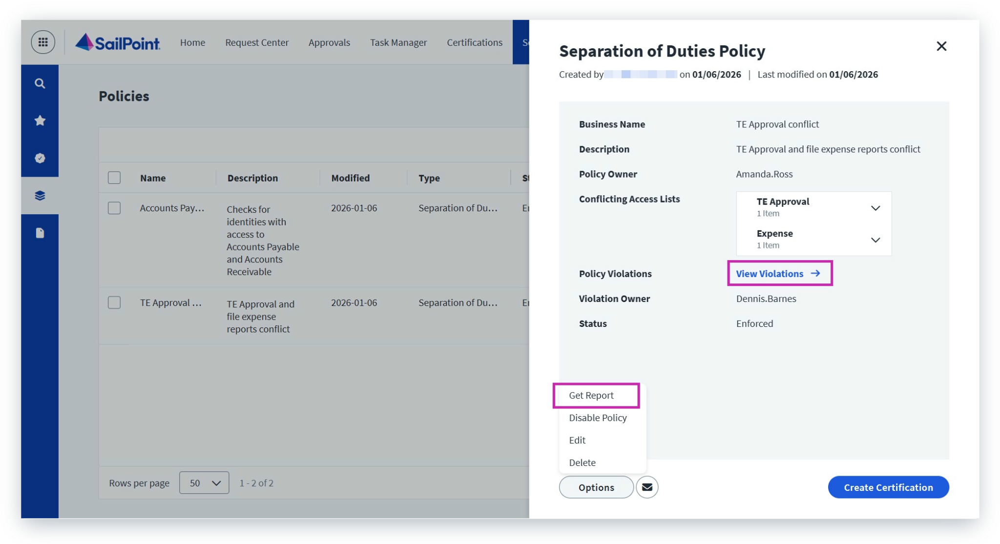

Run a policy manually or configure a subscription defining frequency and recipients. The lesson states that violation owners receive notifications and other stakeholders, such as compliance officers, can also subscribe.

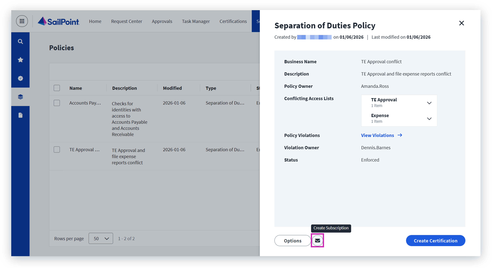

All two creation-panel explanations were read. No policy, notification subscription or violation remediation was executed.

## 12.6 Recap

Governance combines review of existing access with detection of risky conditions. Certification campaigns organize accountable decisions; policies surface conflicts and data problems. Completion includes checking the target-state result, not only recording a review decision.

## Module coverage and missing materials

All six lesson bodies and continuation sections were inspected. Forty unique inline image URLs were saved, including original SVG interface examples and the policy-violation GIF. Expanded content includes three definitions, four phase tabs, five campaign-object markers, three filter markers, four notification accordions, three reassignment panels, four completion accordions, eight review-interface markers and two policy-creation panels.

Seven background-only files were not saved: the common photograph, five Lina lesson-banner variants and the recap banner. Exact paths appear in coverage.json. Separate audiovisual narration, external full product documentation and executable interactions are not included. Conflicting source wording about SoD blocking is flagged above. No knowledge check or live governance action was submitted.
