# 13. Workflows

Working study edition · English paraphrase · Source read on 15 November 2026

**Coverage notice:** All five lesson titles have been verified. The three substantive lessons were read and their main explanations expanded into these notes. Ten labeled points in the leaver example were opened individually. Twenty-seven distinct image assets from the substantive lessons were saved. Background images, possible images in Overview/Recap, and any uninspected embedded media are **not verified as saved**. See the coverage report before treating this chapter as complete.

## 13.1 Overview

Workflows automate repeated administrative tasks in Identity Security Cloud. This module introduces their purpose, the components used to build them, and the ways administrators monitor and troubleshoot them.

The learning objectives are to explain what workflows do, identify the elements used to build one, and understand workflow management in ISC. The module's guiding questions cover creation, implementation, ongoing management, and error resolution.

**Not fully captured here:** narrator/background artwork and any additional media in this introductory lesson were not inventoried in this pass.

## 13.2 Workflows overview

### Purpose and components

A workflow runs a configured sequence of steps in response to a triggering event. This makes it useful for repeated tasks such as lifecycle administration, customized approvals, event-driven certifications, and remediation of risky access.

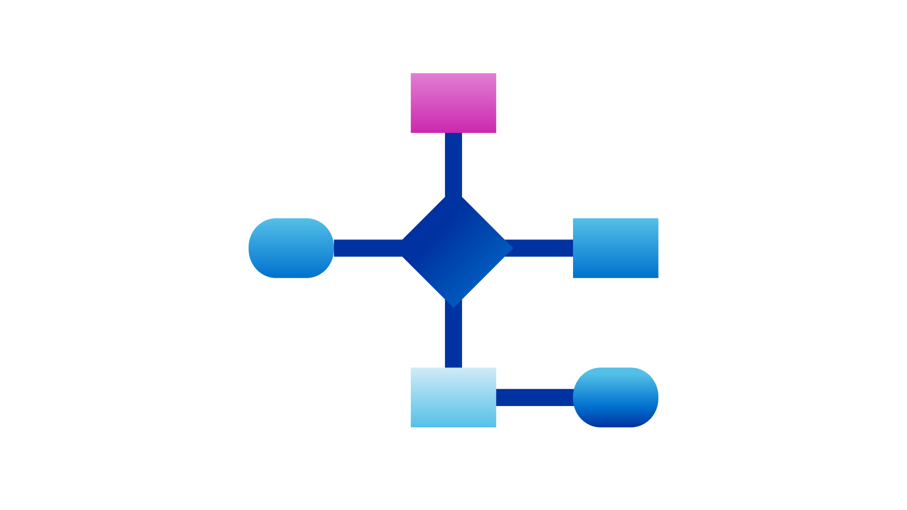

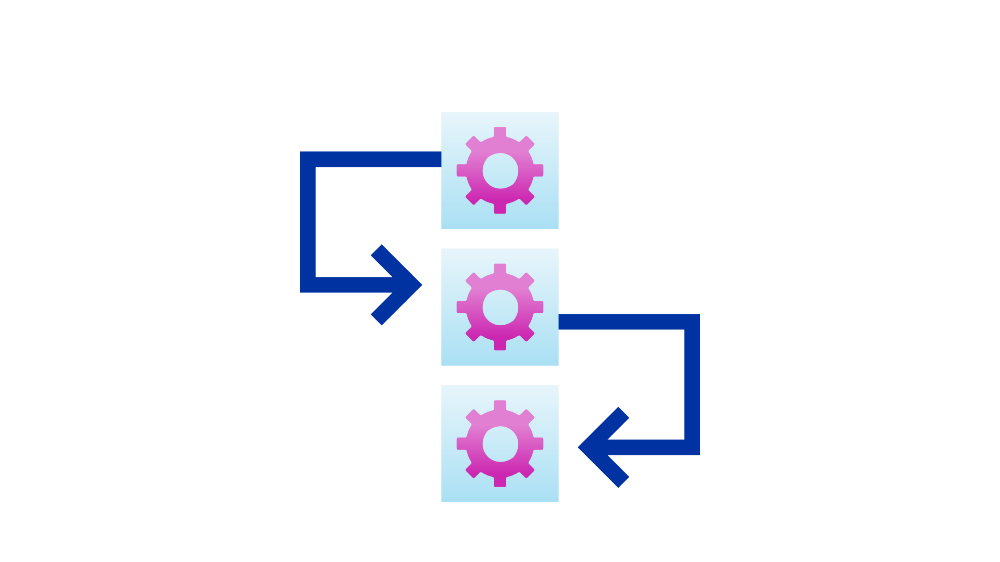

The three component types have distinct responsibilities:

- **Trigger:** determines the event that starts the workflow and supplies its initial input, such as the creation or modification of an identity.
- **Action:** performs an operation in ISC or an external system, such as starting a certification campaign, revoking access, or sending a message.
- **Operator:** controls execution and data flow. Operators make comparisons, branch between paths, iterate over lists, define variables, check data types, or end execution.

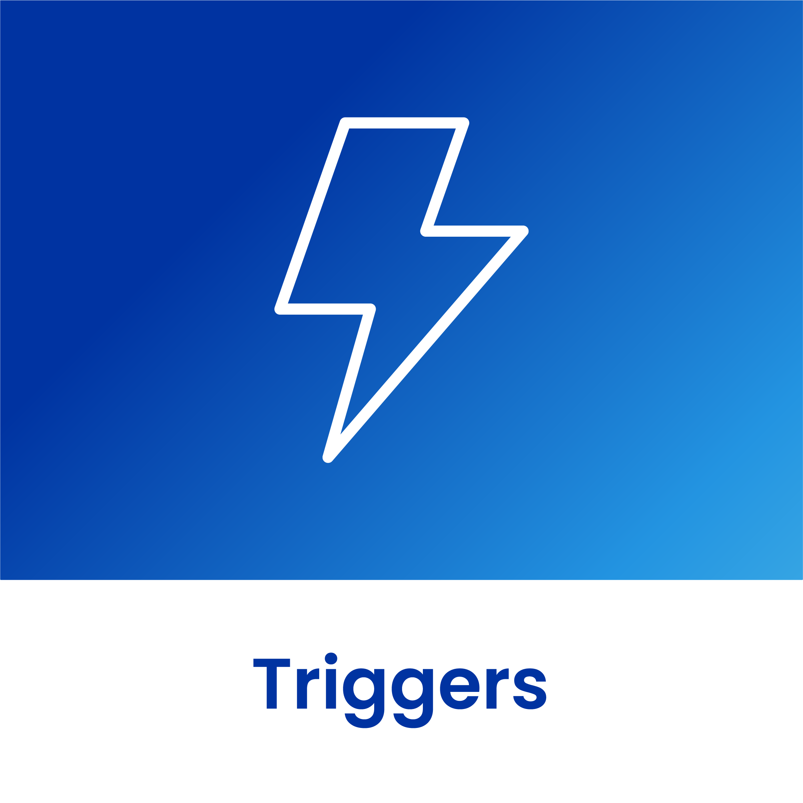

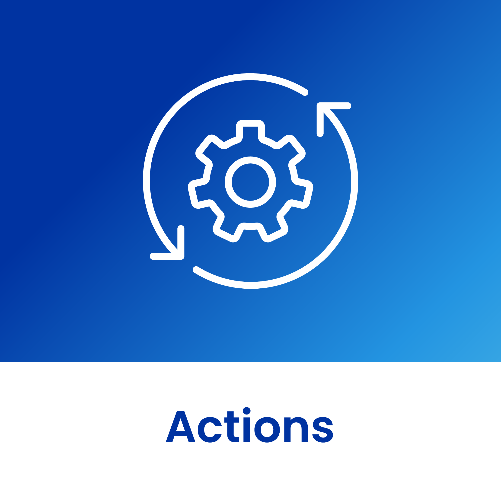

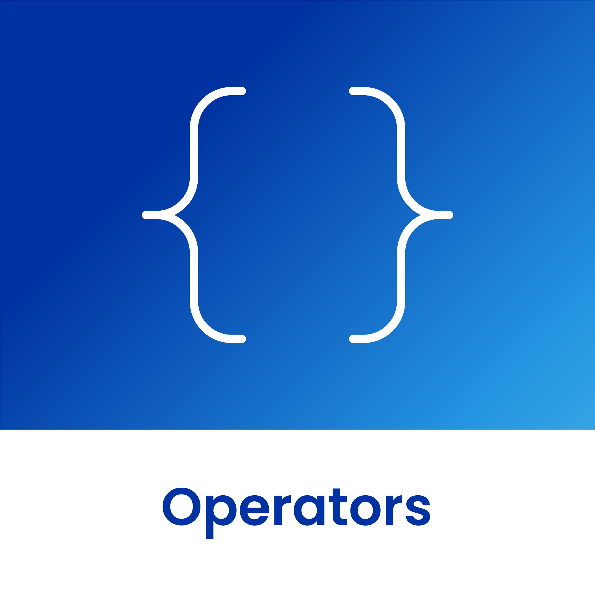

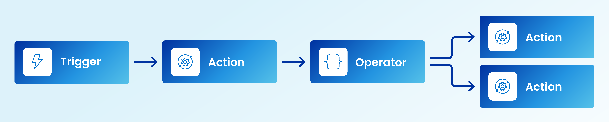

### Format, syntax, and creation options

The course presents a visual flow-chart interface and a JSON representation. Its explanation relates the workflow syntax to AWS Step Functions. A workflow's JSON can be downloaded for editing and uploaded again; JSON also represents data such as variable definitions.

The course describes three starting methods: use a SailPoint template, build through the UI Workflow Builder, or create and upload a JSON definition. These are creation options, rather than a requirement to use all three.

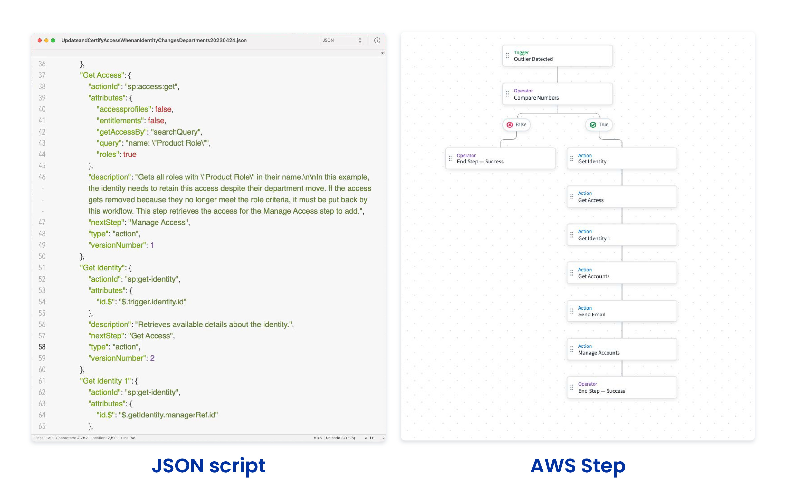

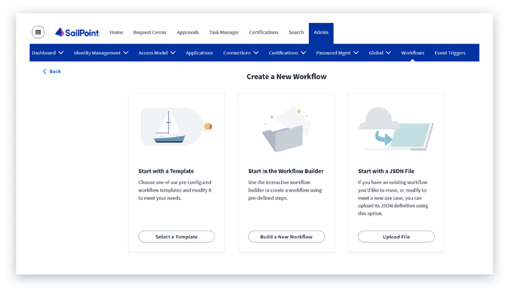

### Review points

Be able to distinguish the event that starts a workflow from the operation it performs and the logic that directs its execution. The lesson's knowledge checks also contrast the visual/JSON representations with CSV, which is not presented as a workflow-authoring format.

**Unavailable in this chapter:** the background photograph `2-Gh5h36bP76602T.jpg` and narrator banner `gZEjJw/LessonBanner-Narrator-Trey.svg` were identified in the rendered lesson but not saved. Their download limitation is recorded in the coverage report.

## 13.3 Building a workflow

### Component rules — expanded tab explanations

A workflow has **one trigger**. It defines the starting event and the initial data available to the workflow. The lesson also notes that workflows can call other workflows with different triggers.

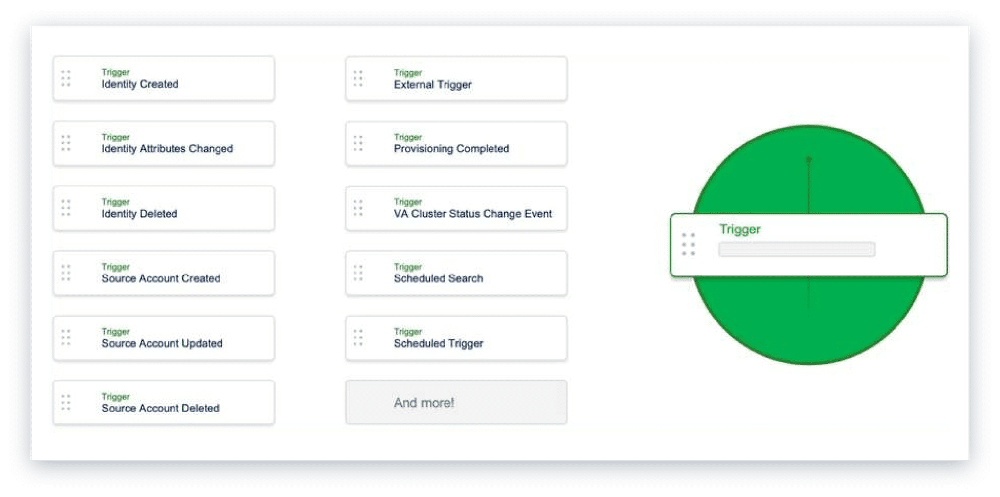

At least **one action** is required. Actions carry out work and can interact with SailPoint functionality or external systems.

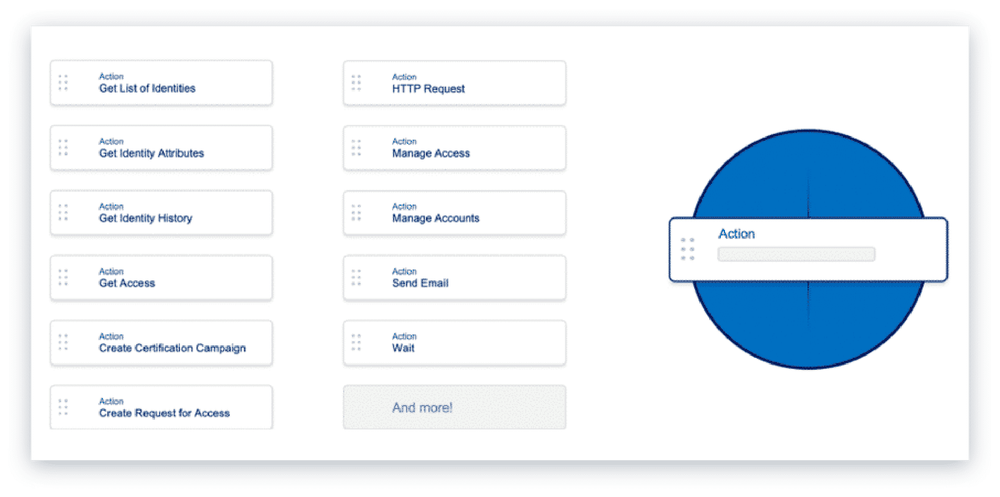

A workflow may use **multiple operators** to control its paths and handle data. Examples include comparing values, iterating through a collection, defining variables, checking types, and marking completion.

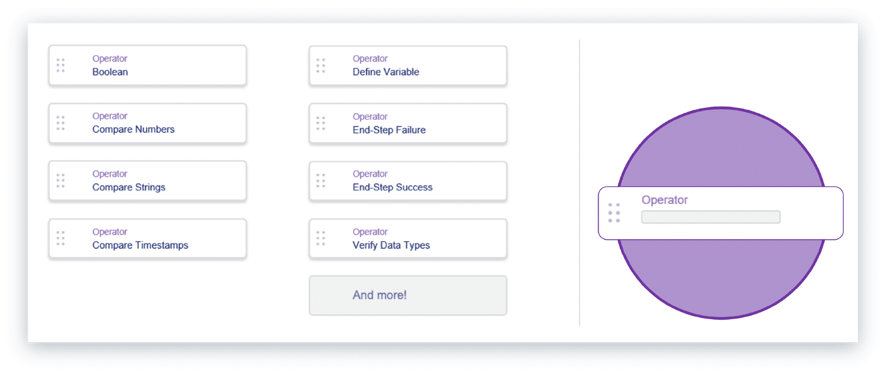

### Use cases — expanded accordion explanations

**Access management:** automate request routing through the relevant approval chain and coordinate tasks when identities are created, changed, or deleted.

**Source and account administration:** respond when account aggregation completes, send notifications, initiate follow-up provisioning work, and react to source changes.

**Certifications:** create or manage campaigns in response to events or schedules.

**Communication:** notify the appropriate stakeholders when an event needs attention or an action is required.

### Joiner, mover, and leaver examples — expanded tabs

A **joiner** workflow can notify a new employee's manager, collect information through forms, and report aggregation failures.

A **mover** workflow can respond to a departmental or role change by collecting access information and starting a certification campaign for the manager to review.

A **leaver** workflow can react to a lifecycle-related attribute change, notify the manager, retrieve the employee's accounts, and disable them. The intended automation depends on the configured trigger/filter and actions.

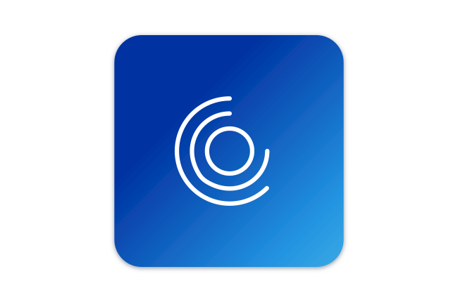

### Leaver example — all ten labeled points expanded

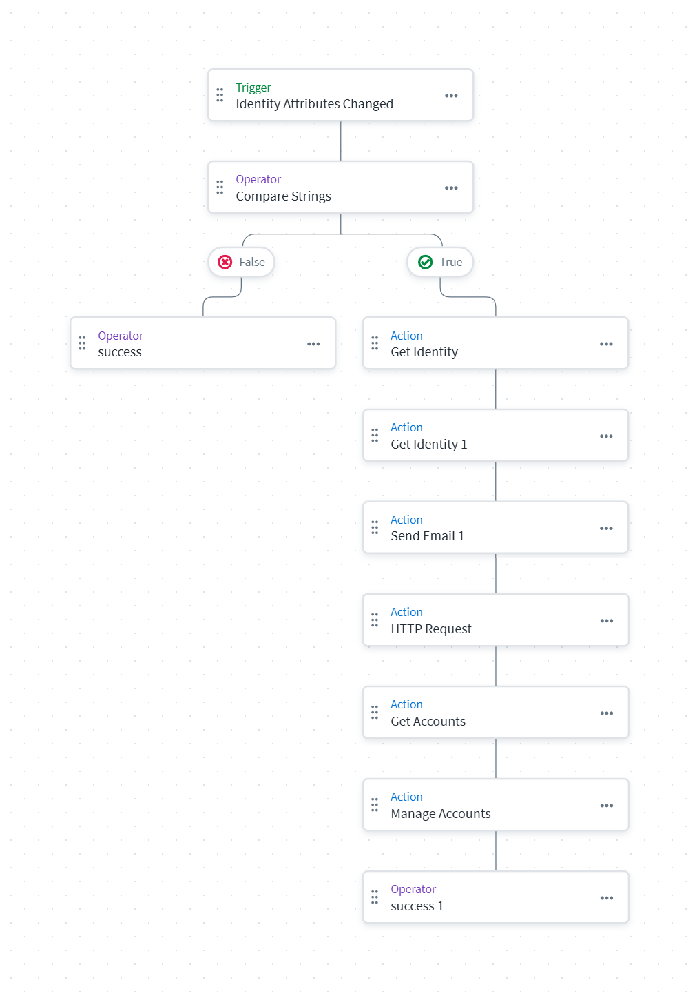

The diagram's labeled explanations form the following sequence:

1. **Trigger:** run when an identity's lifecycle state changes.
2. **Compare values:** check whether the new cloudLifecycleState value is Inactive.
3. **Alternative end path (3a):** if the new value is not Inactive, end successfully without performing the remaining actions.
4. **Identity lookup (3b):** if the new value is Inactive, obtain the identity details needed by subsequent steps, including its ID.
5. **Manager lookup:** retrieve the identity's manager.
6. **Manager notification:** send an email explaining that the identity is now inactive.
7. **External service request:** issue an HTTP request to create a service-desk task for returning physical assets.
8. **Account lookup:** retrieve the identity's current accounts.
9. **Disable accounts:** disable the accounts returned by the account-lookup step.
10. **Successful end:** finish the workflow.

The course points to **Workflows → + New Workflow → Start with a Template → Remove Access When an Identity Becomes Inactive** as the template path for exploring this example. No workflow was created or executed during this capture.

### Review points

A workflow cannot have several independent starting triggers in the configuration described by this lesson. Its use cases extend beyond access requests to source operations, certifications, and notifications.

## 13.4 Managing workflows

### Workflows landing page

The landing page lists existing workflows and provides the controls to create workflows or enable/disable them.

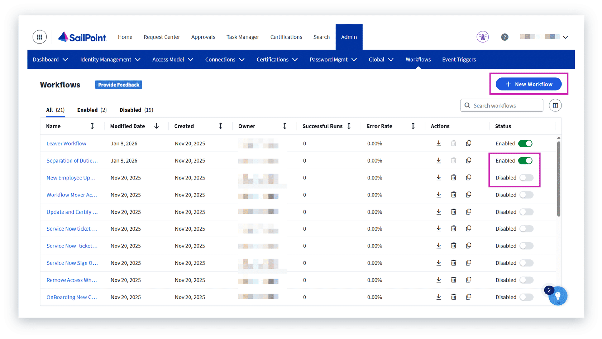

### Workflow details — expanded two-panel explanation

Select a workflow by its name to inspect its details. In the Details area, administrators can change the name or description and download the JSON definition for editing.

The course emphasizes that an enabled workflow is not editable in the ISC UI: disable it before making edits.

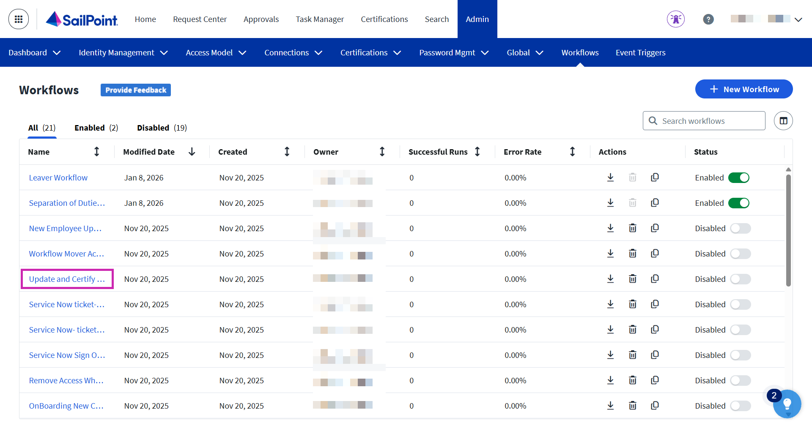

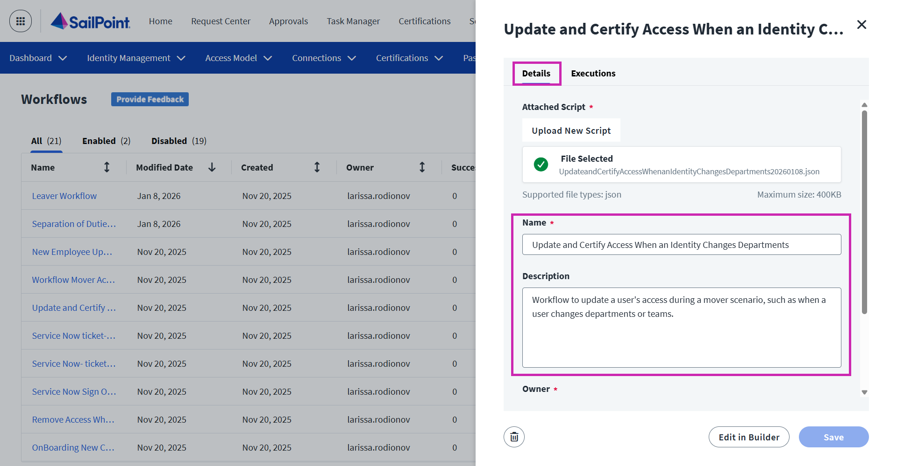

### Execution history — expanded three-panel explanation

Use the **Executions** tab to locate executions and obtain their logs. In the lesson's example, several executions failed. The illustrated route uses the ellipsis menu and **Download Execution** to access an execution report.

The course describes a downloaded CSV report containing error information. Its example shows an Activity Task Failed entry associated with an HTTP 400 bad request on the Send Email action. This is an example of one failure, not a diagnosis to apply to every failed execution.

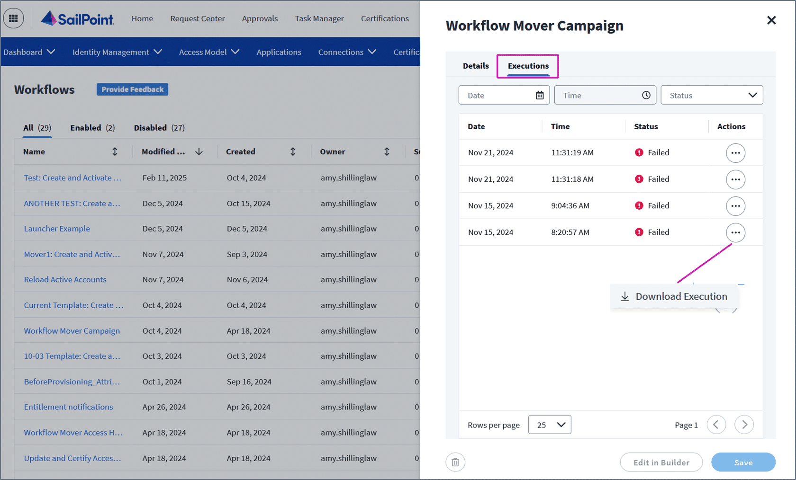

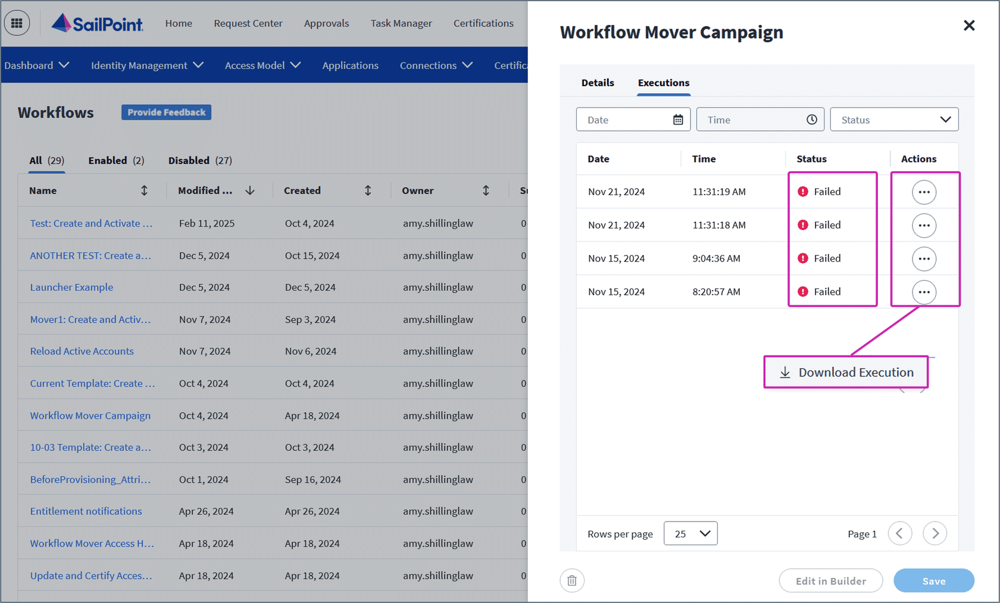

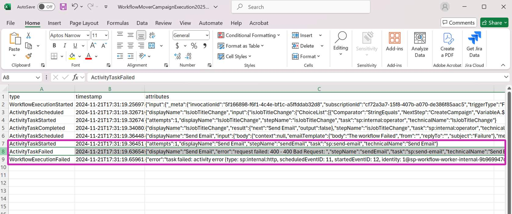

### Error resolution — expanded three-panel explanation

After identifying the failing step, inspect that component in Workflow Builder. In the example, the focus is the Send Email action. The configuration panel on the right contains the controls for triggers, actions, and operators.

The lesson presents two editing routes: correct the definition in Workflow Builder, or update the JSON and upload a new definition. Execution history provides diagnostic evidence; it is not itself the place to directly edit the failed workflow step.

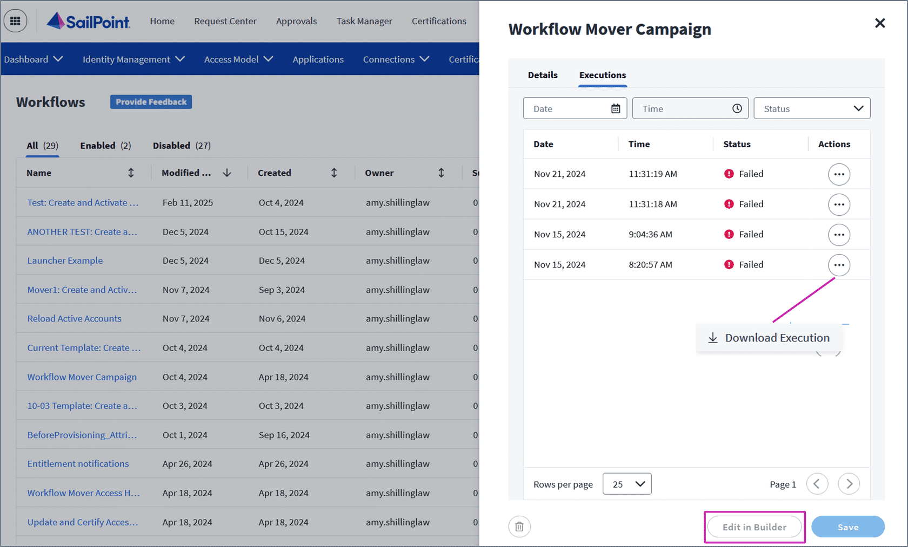

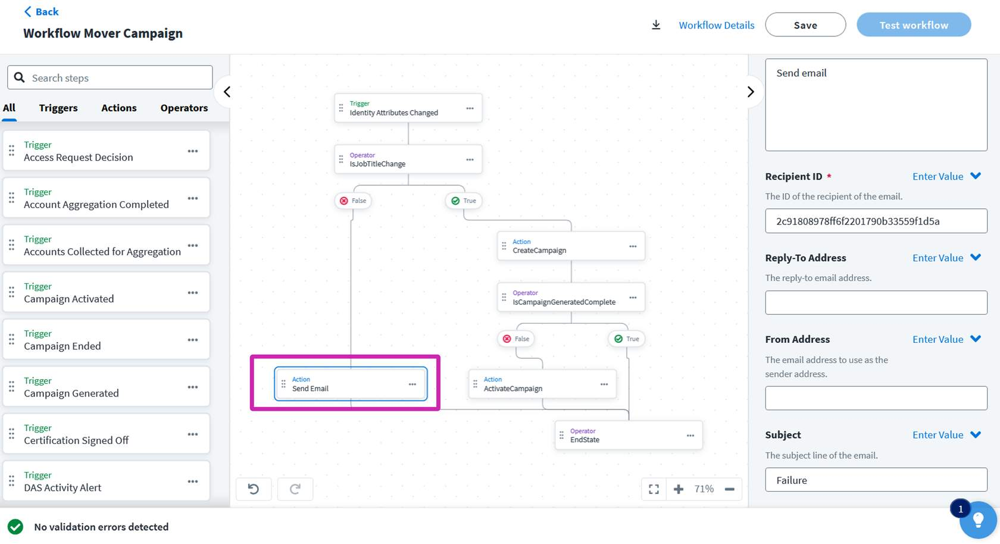

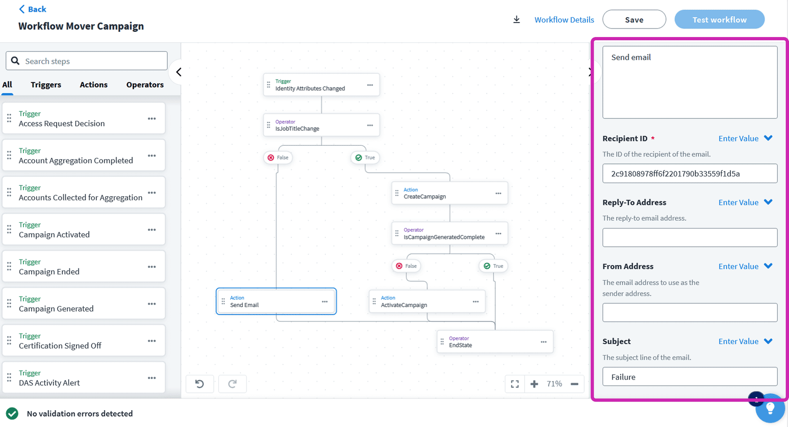

### Review points

Know which page lists workflows, why a workflow must be disabled before editing, and how execution reports help locate the step requiring correction. The notes reflect the captured course version and have not been checked against subsequent interface changes.

## 13.5 Recap

The module's closing outcomes are to understand why workflows matter, explain their components, and recognize how they are managed in ISC. It offers an exit/next action rather than a new technical procedure.

**Not fully captured here:** any narrator, decorative, or other images on the recap page were not inventoried in this pass.

## Capture limitations

The English prose above is a paraphrased study explanation, not a verbatim transcript. The substantive tabs, accordion explanations, process panels, and ten leaver markers were read; knowledge-check answers were not submitted. The embedded UI remains authoritative for any content not captured here.

The 27 distinct retained images are included alongside their corresponding content. This does not establish that every image in the original module has been saved: CSS background images and the introductory/recap artwork remain incomplete. Audio, video, narration transcripts, and external resources were not comprehensively inventoried or exported. No interactive animation is reproduced by this offline document.
